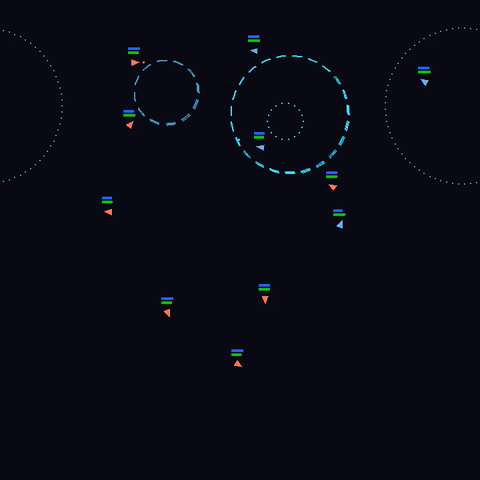
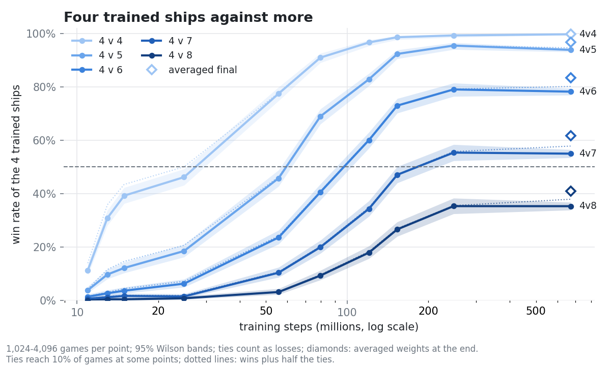
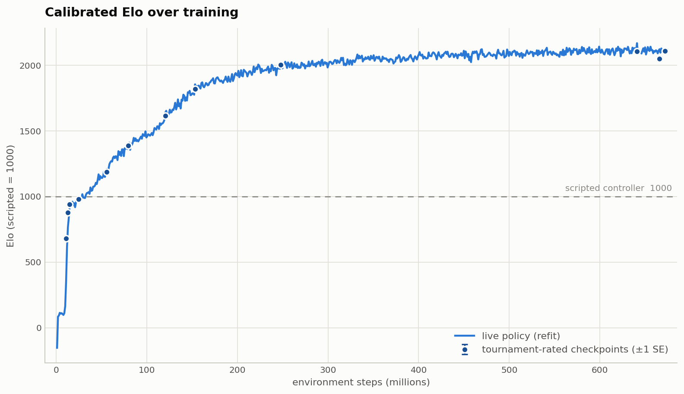
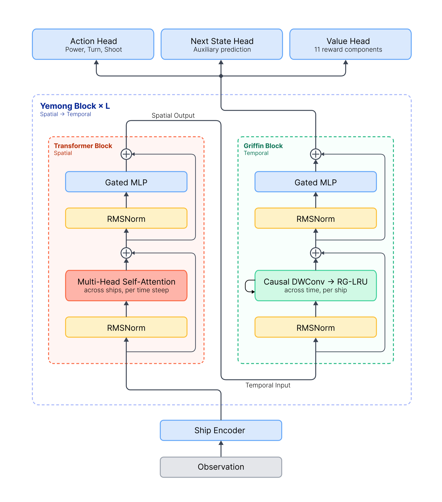

# Boost and Broadside

### Zero-shot fleet coordination from a 4-vs-4 policy



*Figure 1. wild-universe-731, averaged weights, against the scripted opponent (seed 2001, game 406). Down to one ship against six, the learned side still wins. At 4 vs 7 it wins 62% of 4,096 games.*

<sub>More replays: <a href="docs/replays.md">replays</a>.</sub>

Boost and Broadside is a tensorized 2D dogfighting environment and reinforcement
learning system built to study coordination at scale. The central question is simple:
can a policy trained with a small team command much larger fleets without retraining?

The reference policy trained exclusively in **4-vs-4** combat, then transferred
zero-shot to fleets of one to 64 ships. A single recurrent network
commands the whole fleet, producing an action for every ship on each forward pass.

[Explore the results](docs/evaluation.md) · [Watch more replays](docs/replays.md) ·
[Understand the architecture](docs/architecture.md) · [Get started](docs/getting-started.md) ·
[Training runs](docs/training-runs.md)

## Zero-shot team-size transfer

Ships and optional refractive fields are represented as entity tokens. Spatial attention coordinates the
fleet within each timestep, while per-entity [Griffin-style](https://arxiv.org/abs/2402.19427)
recurrence carries information through time. Because the network operates over a
variable-length token sequence, the same weights can run at fleet sizes never seen
during training.



*Figure 2. Win rate of 4 learned ships against 4 to 8 scripted ships at each frozen ladder checkpoint and the final live checkpoint (lines, 95% Wilson bands), and of the final averaged checkpoint (diamonds); 1,024 games per ladder point and 4,096 for the final live and averaged checkpoints, ties count as losses. Ties reach 10% of games at some points, so each ratio also has a dotted line counting wins plus half the ties.*

Rated against the same scripted controller at every size
([chart](docs/evaluation.md#at-a-glance)), the final live checkpoint of the 4-vs-4 policy
is stronger at 8-vs-8 and 16-vs-16 than at the size it trained at: about 2,277 Elo
at 16-vs-16 against 2,128 at 4-vs-4. Past that it weakens, to
2,085 at 32-vs-32 and 1,605 at 64-vs-64, still far
above the scripted controller's 1000.

Selected results from the [recorded crossover sweep](checkpoints/wild-universe-731/artifacts/figures/crossover.json)
of the final live checkpoint, each row the largest scripted fleet it still beats, from
256 games per point (204 at
64 ships); ties count as non-wins:

| Learned ships | Scripted ships | Win rate (live) |
|---:|---:|---:|
| 4 | 7 | **55.9%** |
| 8 | 13 | **64.8%** |
| 16 | 25 | **61.7%** |
| 32 | 46 | **52.3%** |
| 64 | 76 | **54.9%** |

The averaged policy, the running average of the weights that the run keeps beside the live
ones, holds more when outnumbered: four averaged ships win
61.6% of 4,096 games
against seven scripted ships, where the final live weights win
55.0% of 4,096
([over training](docs/evaluation.md#outnumbered-over-training)); ties again count as
non-wins. That 55.0% and the table's
55.9% measure the same checkpoint at 4-vs-7, over
4,096 and 256 games. The
[evaluation guide](docs/evaluation.md#zero-shot-crossover) covers the search method,
sample sizes, raw artifacts, and limitations behind these measurements.

## Learning progression

The reference run, `wild-universe-731`, trained for 672M of a planned
1,000M environment steps in about 2.9 days on a
single RTX 4070 Laptop, and was stopped there. Post-hoc calibration places its final live
checkpoint at about **2,110 Elo** on a scale that fixes the
scripted controller at 1000, a lead of roughly
**1,110 points**, where 400 points already
means ten-to-one odds. Its best averaged checkpoint rates
2,052 in the same tournament.



*Figure 3. The line is the live policy at each update, refit from its recorded games against the calibrated opponents; the dots are tournament-rated checkpoints (±1 SE), the last of them the final live checkpoint. The dot just before it, below the line, is the best averaged checkpoint (2,052 at 666M steps). Scripted controller fixed at 1000.*

The live policy's calibrated rating keeps rising long after wins against the scripted
controller stop being informative: the live policy first wins 99% of evaluation games
against it at 114M steps, while its refit rating
climbs from about
1,469 at 100M to about
2,001 at 250M before levelling off.

See [results and methodology](docs/evaluation.md#post-hoc-elo-calibration) for the rating
procedure, exact values, and uncertainty.

## Under the hood



One trunk processes the whole fleet as entity tokens, with attention mixing across ships
within a timestep and Griffin recurrence carrying each ship through time. Every head
emits one output per ship, however many there are.

- The [environment and physics engine](docs/environment.md) runs thousands of tensorized
  battles in parallel, with toroidal movement, projectiles, resources, and optional
  static refractive fields that continuously affect both ships and projectiles. The core
  simulator lives in
  [`env.py`](src/boost_and_broadside/env/env.py).
- The [policy architecture](docs/architecture.md) combines spatial attention, Griffin
  recurrence, factored action heads, decomposed value estimates, and auxiliary dynamics
  prediction. See
  [`YemongPolicy`](src/boost_and_broadside/models/yemong/policy.py).
- The [training system](docs/training.md) uses recurrent PPO with scripted, self-play,
  running-average, and historical opponents. The update logic is in
  [`ppo.py`](src/boost_and_broadside/train/rl/ppo.py).
- [Evaluation](docs/evaluation.md) and [seeded replays](docs/replays.md) connect aggregate
  measurements with qualitative behavior. The crossover evaluator is
  [`crossover.py`](src/boost_and_broadside/modes/crossover.py).

The run's own charts are linked from
[its artifacts](checkpoints/wild-universe-731/artifacts/figures/), whose records name the
measurement behind each chart and that measurement's command, seeds and commit. The fan,
survivor and `wild-universe-731` clip results come from the scripts in
[`scripts/studies/`](scripts/studies/), whose [README](scripts/studies/README.md) records
their commands, seeds, games per point and commit.

## Quick start

Requires [uv](https://docs.astral.sh/uv/). Git LFS is only needed for the reference
checkpoints: `wild-universe-731`, and the earlier `good-leaf-719` and
`resilient-resonance-682`, all of which load in this version. After cloning:

```bash
git lfs pull   # fetch reference checkpoints (skip if training from scratch)
uv sync

# Resolve and inspect the RL launch without allocating the trainer
uv run bnb train --profile rl --print-config

# Play a 1v1 match against a null ship in four refractive fields
uv run bnb play

# Human vs a trained checkpoint (WASD, Shift, Space)
uv run bnb watch --team0 null --team1 checkpoints/<run>/<checkpoint>.pt
```

Training is designed for CUDA hardware; the simulator and test suite also run on CPU.
The [setup and usage guide](docs/getting-started.md) covers checkpoints, training,
evaluation, replay capture, and development checks.

## Where the numbers come from

The README and the pages in `docs/` are rendered from `*.template.md` files beside them.
Every run-specific number is a named value in [`docs/values.json`](docs/values.json),
built by `scripts/docs_values.py` from the reference run's artifacts and the study results
in `docs/results/`, and every chart is
named in [`docs/figures.yml`](docs/figures.yml). Edit a template, then run
`uv run python scripts/render_docs.py`; with `--check` it fails on an unknown name or a
page out of date.

## License

[MIT](LICENSE).
