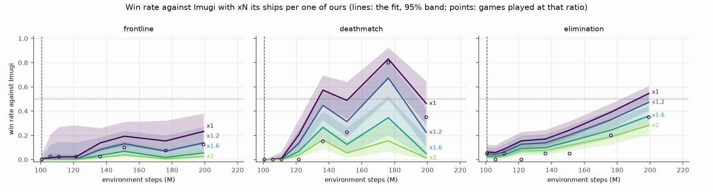
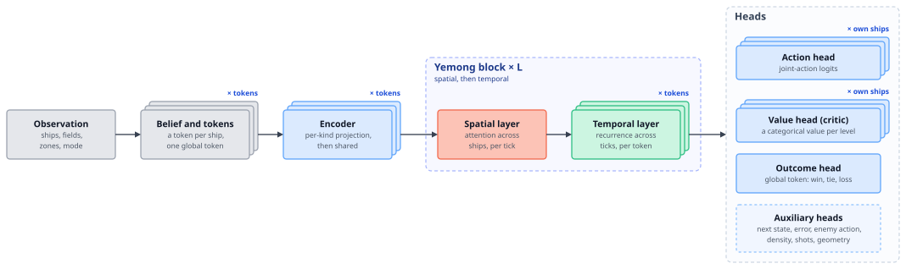
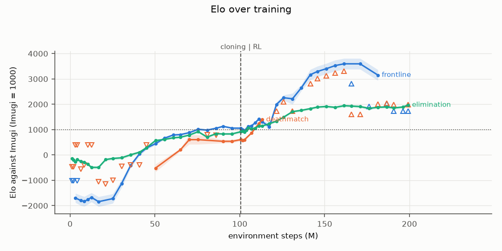
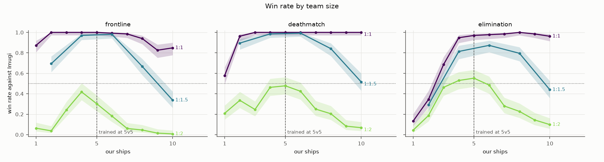

<!-- Generated from README.template.md by docs/hooks/placeholders.py; edit the template, then run: uv run --no-sync python docs/hooks/placeholders.py readme -->

# Boost and Broadside

> **Figure to come** (docs/results/media/hero.gif): The trained fleet against a larger fleet of Imugi, the scripted agent, at the break-even ratio

> **Pending (hero_caption).** One line under the clip: the mode, the lineup (for example 5 against 8), the policy's run and steps, the seed, and how the game ended. The intended clip is the champion barely winning while outnumbered at its break-even ratio.

Boost and Broadside is a two-dimensional air-combat game written as batched tensor
functions in PyTorch, and the system that trains one network to command a whole fleet in
it, on one GPU.

## The result

> **Pending (headline).** The headline, written after the results: how many of Imugi's ships the trained policy beats per one of its own, in which modes, after how many environment steps.

<picture><source media="(prefers-color-scheme: dark)" srcset="docs/results/win_rate_fan_dark.png"></picture>

<sub>**Figure 1.** Each line is one ratio of Imugi's ships to the policy's (×1, ×1.2, ×1.6, ×2), read off the crossover's logistic fit at each snapshot; the band is the fit's 95% interval and the open points are games played at exactly that ratio. The policy is the training's exponential average of the weights, at 8 snapshots of reinforcement learning; the dashed line is the hand-off from behaviour cloning. Every lineup has 20 ships on its larger side, the policy's or Imugi's; 256 to 512 games per snapshot and mode. Deathmatch in this run is slightly off: it trained with 5 tickets per ship (5N) and was evaluated with 4·N^(4/3) tickets, rounded to 5.</sub>

*Each line is the trained policy's win rate against Imugi at one ratio of ships, from a
logistic fit of every game played at that training snapshot; the band is the fit's 95%
interval.*

The break-even ratio is the number of Imugi's ships per one of the policy's at which the
two sides win equally often:

| Mode | Break-even ratio (Imugi's ships per one of ours) | At steps |
|---|---|---|
| Frontline | 0.71 ± 0.06 | 199,229,440 |
| Deathmatch | 0.98 ± 0.06 | 199,229,440 |
| Elimination | 1.12 ± 0.10 | 199,229,440 |

How the games are played, fitted and counted, and what the numbers do not show, is on the
[evaluation page](docs/results/evaluation.md).

## The game

Two teams of ships fly, shoot and die in a round arena, in three modes that form a ladder
of difficulty:

- **Deathmatch:** a pure dogfight. Every ship is visible, a dead ship respawns, and the
  first team to its tickets wins.
- **Elimination:** adds fog of war and a closing boundary. There is no respawn, and the
  boundary shrinks past the centre before the clock runs out, so every game is decided.
- **Frontline:** adds fog of war and zones to take and hold. A team pushes the front by
  capturing zones.

The ships fly at real scale, in metres and seconds, with flight envelopes derived from a
P-51D: two types, Yongma, an energy fighter, and Jujak, a turn fighter. Imugi, a scripted
agent, flies every mode from the same observation a network sees, fog included. It is the
behaviour-cloning teacher and the anchor of every rating (Imugi = 1000 Elo).

[The game](docs/explanation/game/modes.md) ·
[The real-scale ships](docs/explanation/game/real-scale.md) ·
[Imugi](docs/explanation/imugi.md)

## The model



<sub>**Figure 2. Yemong.** The observation's tokens (one per ship, field and zone) pass through blocks of spatial attention across the ships and temporal recurrence per ship, then to per-ship heads.</sub>

Yemong is one network that commands the whole fleet. Each tick, a spatial layer of
attention mixes the ships, the map's fields and zones; a temporal layer of recurrence
carries each ship through time. Every head gives one output per ship, and nothing in the
weights depends on the number of ships, fields or the arena's size, so one set of weights
plays at every team size.

Training is behaviour cloning of Imugi for 100M environment steps, then reinforcement
learning (PPO, against itself and a league of its own snapshots and Imugi) for 100M more,
on one GPU. The same code runs on a laptop RTX 4070 (8 GB) and on an RTX 5090.

[The model](docs/explanation/yemong.md) ·
[Behaviour cloning](docs/explanation/behaviour-cloning.md) ·
[The training loop](docs/explanation/training-loop.md) ·
[The league](docs/explanation/league.md)

## Key results

**Strength over training.** The policy's rating against Imugi in each mode, through
behaviour cloning and reinforcement learning.

<picture><source media="(prefers-color-scheme: dark)" srcset="docs/results/elo_over_training_dark.png"></picture>

<sub>**Figure 3.** Each point is one snapshot of a run's exponential average of the weights, rated 5 against 5 in one field that holds both dry runs' snapshots and champions: dry run 3 (dry-v26-s1, game v26) in colour, dry run 1 (dry-v24-s1, game v24) in grey. Imugi of game v26 is fixed at 1000; Imugi of game v24 is a rated player (the lower dotted line), and dry run 1's earlier games against it are part of the field. The band is one standard error; an open triangle is a bound (the snapshot lost nearly all its games, so its rating has no finite estimate); a snapshot not yet rated is left out and breaks its line (15 of dry run 3's so far). A star is the run's champion. The dashed line is the hand-off from behaviour cloning. Drawn: elimination; the other modes' fields are still being played.</sub>

> **Pending (training_summary).** One or two sentences: the final Elo per mode (elo_deathmatch_final and the others) and where the hand-off from cloning to reinforcement learning shows on the curve.

**Team sizes it did not train at.** Trained at 5 against 5, the same weights play from
1 against 1 to 10 against 10.

<picture><source media="(prefers-color-scheme: dark)" srcset="docs/results/team_size_generalization_dark.png"></picture>

<sub>**Figure 4.** The champion, trained at 5 against 5 alone (dashed line), against Imugi from 1 to 10 of its own ships. Each line is one ratio of Imugi's ships to the policy's (1:1, 1:1.5, 1:2; 1:1.5 at even sizes only); the band is Wilson's 95% interval, a draw counting half a win, from 132 to 134 games per point. Every size plays the preset's own arena. Deathmatch in this run is slightly off: it trained with 5 tickets per ship (5N) and was evaluated with 4·N^(4/3) tickets, rounded to 5.</sub>

> **Pending (generalisation_summary).** One sentence on how the win rate at even numbers holds from 1 against 1 to 10 against 10, with the 10 against 10 values.

**Controlled experiments.** Each change to the model or the training is one arm: a full
training run against the incumbent's, decided by a sequential test on their head-to-head
games and their break-even curves.

> **Figure to come** (docs/results/arms_forest.png): One row per arm: its score against the incumbent with a 95% interval, the indifference zone shaded, the decision marked, and a row for seed-to-seed noise

> **Pending (arms_summary).** One sentence: how many arms were decided, how many were kept, and which change mattered most.

**Throughput.** Environment steps per second over whole updates, collection and learning
together:

| GPU | Behaviour cloning | Reinforcement learning |
|---|---|---|
| RTX 4070 Laptop (8 GB) | **⟨throughput_laptop_4070_bc_steps_per_second⟩** | **⟨throughput_laptop_4070_rl_steps_per_second⟩** |
| RTX 5090 (32 GB) | 19,304 | 21,622 |

[All results](docs/results/index.md) ·
[How they are measured](docs/results/evaluation.md)

## Quickstart

Requires [uv](https://docs.astral.sh/uv/), and CUDA for training.

<!-- not-runnable: changes the environment; training and the crossover need CUDA -->
```bash
uv sync                                          # the environment
uv run --no-sync pytest -m "not gpu"             # the tests that run on the CPU
uv run --no-sync bnb play --preset real_scale_frontline   # fly or watch a match (OpenGL)
uv run --no-sync bnb train --preset real_scale_all_modes --objective chain \
    --chain-budget-steps 200000000 --name example         # clone Imugi, then PPO
uv run --no-sync bnb crossover runs/example-rl/policy     # the break-even ratio
uv run --no-sync mkdocs serve                    # the docs, at http://127.0.0.1:8000
```

The versions and the GPU requirements are on the
[installation page](docs/getting-started/installation.md).

## Documentation

The documentation is a MkDocs site built from [`docs/`](docs/index.md):

- [Results](docs/results/index.md): the crossover, the training curves, the arms, team
  sizes, compute and a gallery of behaviour.
- [Getting started](docs/getting-started/index.md): installation, tests, a first training
  run, a benchmark.
- [Guides](docs/guides/index.md): training, behaviour cloning, benchmarking, playing.
- [Explanation](docs/explanation/index.md): the game, the model, the training loop, the
  league and a [glossary](docs/explanation/glossary.md).

The previous version of the project is at the git tag `v1-torch-final`.

## Citation

> **Pending (citation).** A BibTeX entry: the author, the title, the year and the repository URL, with the commit or tag of the release.

## License

[MIT](LICENSE).
