# Evaluation and results

The central result is zero-shot transfer across team size: a policy trained in 4-vs-4
combat remains effective without retraining as the learned fleet grows from one to
64 ships. Crossover against the scripted controller provides the
quantitative view; seeded replays show what that transfer looks like in motion.

This page distinguishes stored measurements from interpretations and describes the raw
artifacts behind every headline number. Known gaps are collected in
[remaining limitations](#remaining-limitations).

Two policies come out of every run, and each number below says which it measures. The
**live** policy is the weights at a training step. The **averaged** policy is the running
average of those weights that the run keeps beside them, and is the one the project treats
as its product.

## Reference run and provenance

All headline figures refer to `wild-universe-731` (`mwvvm4kb`). It is the first run
trained under frontal armour and the only one trained under this version's physics, in
which a glancing bullet still does 30% of full damage.
Its preserved artifacts include:

- [W&B export](../checkpoints/wild-universe-731/artifacts/wandb-export/): training
  configuration, sampled metric history, and final summary;
- [raw live match history](../checkpoints/wild-universe-731/elo_history.jsonl);
- [crossover sweep](../checkpoints/wild-universe-731/artifacts/figures/crossover.json);
- [curated seeded replays](results/replays/), which come from an earlier run (see
  [replays](replays.md)).

Every run figure on this page *is* a file under
[`checkpoints/wild-universe-731/artifacts/`](../checkpoints/wild-universe-731/artifacts/), linked
where it lies rather than copied here. Its
[`figures` artifact](../checkpoints/wild-universe-731/artifacts/figures/artifact.json) records
which measurement each chart was drawn from and that measurement's digest, and each
measurement in turn records the command that produced it, its seeds, resolved settings,
checkpoint hashes, and the commit it was run from. Earlier runs are summarised in
[training runs](training-runs.md).

The run targeted 1,000M environment steps and was stopped
(status `interrupted`) after 671,846,400 of them over 674 updates, in
70.3 hours on a single RTX 4070 Laptop — about
2,655 environment steps/s, or
21,239 ship-tokens/s at 8
ships per environment. Ship-tokens/s is the primary throughput measure here because it
stays comparable when ships-per-environment changes; steps/s does not. Two caveats on that
figure: the run carried full gradient diagnostics throughout, which are not free, and its
4 refractive fields add entity tokens the network attends over. Neither is
a property of the trained policy.

## Zero-shot crossover

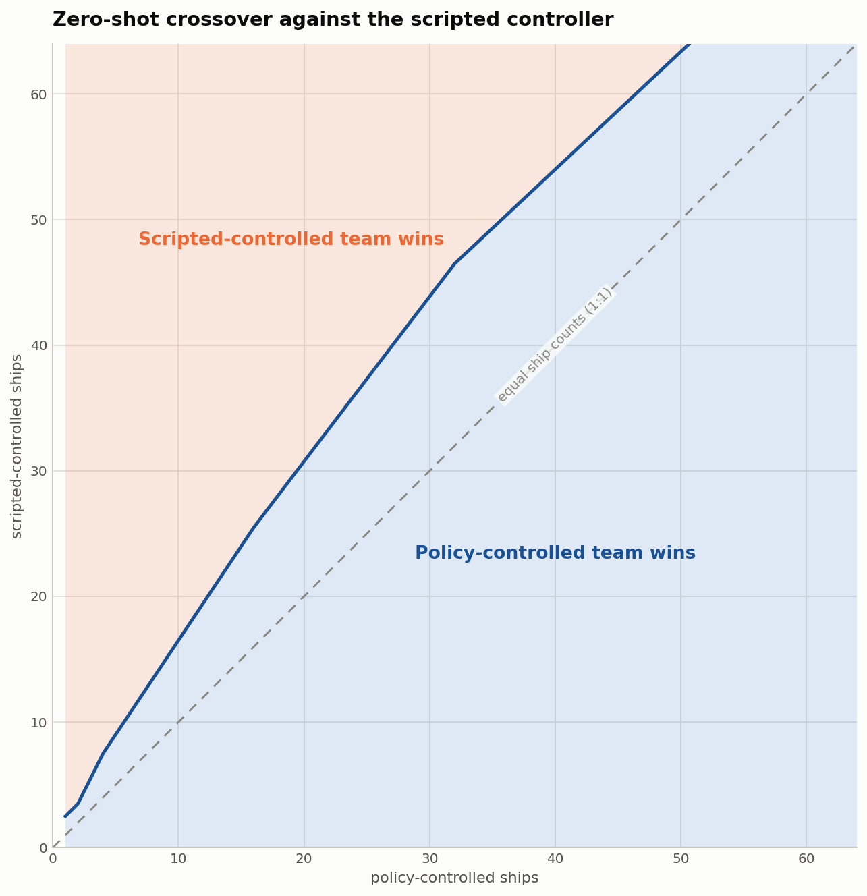

*Figure 1. The final live checkpoint against the scripted controller at learned-team sizes 1, 2, 4, 8, 16, 32, 64, 256 games per matchup where memory allows; the boundary is drawn halfway between the largest scripted team still beaten and the first one not, and straight between measured sizes.*

The final live checkpoint's 50% crossover stays above equal numbers at every size
measured.

[`crossover.py`](../src/boost_and_broadside/modes/crossover.py) fixes the learned policy to
team 0 and the stochastic scripted controller to team 1. For each learned-team size `T`,
it searches increasing scripted-team counts `S` and records:

- `beats_up_to`: the largest `S` with learned-team win rate at least 50%;
- `crossover`: the first adjacent `S` below 50%;
- the measured rates at those points and every search probe.

Ties count against the learned team. The plot draws the visual boundary halfway between
the two adjacent integer counts; it is not a continuous fitted threshold.

The same checkpoint, the final live one (`step_000671846400.pt`), is loaded once and
evaluated across the grid. At each matchup, the runtime ship-token count changes but no
policy weight is updated. The stored sweep covers learned-team sizes
1, 2, 4, 8, 16, 32, 64; the plot joins them with straight lines.

Selected measurements (final live checkpoint):

| Policy-controlled ships | Largest scripted team still beaten | Win rate there | First below 50% | Win rate there |
|---:|---:|---:|---:|---:|
| 4 | 7 | 55.9% | 8 | 33.6% |
| 8 | 13 | 64.8% | 14 | 48.8% |
| 16 | 25 | 61.7% | 26 | 48.8% |
| 32 | 46 | 52.3% | 47 | 47.7% |
| 64 | 76 | 54.9% | 77 | 49.3% |

This supports an empirical claim: the 4-vs-4-trained controller remains effective without
retraining at much larger and asymmetric sizes, and the recorded crossover stays above
numerical parity. It does **not** by itself establish a universal scale-invariance law.
The scripted controller is one opponent family, individual boundary rates carry binomial
sampling noise, and the search assumes a locally monotone boundary.

Every point stores its own win/loss/tie counts and mean episode length. Most cells are
256 parallel games; the largest matchups run fewer, because the
collision tensor grows with the square of the total ship count and the batch is shrunk to
fit. The 64-ship boundary above rests on 204 games at
76 scripted ships, a
54.9% rate with a binomial standard error near
3.5%. Read it as roughly parity around
76, not as a threshold located to the ship.

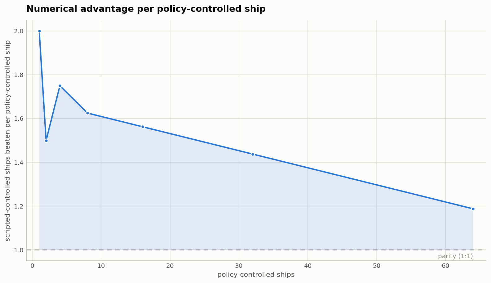

*Figure 2. The largest scripted team the final live checkpoint still beats, divided by its own team size, from the same sweep.*

The ratio view describes where the measured numerical advantage is larger: from
2.00x at one ship (a 51.2% rate, within noise of even) and 1.75x at the
training size of four down to 1.19x at 64. Its shape is
descriptive: no ablation separates coordination, per-ship tactical skill, and weaknesses
of the scripted controller.

## Outnumbered over training

The crossover sweep rates one checkpoint. The fan charts follow a fixed learned-team size
through training instead, against scripted teams of 1, 1.25, 1.5, 1.75 and 2 times its
size, at each frozen ladder checkpoint and at the final live checkpoint, and mark the final
averaged checkpoint beside them.

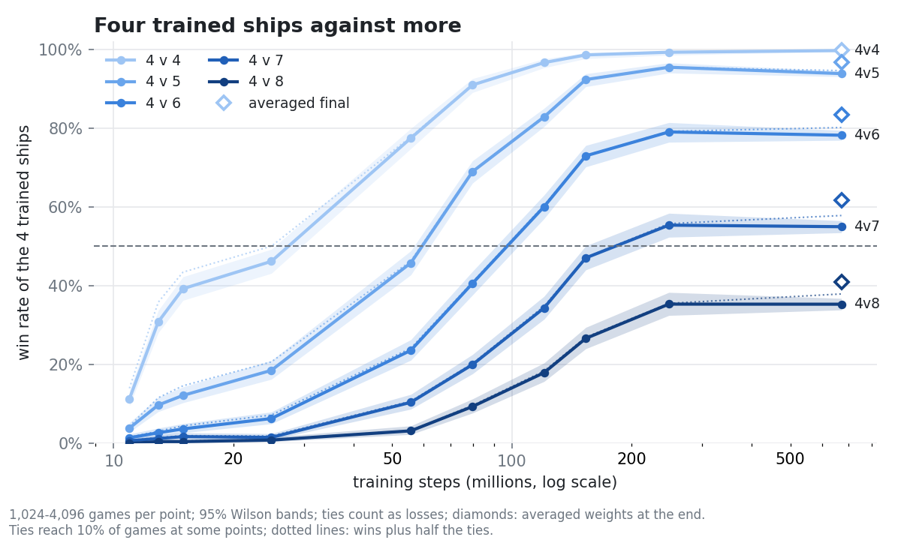

*Figure 3. Win rate of 4 learned ships against 4 to 8 scripted ships at each frozen ladder checkpoint and the final live checkpoint (lines, 95% Wilson bands), and of the final averaged checkpoint (diamonds); 1,024 games per point, ties count as losses.*

At 4 ships, the averaged weights hold more than the live ones at the end of training:
82.1% against 6 scripted ships where the live weights
win 78.3%, 62.6%
against 7 where they win 52.6%, and
40.8% against 8 where they win
34.7%, each over 1,024
games. The live curves stop improving after about 250M steps.

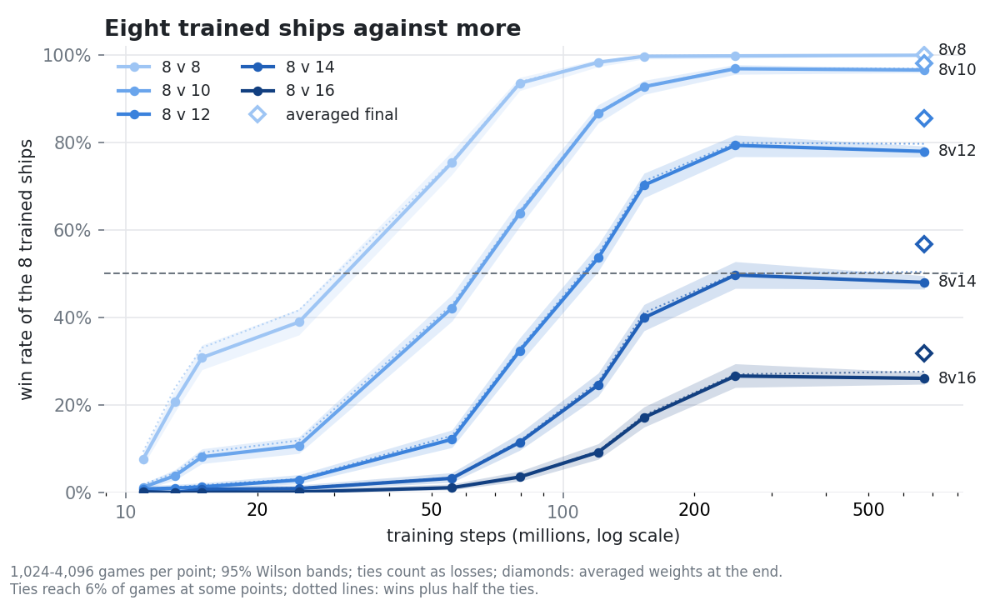

*Figure 4. Win rate of 8 learned ships against 8 to 16 scripted ships over training, live checkpoints as lines and the final averaged checkpoint as diamonds.*

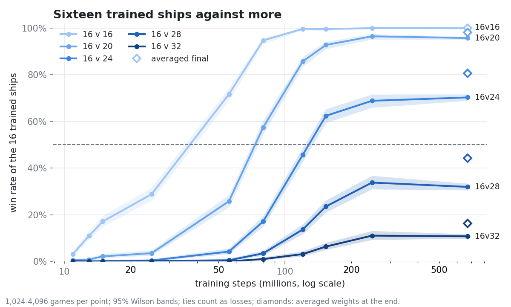

*Figure 5. Win rate of 16 learned ships against 16 to 32 scripted ships over training, live checkpoints as lines and the final averaged checkpoint as diamonds.*

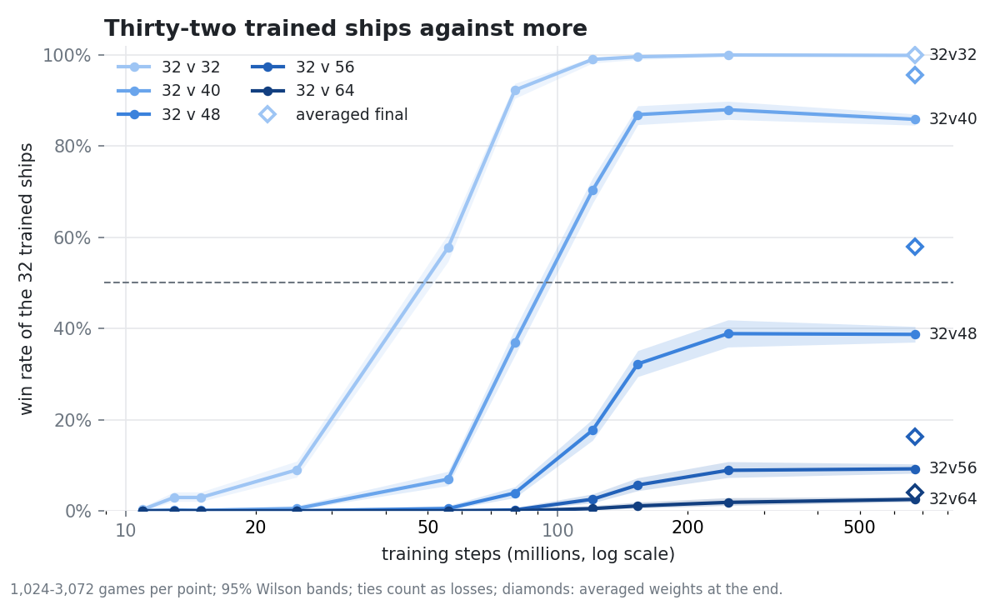

*Figure 6. Win rate of 32 learned ships against 32 to 64 scripted ships over training, live checkpoints as lines and the final averaged checkpoint as diamonds.*

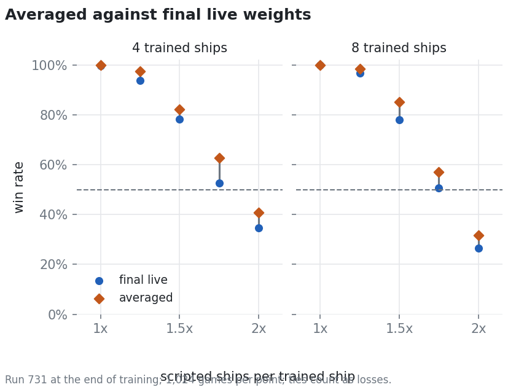

*Figure 7. Win rate of the final averaged weights (diamonds) and the final live weights (dots) at each ratio of scripted to learned ships, one panel per learned-team size; 1,024 games per point, ties count as losses.*

The averaged weights win more often than the live ones at every ratio above equal
numbers. At 1.75 times as many scripted ships, the closest to even, they win
10.0% more of the games at 4 ships (95% interval
±4.3%) and
6.5% more at 8
(±4.3%).

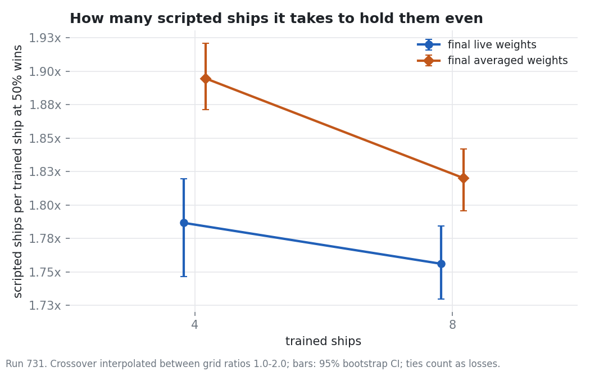

*Figure 8. Scripted ships per learned ship at which the learned team wins half its games, by learned-team size, for the final live and the final averaged weights; interpolated between the fan's grid ratios (1x to 2x), with 95% bootstrap intervals. Ties count as losses.*

Interpolated between the grid points, the averaged weights hold even against
1.89x their number at 4 ships
(1.87–1.92),
1.82x at 8, 1.71x
at 16 and 1.54x at 32; the final live weights
against 1.79x, 1.76x,
1.63x and 1.45x.
The crossover sweep's coarser integer search above gives
1.75x and 1.62x for the final live
checkpoint at 4 and 8 ships.

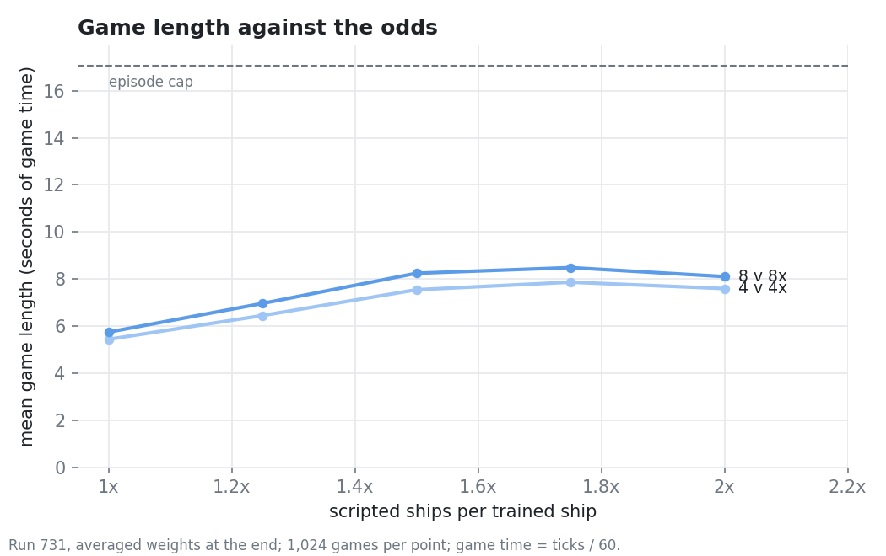

*Figure 9. Mean game length in seconds of game time against the ratio of scripted to learned ships, one line per learned-team size, for the final averaged weights; 1,024 games per point. The episode cap is 17.1 s.*

Games get longer as the odds worsen, from about
5.4 s at equal numbers to about
7.9 s at 1.75 times as many scripted ships (4
learned ships, averaged weights), far inside the 17.1 s cap.

## Qualitative crossover evidence

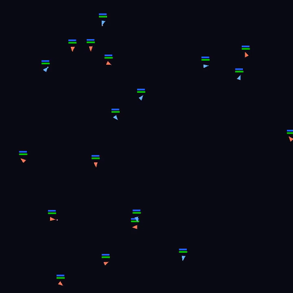

Outnumbered 11 ships to 8, the learned fleet wins with three ships to spare. This clip is
from the earlier run `resilient-resonance-682`; `wild-universe-731`'s final live checkpoint
wins 89.1% of 256 games at
8-vs-11. See [replays](replays.md) for larger battles and capture details. A clip is one
qualitative realization, not the source of the aggregate rates above.

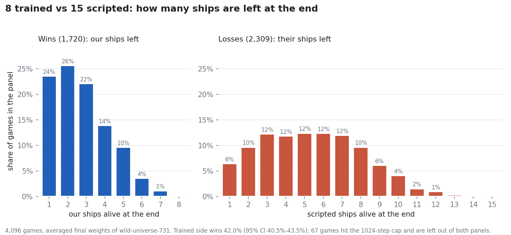

*Figure 10. 4096 seeded games of 8 learned ships (averaged weights) against 15 scripted ships; the learned side won 1720 (42%). Left: learned ships alive at the end of each win. Right: scripted ships alive at the end of each loss.*

## Post-hoc Elo calibration

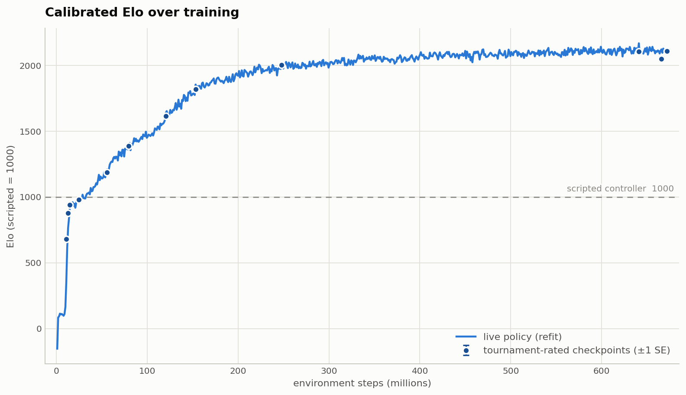

*Figure 11. The line is the live policy at each update, refit from its recorded games against the calibrated opponents; the dots are tournament-rated checkpoints (±1 SE), the last of them the final live checkpoint. Scripted controller fixed at 1000.*

Every rating on this page is calibrated Elo. Training keeps a separate *live* Elo for
opponent sampling and progress reporting; it drifts with sequential K-factor updates and
changing opponents, so it is never quoted as a result. The
[training guide](training.md#live-elo-versus-calibrated-elo) sets the two scales side by
side. [`elo_calibrate.py`](../src/boost_and_broadside/modes/elo_calibrate.py) constructs
the reported scale post hoc in two stages:

1. run an adaptive tournament among stationary players (random, the scripted controller,
   semi-random rungs between them, the frozen ladder checkpoints, and the final
   checkpoint) until every fitted rating reaches the target uncertainty;
2. refit each historical live policy from that update's saved win/loss/tie record against
   the now-calibrated opponents.

The rungs (the same mixture controllers as the
[reference ladder](#reference-ladder-conditioning) below) give the random baseline
informative matchups instead of one near-certain link, and the final checkpoint plays so
the curve's endpoint carries a full tournament rating rather than only the last update's
live record. The stored tournament converged to its ±12
target in 7 of at most 8 adaptive batches
and 114,688 games.

The fit uses [Bradley-Terry](https://doi.org/10.2307/2334029) expected scores. The
primary convention treats a draw as half a win for each side; a decisive-games-only fit
is retained as a diagnostic. Ratings are reported with the scripted controller fixed at
1000, matching the fleet-scale view below. A gap of 400 points corresponds to ten-to-one
odds.

Key values from the
[calibration artifact](../checkpoints/wild-universe-731/artifacts/elo-calibration/):

| Measurement | Elo | Conditional SE | Games |
|---|---:|---:|---:|
| Final live checkpoint, 671.846M steps | 2110.2 | 11.4 | 7,089 tournament games |
| Best-by-live-rating checkpoint, 640.991M steps | 2106.5 | 11.4 | 7,075 tournament games |
| Best averaged checkpoint, 665.874M steps | 2051.8 | 11.2 | 7,798 tournament games |
| Final live policy (refit), 670.851M steps | 2106.4 | 18.9 | 927 recorded games |
| Final averaged policy (refit), 670.851M steps | 2056.8 | 22.3 | — |
| Last frozen ladder checkpoint, 247.837M steps | 2003.7 | 10.9 | 8,544 tournament games |
| Scripted controller | 1000 (anchor) | 5.6 | 10,213 tournament games |
| Random baseline | 86.2 | 8.9 | 6,947 tournament games |

The anchor and the reference player are different here: ratings are shifted so the
scripted controller reads 1000, while errors are conditioned on
`semi_scripted_0p9`, the rung the fit was best determined against. The
anchor shift carries ±5.6 in common across every rating,
which cancels whenever two of them are compared.

The final live checkpoint's lead over scripted is about
1,110 points. The best-by-live-rating
checkpoint sits 4 points below it, well inside
the error bars, so selecting on the online gauge cost nothing measurable here. The best
averaged checkpoint sits 58 points below it in
this 4-vs-4 tournament, although the averaged weights hold more than the live ones against
larger scripted fleets ([above](#outnumbered-over-training)). The independent
[fleet-scale tournament](#symmetric-fleet-scale-ratings) below rates the final live
checkpoint 2,128.3 ± 9.6 in its own 4-vs-4
bracket, about one combined standard error from this tournament's value.

The rungs matter more than they look: they are what keeps random connected to the field
by anything other than near-certain games, and saturated matchups carry almost no rating
information.

The compact plot above carries ±1 SE bars on the checkpoint dots but omits the refit
curve's own band. The calibration artifact stores the full win/tie matrices, the per-batch
convergence record, and both tie conventions, so the diagnostics can be redrawn without
replaying a game.

The live Elo that training itself kept has the same shape, and ends close to the
calibrated values here; it is drawn below as a shape only, with the calibrated endpoints
marked beside it.

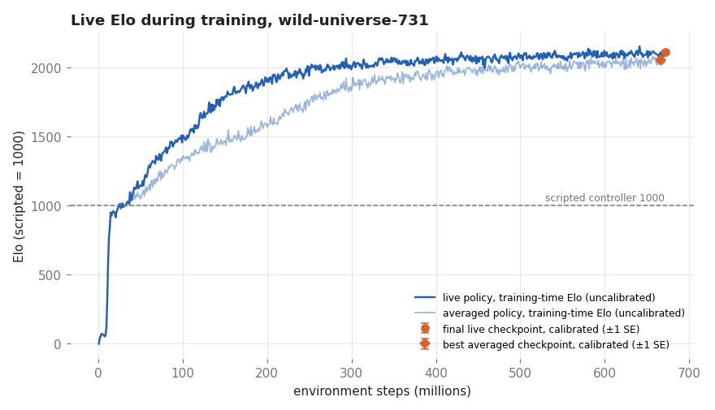

*Figure 12. The live Elo the trainer kept while it ran (dark line: live policy; light line: averaged policy), from sequential updates against a changing opponent pool: a shape, not a rating. The orange points are post-hoc calibrated ratings, of the final live checkpoint (2,110 ± 11) and the best averaged checkpoint (2,052 ± 11). Drawn by scripts/plot_elo_history.py.*

## Symmetric fleet-scale ratings

The frozen training ladder and final live checkpoint were replayed in symmetric battles
from 1-vs-1 through 64-vs-64. Each size has its own stationary tournament containing
random, scripted, the frozen ladder checkpoints, and the final checkpoint. The evaluator
swaps team roles and stores directed win/loss/tie counts in the
[fleet-scale artifact](../checkpoints/wild-universe-731/artifacts/elo-scale/). The ratings
below, like the figure, join each tournament to the
[reference ladder](#reference-ladder-conditioning) at the same size before fitting.

Ratings again fix the scripted controller at 1000. The plotted quantity is therefore the
checkpoint's advantage over a consistent opponent, directly comparable with the calibrated
training curve above.

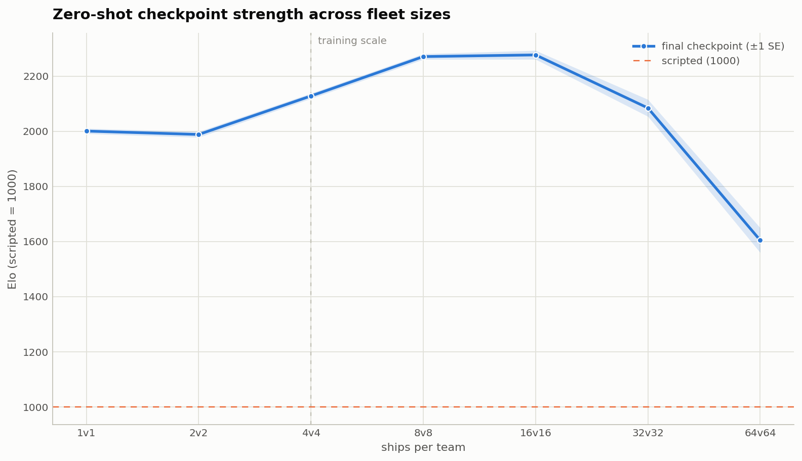

*Figure 13. Elo of the final live checkpoint (672M steps) in a separate stationary tournament at each symmetric size, with the scripted controller fixed at 1000 and the reference ladder joined in; the band is ±1 standard error. The policy trained at 4-vs-4 only.*

The 4-vs-4 checkpoint is stronger at 8-vs-8 and 16-vs-16 than at its training size, then
weakens at 32-vs-32 and falls well below its 1-vs-1 rating at 64-vs-64.

| Ships per team | Tournament games | Final live checkpoint Elo (±1 SE) | Reached ±10 target |
|---:|---:|---:|---|
| 1 | 81,920 | 2001 ± 10 | yes |
| 2 | 65,536 | 1989 ± 11 | yes |
| 4 | 98,304 | 2128 ± 10 | yes |
| 8 | 109,375 | 2271 ± 10 | yes |
| 16 | 46,872 | 2277 ± 16 | no |
| 32 | 11,712 | 2085 ± 31 | no |
| 64 | 2,928 | 1605 ± 45 | no |

At the native 4-vs-4 scale this tournament rates the final live checkpoint
2128 ± 10, against the calibration
tournament's independent 2110.2 ±
11.4 above — two fits with different fields and different
reference players, about one combined standard error apart.

Each size gets the same budget of at most 12 adaptive batches, and each
batch is shrunk to fit the collision-memory limit, so a 64-vs-64 batch is
244 games where a 4-vs-4 batch is
16,384. The three largest sizes spent that budget without reaching
the ±10 Elo target and stop where they are, so their error bars
are wide, and 8 and 16 do not separate from one another.

The fall at 32-vs-32 and 64-vs-64 is not noise. The
[crossover sweep](#zero-shot-crossover) measures the same widths independently with win
rates and turns down in the same place: the policy takes
99.6% of equal-count games at 32-vs-32 and
93.4% at 64-vs-64, and its numerical advantage
falls from 1.44x to 1.19x. Both
measurements agree that something gives out at the largest widths tested — in a policy
trained at 4-vs-4 that still wins most equal fights sixteen times wider.

### Reference-ladder conditioning

Random play is extremely far from scripted play, making a direct random-to-scripted
link statistically inefficient; both the fleet-scale tournaments and the training-curve
calibration therefore add intermediate controllers. For each ship on each simulation
step, a controller with probability `P` uses the complete scripted action; otherwise it
samples a complete action uniformly at random. The refined ladder uses
`P = 0, 20, 30, 40, 50, 60, 70, 80, 90, 95, 100%`.

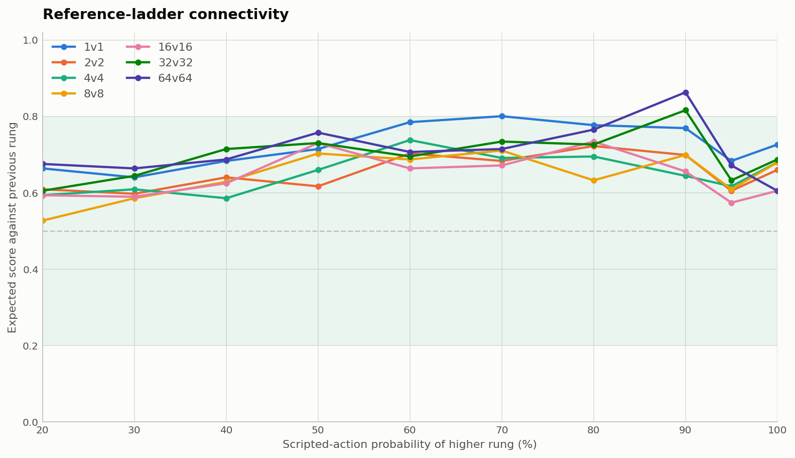

*Figure 14. Expected score of the stronger rung against its neighbour, for every adjacent pair at every fleet size; 128 side-balanced games per pair.*

Across 70 adjacent comparisons over 7 fleet
sizes, the stronger rung scores between 52.7% and
86.3% against its neighbor. No pair approaches a deterministic
matchup.

The saved
[reference tournament](../checkpoints/wild-universe-731/artifacts/semi-random-ladder/)
contains 128 side-balanced games for every unordered pair at every
scale. Its outcome matrices are joined to the checkpoint tournament through the shared
random and scripted endpoints before fitting, which improves graph connectivity without
treating an interpolated controller as a trained checkpoint.

The same measurement checks training's live gauge, which assigns each rung 1000·p instead
of fitting it. Every scale carries a `live_gauge_error`: the fitted ladder regauged to the
same two endpoints, minus the rating training uses. At 4-vs-4 the linear placement runs
about 139 Elo high at the `p=0.2` rung and up to
153 at `p=0.3`, about
102 at `p=0.6` and `p=0.7`, and comes within
47 points from `p=0.8` up. That is the
approximation the [live Elo contract](training.md#live-elo-versus-calibrated-elo) was
accepted on; in this run's environment it is larger in the middle rungs than in the run
the contract was measured on.

## Scripted benchmark over training

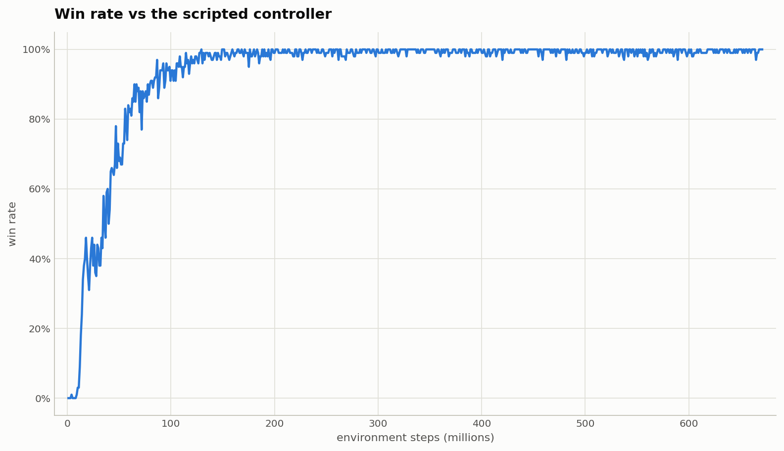

*Figure 15. The live policy's 4-vs-4 win rate against the scripted controller in the evaluation battery at each update.*

Across the 674 sampled history points with this metric, the live
policy first reaches 95% at 86.6M environment steps
and 99% at 114.5M; the final point is
100%. After 200M steps no sampled value falls below
97%, so from there on the benchmark is a weak
discriminator.

The calibrated Elo continues to improve after the scripted curve becomes less informative.
That is consistent with continued learning from self-play and league opponents, but it
does not isolate which mechanism caused the improvement.

## Auxiliary dynamics learning

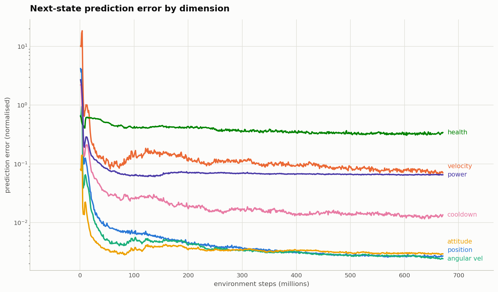

*Figure 16. The auxiliary dynamics head's normalised error per state channel over training, log scale.*

The auxiliary head's normalized errors fall strongly for predictable dynamics channels.
For example, position-x falls from 4.19 at the first
sampled update to 0.0027 at the last; velocity-x from
10.12 to 0.070; power
from 2.70 to 0.065. Health
changes much less, from 0.64 to
0.34.

These are direct measurements from the archived W&B history. A plausible reading is that
health is dominated by sparse, hard-to-forecast damage events, but that is an
interpretation and no ablation isolates the cause. Deeper sequence behavior is in
the [autoregressive reports](../checkpoints/wild-universe-731/artifacts/figures/ar_report_4v4/) and [noise calibration](../checkpoints/wild-universe-731/artifacts/figures/noise_calibration/).

## Training health

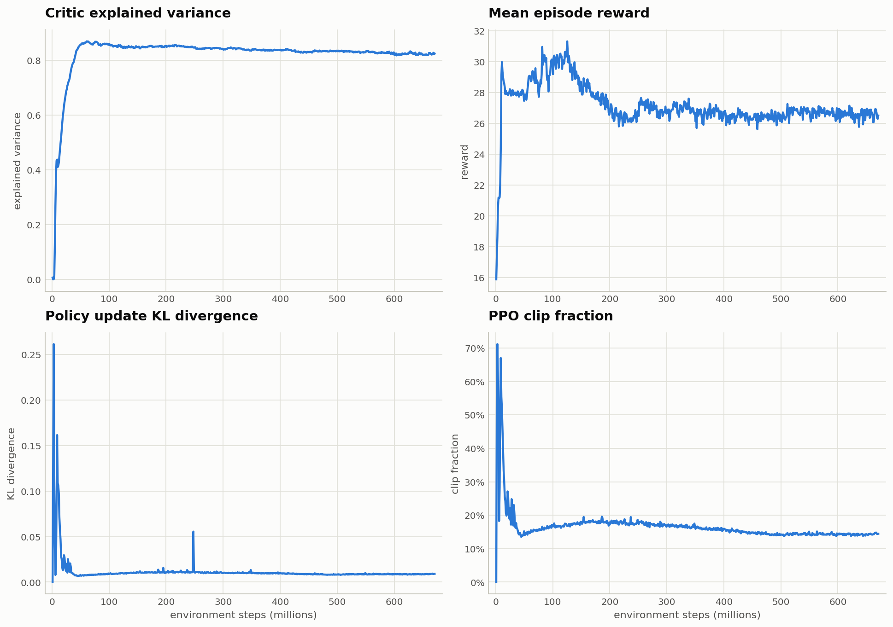

*Figure 17. Critic explained variance, mean episode reward, policy-update KL divergence and PPO clip fraction over training.*

The final aggregate critic explained variance is 0.825, with a
sampled maximum of 0.870. The panel also shows reward, KL, and
clip-fraction trajectories. These are optimization diagnostics rather than headline
task-performance measures.

## Reproduce the figures

Every run figure comes from one command, run against a finished run's own measurements:

```bash
uv run bnb figures --run wild-universe-731
uv run bnb figures --run wild-universe-731 --only elo_curve.png
```

It writes into `checkpoints/<run>/artifacts/figures`, which is where these pages link. So
there is exactly one copy of each chart, and illustrating the documents with a different
run is a matter of pointing the links at it rather than of regenerating anything. Charts
are checked against the schema of the measurement they read, so an artifact written before
a schema change is refused by name instead of drawn from fields that no longer mean what
the renderer expects.

Rendering is offline and runs no simulation, so it needs no GPU. Refitting a stored
calibration also needs none: `uv run bnb elo-calibrate --from-artifact <artifact
directory>` refits the saved win/tie matrices and writes a new artifact. Rerunning the
measurements themselves does need one; see
[getting started](getting-started.md#evaluate).

The numbers quoted on this page are read from the same artifacts by
`scripts/docs_values.py` into [`values.json`](values.json), and every chart is named in
[`figures.yml`](figures.yml); `scripts/render_docs.py` renders the page from
`evaluation.template.md`.

The curated replays are the one class of output no renderer produces. A clip is captured
as scratch under `out/`, reviewed, then copied into `docs/results/replays/` and committed.
The committed file is the clip.

## Remaining limitations

- The 16-, 32-, and 64-vs-64 checkpoint ratings did not reach the
  ±10 Elo target within their batch budget and carry
  ±16, ±31, and
  ±45; the largest fleets are measured from far fewer games than
  the smaller ones.
- The crossover boundary at the largest sizes rests on fewer than
  256 games per point, so each boundary carries several points
  of binomial noise.
- The run stopped at 672M of its planned
  1,000M steps. The calibrated curve had levelled off by then
  (within 50 Elo of the final rating from about
  457M steps), but what the remaining steps
  would have added is unmeasured.
- The crossover sweep and the fleet-scale tournaments rate the final live checkpoint, not
  the averaged one; the averaged policy is measured in the calibration tournament and the
  fan charts.
- Elo is defined within one game. Earlier runs trained under different physics, so their
  ratings are not on this run's scale (see [training runs](training-runs.md)).
- Results come from one training run against one scripted opponent family; there is no
  multi-run seed study.
- The transfer results demonstrate execution and performance across observed sizes, not
  invariance under arbitrary maps, physics, observation changes, or unbounded team size.
- No causal ablation assigns the observed transfer to attention, recurrence, auxiliary
  prediction, reward decomposition, or league play individually.
