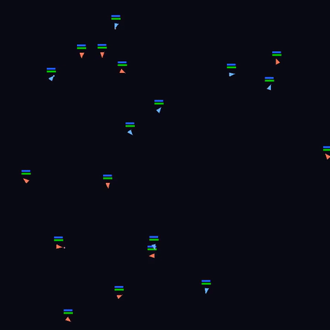

# Evaluation and results

The central result is zero-shot transfer across team size: a policy trained in 4-vs-4
combat remains effective without retraining as the learned fleet grows from one to
{{crossover_largest_size}} ships. Crossover against the scripted controller provides the
quantitative view; seeded replays show what that transfer looks like in motion.

This page distinguishes stored measurements from interpretations and describes the raw
artifacts and study records behind every headline number. Known gaps are collected in
[remaining limitations](#remaining-limitations).

Two policies come out of every run, and each number below says which it measures. The
**live** policy is the weights at a training step. The **averaged** policy is the running
average of those weights that the run keeps beside them, and is the one the project treats
as its product.

## At a glance

{{figure: elo_scale}}

Trained at 4-vs-4 only, the final live checkpoint stays far above the scripted controller
at every symmetric size from 1-vs-1 to 64-vs-64; how the ratings are measured is under
[symmetric fleet-scale ratings](#symmetric-fleet-scale-ratings). The fan charts below follow
the policy through training when it is outnumbered.

## Outnumbered over training

The [crossover sweep](#zero-shot-crossover) below rates one checkpoint. The fan charts follow a fixed learned-team size
through training instead, against scripted teams of 1, 1.25, 1.5, 1.75 and 2 times its
size, at each frozen ladder checkpoint and at the final live checkpoint, and mark the final
averaged checkpoint beside them.

{{figure: fan_4_ships}}

At 4 ships, the averaged weights hold more than the live ones at the end of training:
{{fan_4_ships_vs_6_averaged_win_rate:.1%}} against 6 scripted ships where the live weights
win {{fan_4_ships_vs_6_live_win_rate:.1%}}, {{fan_4_ships_vs_7_averaged_win_rate:.1%}}
against 7 where they win {{fan_4_ships_vs_7_live_win_rate:.1%}}, and
{{fan_4_ships_vs_8_averaged_win_rate:.1%}} against 8 where they win
{{fan_4_ships_vs_8_live_win_rate:.1%}}, each over {{fan_4_ships_vs_8_averaged_games:,}}
games. The live curves stop improving after about 250M steps.

{{figure: fan_8_ships}}

{{figure: fan_16_ships}}

{{figure: fan_32_ships}}

{{figure: fan_averaged_vs_final}}

The averaged weights win more often than the live ones at every ratio above equal
numbers. At 1.75 times as many scripted ships, the closest to even, they win
{{fan_4_ships_vs_7_averaged_minus_live:.1%}} more of the games at 4 ships (95% interval
±{{fan_4_ships_vs_7_averaged_minus_live_ci95:.1%}}) and
{{fan_8_ships_vs_14_averaged_minus_live:.1%}} more at 8
(±{{fan_8_ships_vs_14_averaged_minus_live_ci95:.1%}}).

{{figure: fan_crossover_by_size}}

Interpolated between the grid points, the averaged weights hold even against
{{fan_4_ships_averaged_break_even_ratio:.2f}}x their number at 4 ships
({{fan_4_ships_averaged_break_even_ratio_low:.2f}}–{{fan_4_ships_averaged_break_even_ratio_high:.2f}}),
{{fan_8_ships_averaged_break_even_ratio:.2f}}x at 8, {{fan_16_ships_averaged_break_even_ratio:.2f}}x
at 16 and {{fan_32_ships_averaged_break_even_ratio:.2f}}x at 32; the final live weights
against {{fan_4_ships_live_break_even_ratio:.2f}}x, {{fan_8_ships_live_break_even_ratio:.2f}}x,
{{fan_16_ships_live_break_even_ratio:.2f}}x and {{fan_32_ships_live_break_even_ratio:.2f}}x.
The crossover sweep's coarser integer search [below](#zero-shot-crossover) gives
{{crossover_4_ships_ratio:.2f}}x and {{crossover_8_ships_ratio:.2f}}x for the final live
checkpoint at 4 and 8 ships.

{{figure: fan_game_length_by_ratio}}

Games get longer as the odds worsen, then shorter again at the worst odds. With 4 learned
ships (averaged weights) they run from about {{fan_4_ships_vs_4_averaged_mean_seconds:.1f}} s
at equal numbers to about {{fan_4_ships_vs_7_averaged_mean_seconds:.1f}} s at 1.75 times as
many scripted ships, then {{fan_4_ships_vs_8_averaged_mean_seconds:.1f}} s at twice as many;
with 32 they peak earlier, at {{fan_32_ships_vs_48_averaged_mean_seconds:.1f}} s at 1.5
times, and fall to {{fan_32_ships_vs_64_averaged_mean_seconds:.1f}} s at twice as many. All
of them stay far inside the {{config_episode_seconds:.1f}} s cap.

## Reference run and provenance

All headline figures refer to `{{run_name}}` (`{{run_wandb_id}}`). It is the only run
trained under this version's physics: frontal armour at
{{config_bullet_min_damage_fraction}}, so a head-on hit lands
{{config_bullet_min_damage_fraction:.0%}} of its damage and the reduction fades with the
hit angle until a broadside hit lands nearly in full. Its preserved artifacts include:

- [W&B export](../checkpoints/{{run_name}}/artifacts/wandb-export/): training
  configuration, sampled metric history, and final summary;
- [raw live match history](../checkpoints/{{run_name}}/elo_history.jsonl);
- [crossover sweep](../checkpoints/{{run_name}}/artifacts/figures/crossover.json);
- seeded clips of its averaged weights in [`results/v1-731/clips/`](results/v1-731/clips/),
  beside the older curated replays of an earlier run in [`results/replays/`](results/replays/)
  (see [replays](replays.md)).

The run's own figures on this page are files under
[`checkpoints/{{run_name}}/artifacts/`](../checkpoints/{{run_name}}/artifacts/), linked
where they lie rather than copied here. Its
[`figures` artifact](../checkpoints/{{run_name}}/artifacts/figures/artifact.json) records
which measurement each chart was drawn from and that measurement's digest, and each
measurement in turn records the command that produced it, its seeds, resolved settings,
checkpoint hashes, and the commit it was run from.

The fan charts, the averaged-against-live, crossover-by-size and game-length charts, the
survivor chart and the clips come instead from studies run with the scripts in
[`scripts/studies/`](../scripts/studies/). They have no artifact record; their results are
under [`results/v1-731/`](results/v1-731/), and the
[studies README](../scripts/studies/README.md) records their commands, seeds, games per
point and the commit they ran against, so they can be reproduced. Earlier runs are
summarised in [training runs](training-runs.md).

The run targeted {{run_target_steps_millions:,.0f}}M environment steps and was stopped
(status `{{run_status}}`) after {{run_steps:,}} of them over {{run_updates}} updates, in
{{run_hours:.1f}} hours on a single {{run_gpu}} — about
{{run_steps_per_second:,.0f}} environment steps/s, or
{{run_ship_tokens_per_second:,.0f}} ship-tokens/s at {{config_ships_per_environment}}
ships per environment. Ship-tokens/s is the primary throughput measure here because it
stays comparable when ships-per-environment changes; steps/s does not. Two caveats on that
figure: the run carried full gradient diagnostics throughout, which are not free, and its
{{config_fields}} refractive fields add entity tokens the network attends over. Neither is
a property of the trained policy.

## Zero-shot crossover

{{figure: crossover_phase}}

The final live checkpoint's 50% crossover stays above equal numbers at every size
measured.

[`crossover.py`](../src/boost_and_broadside/modes/crossover.py) fixes the learned policy to
team 0 and the stochastic scripted controller to team 1. For each learned-team size `T`,
it searches increasing scripted-team counts `S` and records:

- `beats_up_to`: the largest `S` with learned-team win rate at least 50%;
- `crossover`: the first adjacent `S` below 50%;
- the measured rates at those points and every search probe.

Ties count against the learned team. The plot draws the visual boundary halfway between
the two adjacent integer counts; it is not a continuous fitted threshold.

The same checkpoint, the final live one (`{{crossover_checkpoint}}`), is loaded once and
evaluated across the grid. At each matchup, the runtime ship-token count changes but no
policy weight is updated. The stored sweep covers learned-team sizes
{{crossover_sizes}}; the plot joins them with straight lines.

Selected measurements (final live checkpoint):

| Policy-controlled ships | Largest scripted team still beaten | Win rate there | First below 50% | Win rate there |
|---:|---:|---:|---:|---:|
| 4 | {{crossover_4_ships_beats_up_to}} | {{crossover_4_ships_beats_up_to_win_rate:.1%}} | {{crossover_4_ships_crossover}} | {{crossover_4_ships_crossover_win_rate:.1%}} |
| 8 | {{crossover_8_ships_beats_up_to}} | {{crossover_8_ships_beats_up_to_win_rate:.1%}} | {{crossover_8_ships_crossover}} | {{crossover_8_ships_crossover_win_rate:.1%}} |
| 16 | {{crossover_16_ships_beats_up_to}} | {{crossover_16_ships_beats_up_to_win_rate:.1%}} | {{crossover_16_ships_crossover}} | {{crossover_16_ships_crossover_win_rate:.1%}} |
| 32 | {{crossover_32_ships_beats_up_to}} | {{crossover_32_ships_beats_up_to_win_rate:.1%}} | {{crossover_32_ships_crossover}} | {{crossover_32_ships_crossover_win_rate:.1%}} |
| 64 | {{crossover_64_ships_beats_up_to}} | {{crossover_64_ships_beats_up_to_win_rate:.1%}} | {{crossover_64_ships_crossover}} | {{crossover_64_ships_crossover_win_rate:.1%}} |

This supports an empirical claim: the 4-vs-4-trained controller remains effective without
retraining at much larger and asymmetric sizes, and the recorded crossover stays above
numerical parity. It does **not** by itself establish a universal scale-invariance law.
The scripted controller is one opponent family, individual boundary rates carry binomial
sampling noise, and the search assumes a locally monotone boundary.

Every point stores its own win/loss/tie counts and mean episode length. Most cells are
{{crossover_games_per_matchup}} parallel games; the largest matchups run fewer, because the
collision tensor grows with the square of the total ship count and the batch is shrunk to
fit. The 64-ship boundary above rests on {{crossover_64_ships_beats_up_to_games}} games at
{{crossover_64_ships_beats_up_to}} scripted ships, a
{{crossover_64_ships_beats_up_to_win_rate:.1%}} rate with a binomial standard error near
{{crossover_64_ships_beats_up_to_binomial_stderr:.1%}}. Read it as roughly parity around
{{crossover_64_ships_beats_up_to}}, not as a threshold located to the ship.

{{figure: crossover_ratio}}

The ratio view describes where the measured numerical advantage is larger: from
{{crossover_1_ships_ratio:.2f}}x at one ship (a {{crossover_1_ships_beats_up_to_win_rate:.1%}} rate, within noise of even) and {{crossover_4_ships_ratio:.2f}}x at the
training size of four down to {{crossover_64_ships_ratio:.2f}}x at 64. Its shape is
descriptive: no ablation separates coordination, per-ship tactical skill, and weaknesses
of the scripted controller.

## Qualitative crossover evidence



Outnumbered 11 ships to 8, the learned fleet wins with three ships to spare. This clip is
from the earlier run `resilient-resonance-682`; `{{run_name}}`'s final live checkpoint
wins {{crossover_8_ships_vs_11_win_rate:.1%}} of {{crossover_8_ships_vs_11_games}} games at
8-vs-11. See [replays](replays.md) for larger battles and capture details. A clip is one
qualitative realization, not the source of the aggregate rates above.

{{figure: clip_survivors_8v15}}

## Post-hoc Elo calibration

{{figure: elo_curve}}

Every rating on this page is calibrated Elo. Training keeps a separate *live* Elo for
opponent sampling and progress reporting; it drifts with sequential K-factor updates and
changing opponents, so it is never quoted as a result. The
[training guide](training.md#live-elo-versus-calibrated-elo) sets the two scales side by
side. [`elo_calibrate.py`](../src/boost_and_broadside/modes/elo_calibrate.py) constructs
the reported scale post hoc in two stages:

1. run an adaptive tournament among stationary players (random, the scripted controller,
   semi-random rungs between them, the frozen ladder checkpoints, and the final
   checkpoint) until every fitted rating reaches the target uncertainty;
2. refit each historical live policy from that update's saved win/loss/tie record against
   the now-calibrated opponents.

The rungs (the same mixture controllers as the
[reference ladder](#reference-ladder-conditioning) below) give the random baseline
informative matchups instead of one near-certain link, and the final checkpoint plays so
the curve's endpoint carries a full tournament rating rather than only the last update's
live record. The stored tournament converged to its ±{{calibration_target_stderr:.0f}}
target in {{calibration_batches}} of at most {{calibration_max_batches}} adaptive batches
and {{calibration_games:,}} games.

The fit uses [Bradley-Terry](https://doi.org/10.2307/2334029) expected scores. The
primary convention treats a draw as half a win for each side; a decisive-games-only fit
is retained as a diagnostic. Ratings are reported with the scripted controller fixed at
1000, matching the fleet-scale view below. A gap of 400 points corresponds to ten-to-one
odds.

Key values from the
[calibration artifact](../checkpoints/{{run_name}}/artifacts/elo-calibration/):

| Measurement | Elo | Conditional SE | Games |
|---|---:|---:|---:|
| Final live checkpoint, {{calibration_final_live_steps_millions:.3f}}M steps | {{calibration_final_live_elo:.1f}} | {{calibration_final_live_stderr:.1f}} | {{calibration_final_live_games:,.0f}} tournament games |
| Best-by-live-rating checkpoint, {{calibration_best_live_steps_millions:.3f}}M steps | {{calibration_best_live_elo:.1f}} | {{calibration_best_live_stderr:.1f}} | {{calibration_best_live_games:,.0f}} tournament games |
| Best averaged checkpoint, {{calibration_best_averaged_steps_millions:.3f}}M steps | {{calibration_best_averaged_elo:.1f}} | {{calibration_best_averaged_stderr:.1f}} | {{calibration_best_averaged_games:,.0f}} tournament games |
| Final live policy (refit), {{calibration_refit_live_steps_millions:.3f}}M steps | {{calibration_refit_live_elo:.1f}} | {{calibration_refit_live_stderr:.1f}} | {{calibration_refit_live_games:,}} recorded games |
| Final averaged policy (refit), {{calibration_refit_live_steps_millions:.3f}}M steps | {{calibration_refit_averaged_elo:.1f}} | {{calibration_refit_averaged_stderr:.1f}} | — |
| Last frozen ladder checkpoint, {{calibration_last_ladder_steps_millions:.3f}}M steps | {{calibration_last_ladder_elo:.1f}} | {{calibration_last_ladder_stderr:.1f}} | {{calibration_last_ladder_games:,.0f}} tournament games |
| Scripted controller | 1000 (anchor) | {{calibration_scripted_stderr:.1f}} | {{calibration_scripted_games:,.0f}} tournament games |
| Random baseline | {{calibration_random_elo:.1f}} | {{calibration_random_stderr:.1f}} | {{calibration_random_games:,.0f}} tournament games |

The anchor and the reference player are different here: ratings are shifted so the
scripted controller reads 1000, while errors are conditioned on
`{{calibration_reference_player}}`, the rung the fit was best determined against. The
anchor shift carries ±{{calibration_scripted_stderr:.1f}} in common across every rating,
which cancels whenever two of them are compared.

The final live checkpoint's lead over scripted is about
{{calibration_final_live_lead_over_scripted:,.0f}} points. The best-by-live-rating
checkpoint sits {{calibration_best_live_gap_to_final:.0f}} points below it, well inside
the error bars, so selecting on the online gauge cost nothing measurable here. The best
averaged checkpoint sits {{calibration_best_averaged_gap_to_final:.0f}} points below it in
this 4-vs-4 tournament, although the averaged weights hold more than the live ones against
larger scripted fleets ([above](#outnumbered-over-training)). The independent
[fleet-scale tournament](#symmetric-fleet-scale-ratings) below rates the final live
checkpoint {{scale_4_ships_elo:,.1f}} ± {{scale_4_ships_stderr:.1f}} in its own 4-vs-4
bracket, about one combined standard error from this tournament's value.

The rungs matter more than they look: they are what keeps random connected to the field
by anything other than near-certain games, and saturated matchups carry almost no rating
information.

The compact plot above carries ±1 SE bars on the checkpoint dots but omits the refit
curve's own band. The calibration artifact stores the full win/tie matrices, the per-batch
convergence record, and both tie conventions, so the diagnostics can be redrawn without
replaying a game.

The live Elo that training itself kept has the same shape, and ends close to the
calibrated values here; it is drawn below as a shape only, with the calibrated endpoints
marked beside it.

{{figure: elo_history_731}}

## Symmetric fleet-scale ratings

The frozen training ladder and final live checkpoint were replayed in symmetric battles
from 1-vs-1 through 64-vs-64. Each size has its own stationary tournament containing
random, scripted, the frozen ladder checkpoints, and the final checkpoint. The evaluator
swaps team roles and stores directed win/loss/tie counts in the
[fleet-scale artifact](../checkpoints/{{run_name}}/artifacts/elo-scale/). The ratings
below, like the figure, join each tournament to the
[reference ladder](#reference-ladder-conditioning) at the same size before fitting.

Ratings again fix the scripted controller at 1000. The plotted quantity is therefore the
checkpoint's advantage over a consistent opponent, directly comparable with the calibrated
training curve above.

The ratings are plotted [at the top of this page](#at-a-glance). The 4-vs-4 checkpoint is stronger at 8-vs-8 and 16-vs-16 than at its training size, then
weakens at 32-vs-32 and falls well below its 1-vs-1 rating at 64-vs-64.

| Ships per team | Tournament games | Final live checkpoint Elo (±1 SE) | Reached ±{{scale_target_stderr:.0f}} target |
|---:|---:|---:|---|
| 1 | {{scale_1_ships_games:,}} | {{scale_1_ships_elo:.0f}} ± {{scale_1_ships_stderr:.0f}} | {{scale_1_ships_converged}} |
| 2 | {{scale_2_ships_games:,}} | {{scale_2_ships_elo:.0f}} ± {{scale_2_ships_stderr:.0f}} | {{scale_2_ships_converged}}¹ |
| 4 | {{scale_4_ships_games:,}} | {{scale_4_ships_elo:.0f}} ± {{scale_4_ships_stderr:.0f}} | {{scale_4_ships_converged}} |
| 8 | {{scale_8_ships_games:,}} | {{scale_8_ships_elo:.0f}} ± {{scale_8_ships_stderr:.0f}} | {{scale_8_ships_converged}} |
| 16 | {{scale_16_ships_games:,}} | {{scale_16_ships_elo:.0f}} ± {{scale_16_ships_stderr:.0f}} | {{scale_16_ships_converged}} |
| 32 | {{scale_32_ships_games:,}} | {{scale_32_ships_elo:.0f}} ± {{scale_32_ships_stderr:.0f}} | {{scale_32_ships_converged}} |
| 64 | {{scale_64_ships_games:,}} | {{scale_64_ships_elo:.0f}} ± {{scale_64_ships_stderr:.0f}} | {{scale_64_ships_converged}} |

¹ The target applies to each tournament's own fit, whose errors are conditioned on that
tournament's reference player; at 2-vs-2 its largest was
±{{scale_2_ships_max_stderr:.2f}}. The table's errors are those of the joined fit with the
scripted controller at 1000, a different conditioning, which puts this row at
±{{scale_2_ships_stderr:.1f}}.

At the native 4-vs-4 scale this tournament rates the final live checkpoint
{{scale_4_ships_elo:.0f}} ± {{scale_4_ships_stderr:.0f}}, against the calibration
tournament's independent {{calibration_final_live_elo:.1f}} ±
{{calibration_final_live_stderr:.1f}} above — two fits with different fields and different
reference players, about one combined standard error apart.

Each size gets the same budget of at most {{scale_max_batches}} adaptive batches, and each
batch is shrunk to fit the collision-memory limit, so a 64-vs-64 batch is
{{scale_64_ships_batch_games}} games where a 4-vs-4 batch is
{{scale_4_ships_batch_games:,}}. The three largest sizes spent that budget without reaching
the ±{{scale_target_stderr:.0f}} Elo target and stop where they are, so their error bars
are wide, and 8 and 16 do not separate from one another.

The fall at 32-vs-32 and 64-vs-64 is not noise. The
[crossover sweep](#zero-shot-crossover) measures the same widths independently with win
rates and turns down in the same place: the policy takes
{{crossover_32_ships_equal_count_win_rate:.1%}} of equal-count games at 32-vs-32 and
{{crossover_64_ships_equal_count_win_rate:.1%}} at 64-vs-64, and its numerical advantage
falls from {{crossover_32_ships_ratio:.2f}}x to {{crossover_64_ships_ratio:.2f}}x. Both
measurements agree that something gives out at the largest widths tested — in a policy
trained at 4-vs-4 that still wins most equal fights sixteen times wider.

### Reference-ladder conditioning

Random play is extremely far from scripted play, making a direct random-to-scripted
link statistically inefficient; both the fleet-scale tournaments and the training-curve
calibration therefore add intermediate controllers. For each ship on each simulation
step, a controller with probability `P` uses the complete scripted action; otherwise it
samples a complete action uniformly at random. The refined ladder uses
`P = 0, 20, 30, 40, 50, 60, 70, 80, 90, 95, 100%`.

{{figure: semi_random_connectivity}}

Across {{ladder_adjacent_comparisons}} adjacent comparisons over {{ladder_scales}} fleet
sizes, the stronger rung scores between {{ladder_adjacent_score_min:.1%}} and
{{ladder_adjacent_score_max:.1%}} against its neighbor. No pair approaches a deterministic
matchup.

The saved
[reference tournament](../checkpoints/{{run_name}}/artifacts/semi-random-ladder/)
contains {{ladder_games_per_pair}} side-balanced games for every unordered pair at every
scale. Its outcome matrices are joined to the checkpoint tournament through the shared
random and scripted endpoints before fitting, which improves graph connectivity without
treating an interpolated controller as a trained checkpoint.

The same measurement checks training's live gauge, which assigns each rung 1000·p instead
of fitting it. Every scale carries a `live_gauge_error`: the fitted ladder regauged to the
same two endpoints, minus the rating training uses. At 4-vs-4 the linear placement runs
about {{ladder_4_ships_live_gauge_error_0p2:.0f}} Elo high at the `p=0.2` rung and up to
{{ladder_4_ships_live_gauge_error_0p3:.0f}} at `p=0.3`, about
{{ladder_4_ships_live_gauge_error_0p6:.0f}} at `p=0.6` and `p=0.7`, and comes within
{{ladder_4_ships_live_gauge_error_0p8:.0f}} points from `p=0.8` up. That is the
approximation the [live Elo contract](training.md#live-elo-versus-calibrated-elo) was
accepted on; in this run's environment it is larger in the middle rungs than in the run
the contract was measured on.

## Scripted benchmark over training

{{figure: win_rate_vs_scripted}}

Across the {{scripted_win_rate_points}} sampled history points with this metric, the live
policy first reaches 95% at {{scripted_win_rate_first_95_millions:.1f}}M environment steps
and 99% at {{scripted_win_rate_first_99_millions:.1f}}M; the final point is
{{scripted_win_rate_final:.0%}}. After 200M steps no sampled value falls below
{{scripted_win_rate_min_after_200m:.0%}}, so from there on the benchmark is a weak
discriminator.

The calibrated Elo continues to improve after the scripted curve becomes less informative.
That is consistent with continued learning from self-play and league opponents, but it
does not isolate which mechanism caused the improvement.

## Auxiliary dynamics learning

{{figure: next_state_error}}

The auxiliary head's normalized errors fall strongly for predictable dynamics channels.
For example, position-x falls from {{next_state_position_error_first:.2f}} at the first
sampled update to {{next_state_position_error_final:.4f}} at the last; velocity-x from
{{next_state_velocity_error_first:.2f}} to {{next_state_velocity_error_final:.3f}}; power
from {{next_state_power_error_first:.2f}} to {{next_state_power_error_final:.3f}}. Health
changes much less, from {{next_state_health_error_first:.2f}} to
{{next_state_health_error_final:.2f}}.

These are direct measurements from the archived W&B history. A plausible reading is that
health is dominated by sparse, hard-to-forecast damage events, but that is an
interpretation and no ablation isolates the cause. Deeper sequence behavior is in
the [autoregressive reports](../checkpoints/{{run_name}}/artifacts/figures/ar_report_4v4/) and [noise calibration](../checkpoints/{{run_name}}/artifacts/figures/noise_calibration/).

## Training health

{{figure: training_health}}

The final aggregate critic explained variance is {{explained_variance_final:.3f}}, with a
sampled maximum of {{explained_variance_max:.3f}}. The panel also shows reward, KL, and
clip-fraction trajectories. These are optimization diagnostics rather than headline
task-performance measures.

## Reproduce the figures

Every figure drawn from the run's own artifacts comes from one command, run against a
finished run's own measurements:

```bash
uv run bnb figures --run wild-universe-731
uv run bnb figures --run wild-universe-731 --only elo_curve.png
```

It writes into `checkpoints/<run>/artifacts/figures`, which is where these pages link. So
there is exactly one copy of each chart, and illustrating the documents with a different
run is a matter of pointing the links at it rather than of regenerating anything. Charts
are checked against the schema of the measurement they read, so an artifact written before
a schema change is refused by name instead of drawn from fields that no longer mean what
the renderer expects.

Rendering is offline and runs no simulation, so it needs no GPU. Refitting a stored
calibration also needs none: `uv run bnb elo-calibrate --from-artifact <artifact
directory>` refits the saved win/tie matrices and writes a new artifact. Rerunning the
measurements themselves does need one; see
[getting started](getting-started.md#evaluate).

The numbers quoted on this page are read from the same artifacts, and from the study
results under `results/v1-731/`, by `scripts/docs_values.py` into
[`values.json`](values.json), and every chart is named in
[`figures.yml`](figures.yml); `scripts/render_docs.py` renders the page from
`evaluation.template.md`.

The study results are reproduced from [`scripts/studies/`](../scripts/studies/) rather than
by `bnb figures`; its README gives the commands and seeds. Clips are the one class of
output no renderer produces. A clip is captured as scratch under `out/`, reviewed, then
copied into `docs/results/` and committed. The committed file is the clip.

## Remaining limitations

- The 16-, 32-, and 64-vs-64 checkpoint ratings did not reach the
  ±{{scale_target_stderr:.0f}} Elo target within their batch budget and carry
  ±{{scale_16_ships_stderr:.0f}}, ±{{scale_32_ships_stderr:.0f}}, and
  ±{{scale_64_ships_stderr:.0f}}; the largest fleets are measured from far fewer games than
  the smaller ones.
- The crossover boundary rests on {{crossover_games_per_matchup}} games per point, and at
  64 ships on fewer ({{crossover_64_ships_beats_up_to_games}} at the boundary), so each
  boundary carries several points of binomial noise.
- The run stopped at {{run_steps_millions:.0f}}M of its planned
  {{run_target_steps_millions:,.0f}}M steps. The calibrated curve had levelled off by then
  (within 50 Elo of the final rating from about
  {{calibration_curve_within_50_from_millions:.0f}}M steps), but what the remaining steps
  would have added is unmeasured.
- The crossover sweep and the fleet-scale tournaments rate the final live checkpoint, not
  the averaged one; the averaged policy is measured in the calibration tournament and the
  fan charts.
- Elo is defined within one game. Earlier runs trained under different physics, so their
  ratings are not on this run's scale (see [training runs](training-runs.md)).
- Results come from one training run against one scripted opponent family; there is no
  multi-run seed study.
- The transfer results demonstrate execution and performance across observed sizes, not
  invariance under arbitrary maps, physics, observation changes, or unbounded team size.
- No causal ablation assigns the observed transfer to attention, recurrence, auxiliary
  prediction, reward decomposition, or league play individually.
