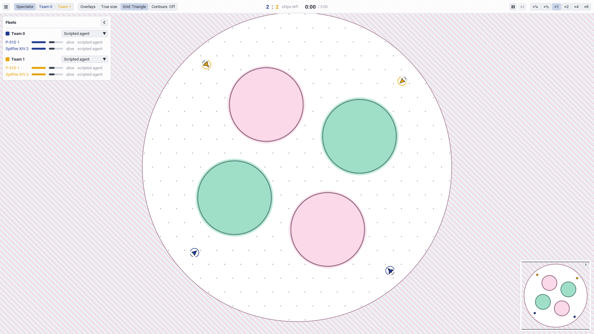

# Modes

A mode is the game's rules on top of the physics: a clock, a win rule, an objective, where
ships spawn, which ships are protected, and the mode's part of the observation. Modes live
in `bnb.game.modes` and are pure like the rest of the game. The spec is
`docs/rewrite/sections/modes-spec.md`; Frontline's capture rules are checked against v1's
code by the fixtures in `tests/reference/rewards`.

The modes are `bnb.contracts.config.MODES`:

- **team deathmatch**: score by deaths;
- **Frontline**: capture zones around a ring and push the front;
- **elimination**: team deathmatch without respawns and with a boundary that shrinks
  past the centre before the clock's end, so every ship dies: wipe out the other team
  first (ships that die on the same tick go to the health left, the living ships' shield
  fractions, summed);
- **sandbox**: the physics game alone, with no score and no win, only the clock. The race's
  reference tests run in it.

## Clocks and presets

A match ends when its clock runs out or when the win rule ends it. The clocks by mode
(`bnb.game.modes.rules.CLOCKS`), which a `GameConfig` or a pool may override:

<!-- generated: mode-clocks -->

The game presets (`bnb.game.modes.rules.PRESETS`): the training ones (5v5 at 10 fields),
the fleet-size evaluation ones (`<base>_<n>v<n>_arena` and `_density`), and `arena`, a 2v2
team deathmatch of the real-scale ships on a 1950 m map with no fields, where a ship killed
spawns again on the next tick. Its lineup, one Yongma and one Jujak a team, is its
own (`LINEUPS`, as type indices by `bnb.game.api.preset_lineup`); every other preset plays
the game's default, the set's first two types alternating (`Rules.team_types`). The lineup
is kept beside the config, not in it, because a policy file records every field of its
game's config and one recorded without a field is another game. The arena is about three
full-stick turn circles of its two ships across (each turns at about 500-600 m at its
162 m/s cruise): first set at 1300 m, two circles across, and widened by half for more
room. Its ships come within gun range (about 600 m) within seconds of spawning: in the
scripted agent's 2v2s on it, 0-12 s after the start, the first kill 9-23 s in, with 3-10%
of the ships' time beyond the boundary (at 1300 m: 0-7.5 s, 6-14 s and 10-16%).
`real_scale_deathmatch` plays a 4200 m arena (the author, 2026-11-13), smaller than the
real-scale map's 7800 m, which `real_scale_frontline` keeps.

A game at another fleet size takes its arena radius from `bnb.game.api.arena_radius_for`
(game v16): the density rule (the base game's radius times sqrt(n / n_base), so the ships
stay as crowded), times an optional arena scale, then at least the mode's minimum
(`bnb.game.modes.rules.MINIMUM_ARENA_RADIUS`, m at map scale 1 times the ship set's map
scale, 3 for the real-scale set). Team deathmatch's minimum is 1000 m, 3000 m at real
scale: by the rule alone real-scale 2v2 and 1v1 would play 2656 m and 1878 m arenas.
Elimination and frontline have none for now. The minimum applies after the arena scale,
so a map drawn at half size is still floored. The `_density` fleet presets and Clover
take their radius from it; the `arena` preset's 1950 m is its own choice, not derived.
`real_scale_elimination` is elimination at the training size (5v5, 10 random fields, the
7800 m real-scale map, 180 s); `clover` is the author's 2v2 elimination map with a fixed
layout (see [Fixed layouts and Clover](#fixed-layouts-and-clover)). A config's fields may be
0 to 64; with none the medium is uniform (an index of 1 everywhere) and nothing blocks
sight.

<!-- generated: game-presets -->

## The mode phase

The mode phase (`bnb.game.modes.phase.mode_phase`) runs inside `resolve`, after damage,
death and shields and before the clocks. It updates the mode state, emits the two
objective events and decides whether the match is won.

- `done` is the clock or the win.
- `result` is for team 0: +1 a win, -1 a loss, 0 a draw. It is the win rule's when the win
  ended the match, otherwise the clock rule's (`bnb.game.modes.phase.clock_result`), and 0
  where the match goes on.
- `objective_progress` and `objective` are signed amounts per ship, each summing to zero
  over the environment. Team deathmatch and sandbox emit zero.

When a match ends, the environment gets a new map and a fresh mode state
(`bnb.game.modes.phase.new_match`), and every ship spawns by the mode's placement.

## Team deathmatch

- **Respawn:** a dead ship respawns after a fixed wait: 10 s at real scale (the author,
  2026-11-13; the `real_scale_deathmatch` preset's), 4 s in the standard game. There are no waves. The wait is the `bnb.contracts.pools.Pool.respawn_seconds` setting, shown in the
  Map / mode panel's Team deathmatch group.
- **Score:** every death scores one point for the other team, whatever its cause: an
  enemy's hit, friendly fire or the boundary.
- **Win:** the first team to `kills_per_ship * ships_per_team` points. Both reaching it on
  the same tick is a draw. At the clock the higher score wins, and equal scores draw. With
  benched ships (below) a team's target is `kills_per_ship` times the enemy's *active*
  ships (`bnb.game.modes.phase.deathmatch_targets`), and the observation's `score_target`
  is the viewer's own.
- **Spawns, uniform:** each spawning ship draws candidate points uniformly over the arena
  and takes the one farthest from the nearest living enemy. At a reset, when every ship
  spawns at once, each ship's first candidate stands in for its position, and each ship
  takes the candidate farthest from the nearest enemy's. One pass serves both, and nothing
  in it depends on the team or sim index.
- **Spawn headings:** random, but never so far outward that the ship cannot turn away from
  the edge in time: within `Rules.spawn_turn_distance` (75 m in the standard set, 436.5 m
  in the real-scale one, the set's largest full-stick turn excursion from spawn speed) of
  the edge, a heading's outward cosine is at most the distance to the edge over that
  distance, tangent at the edge. The draw is spread evenly over the allowed directions,
  and from that distance inward it is the plain uniform heading. In the arena, where a
  killed ship spawns anywhere on the next tick, that band is 40% of the map's area (and
  the best-of-8 candidates, kept away from the enemy, lean outward).
- **Spawns, grouped** (`spawn_groups`, for example `(2, 2, 1)`): at a reset the groups'
  centres are spread over the arena, and each team's ships are assigned to groups by
  formation rank. A respawn lands at a distance from an anchor, a random living ship of
  either team, choosing the candidate farthest from the nearest living enemy.

## Elimination

Team deathmatch's variant with no respawn (the author, 2026-11-12). It scores as team
deathmatch, every death a point for the other team, with one kill per enemy ship to win
(`ModeRules.kills_per_ship` is 1 whatever the config's), so a team with no ship left loses.

- **No respawn:** a dead ship waits the episode's whole length (`CLOCKS` gives elimination
  no respawn wait, and `bnb.game.rules` sets it to the episode's), so it is still waiting
  when the episode ends. A config takes no `respawn_seconds` in elimination, and the live
  tuning's episode length moves the wait with it.
- **At the clock** (`bnb.game.modes.phase.clock_result`; since the boundary closes first,
  in practice a lead set shorter than a shield's life): the team with more health left wins
  (game v12): each living ship counts its shield over its type's full shield, 0 to 1,
  summed by team (the shield is the game's only health: a ship whose shield is gone dies to
  any damage). Equal, a draw. The rule is zero-sum, so the side behind has to attack: a
  side that runs from a losing fight cannot run out the clock into a draw. The RL outcome
  reward reads the same result (`bnb.learn.rewards.outcome_events`).
- **Spawns, by team side** (game version 7; `bnb.game.modes.spawns.side_placement`): the
  teams start on opposite sides, not as a lottery. Each team's area is a disc of
  `ModeRules.side_area_fraction` (0.15) arena radii around its centre, `Rules.spawn_offset`
  (0.8) arena radii out along the match's spawn axis; each ship a uniform point in it,
  nose toward the enemy area's centre within `side_heading_jitter` (15 degrees), turned
  the least that keeps team deathmatch's edge rule. A fixed layout's spawns (Clover)
  replace it.
- **The boundary shrinks** (game v14, closing before the clock since v16;
  `bnb.game.layout.boundary_fraction`): it stays at the arena radius for
  `ModeRules.shrink_hold_seconds` (18 s, 36 s at real scale: a fifth of the clock), then
  shrinks, linear in radius (`shrink_law` 0, the default) or along the smootherstep (1: a
  smooth start and end), past radius 0 to minus one ramp width, which it reaches
  `shrink_end_lead_seconds` (8 s) before the clock. Boundary damage (see
  [physics](physics.md)) is measured from the boundary as it stands, so a side that keeps
  away from the fight is pushed back into it, and the end time does not depend on how the
  sides fly. A negative radius puts every point beyond the boundary: from the zero
  crossing even a ship at the centre is hurt every tick, so its shield does not recharge,
  and from the close it takes the boundary's most. The lead is set so the largest shield
  of either set dies in it: 160 at 30 per s (40 at real scale) is 5.3 s, plus a tick to
  kill a broken shield, leaving 2.6 s of margin before the damage between the zero
  crossing and the close is counted. So every ship dies before the clock; the tie-break
  below decides only ships that die together. The three settings are live, in the Map /
  mode panel's Elimination group. Positions and every map length keep the arena radius
  as their scale; only the boundary moves.
- **Observation:** the `mode_elimination` flag; the scores are the kills and the winning
  score is the enemy's (active) ships. The globals `boundary_fraction` (the boundary's
  radius over the arena radius, 0 once it has passed the centre) and
  `boundary_time_to_zero` (seconds to the zero crossing, then 0) show the shrink.
- **Clock:** 90 s by default, 180 s at real scale (both presets): a short episode.

## Fixed layouts and Clover

A game config may carry a fixed map, `GameConfig.layout`
(`bnb.contracts.config.MapLayout`), in team deathmatch or elimination; without one the map
is drawn at every new match, as before. A layout lists half its fields
(`FixedField`: centre, radius and the levels it draws from), each with its image under the
map's 180-degree rotation, so the map stays point-symmetric and both seats meet the same
map; a field and its image draw one level per match (`bnb.game.modes.phase.layout_fields`,
from the uniform a random map spends on that field's level). Its spawns (`FixedSpawn`:
position, a heading or none for toward the centre, position and heading jitter) are team
0's by slot, team 1's their images (`bnb.game.modes.spawns.layout_placement`). With
`rotated` (the default) the whole layout turns about the centre by the spawn axis's
uniform angle at every new match, so a fixed map is met at every bearing, as random maps
are, and the model's position codes see it everywhere. The layout is part of the mode's
rules (`ModeRules.layout`), so a batch slices games of different layouts apart. Saved maps
keep it (`game.layout` in the map's file).

**Clover** (`clover`, the author's design): a 2v2 elimination of the real-scale ships,
180 s. Its arena, 4933.2 m, is the real-scale map at 2 ships a side by the fleet presets'
density rule (radius as the square root of the fleet: 7800 sqrt(2/5)). Four fields of
radius 1233 m (a quarter of the arena radius) sit in a square, their centres at 0.45 arena
radii on the diagonals: upper right and lower left high index (+1 or +2, drawn together),
upper left and lower right low (-1 or -2), four combinations. Each team's two spawns lie at
0.875 arena radii, each between a high and a low field: team 0 at 1 and 4 o'clock, team 1
at 7 and 10, nose to the centre, with up to 150 m and 5 degrees of jitter. Turned half a
turn, team 0's situation is team 1's exactly. Clover plays the game's default lineup
(Yongma and Jujak alternating).

## Benched ships

Unequal teams at one static size, for evaluation (the crossover, `bnb crossover`):
`bnb.game.api.reset`, `bnb.game.api.step`, `bnb.game.api.resolve` and
`bnb.game.api.perceive` take `active`, (B, 2) int32, each team's
active ship count per environment, a runtime input, so one compiled graph plays every
handicap at once. A team's benched ships are its last `ships_per_team - active` slots
(`bnb.game.state.benched_of`). They are kept as dead ships waiting to respawn: alive false,
`respawn_wait` held at the full respawn length, the speed floor and a still nose, at the
point their last spawn placed them. So they never fly, fire, take or deal damage, score,
give the enemy a point, respawn or show to the enemy, and a reset's spawns keep no distance
from them. In the observation their rows are a dead ship's: alive 0, fired and spawned 0,
`respawn_wait` the full respawn length; the enemy's view shows them not visible (hidden
columns zero), and their own team's view shows them as it shows its own dead ships
(visible, with the frozen values, no accelerations). With every ship active (or `active`
None, as in training) the game is bit-identical to the game without the input
(`tests/sections/test_benched.py`).

## Frontline

- **The ring:** `bnb.game.modes.frontline.ZONES` zones on a circle around the
  centre, at a random rotation and a random handedness (clockwise or counter-clockwise). At front 0 their roles are, in ring order:
  neutral, team 0's spawn, team 0's defense, team 1's defense, team 1's spawn.
- **Meters:** only the two defense zones have meters, from 0 to 1. A meter moves only on a
  strict majority of the living ships inside its zone: it rises while the attackers
  outnumber the defenders there, and falls while the defenders outnumber the attackers. Its
  rate is the harmonic number of the lead (1, 1.5, 1.83, ... for a lead of 1, 2, 3, ...)
  over `capture_seconds`, so a lead of one fills an empty meter in `capture_seconds`.
- **Captures:** a full meter captures. The front moves one step in the capturing team's
  favour, every meter empties, and the roles rotate around the ring.
- **Win:** a front of `front_threshold` captures ahead. At the clock the sign of the front
  decides, and 0 draws.
- **Capture lock** (game version 8): after a capture, the team that lost the zone gains no
  capture progress on it for L seconds: its majority there does not move the meter (a
  defending majority still does), so the zone cannot be taken straight back. L is set by
  the ring's size, `lock_seconds_per_root_km` x sqrt(d / 1 km), d the distance between
  adjacent zone centres. The default, 19 s per sqrt(km), is about 45 s at 5v5 on the
  real-scale map (d = 5.64 km), 54 s at 10v10 and 64 s at 20v20: the hard lock at which
  the team that captured is about as likely as the other to capture next (P = 0.5 in
  the frontline design bench, bench/frontline_design.py on the tune/respawn-waves branch), to be calibrated again on the final ship card. The state
  holds it per team and zone (the `bnb.game.state.ModeState` field lock, ticks), so it is exact for any sequence
  of captures; `frontline.lock_ticks`, `locks_after` and `attacker_locked` compute it.
- **Respawn waves** (game version 8): a dead ship waits its minimum (`respawn_seconds`, 8 s
  at real scale and 4 s in the standard game) and then respawns at its team's next
  respawn wave. Each team's waves come every `wave_seconds` (20 s at real scale, 10 s in
  the standard game), from a random phase per team drawn at the match's start (uniform
  over one interval, from two of the mode's uniforms), and a capture does not move them.
  The state holds each team's ticks to its next wave (`ModeState.wave_wait`); the wave
  lands on the tick it reaches 0 and the next is an interval later. `wave_seconds` 0
  turns the waves off (every tick lands), which leaves the fixed wait. The respawn waves
  study (docs/rewrite/sections/respawn-waves/progress.md on the tune/respawn-waves branch) found the waves move the pace
  (an earlier first capture, shorter games) and not the momentum.
- **Spawns:** a ship spawns at a random point near its team's current spawn zone, facing
  the zone its team attacks.
- **Spawn protection:** a hit on a ship inside its own team's spawn zone deals no damage.
  The bullet is still spent. Boundary damage is unaffected.
- **Objective events,** two amounts per ship, each summing to zero over the environment:
  - `objective_progress` follows the meters. When a meter moves, the side the move favours
    shares the size of the move among its ships inside the zone, and the other side loses
    the same amount, shared among its ships outside the zone (all its ships, if none is
    outside). The tick that completes a capture pays nothing here.
  - `objective` follows captures. A capture is worth +1 to the attacking side and -1 to the
    defending side. Within each side, half is shared among the ships in the zone on the
    completing tick, and half by an attempt ledger kept while the meter rose: attackers are
    credited for being present, defenders charged for being absent.
- **The map** is mirror-symmetric about the axis through the centre and the neutral zone.

## The mode's rules

`bnb.game.modes.rules.ModeRules` holds each mode's constants, as Python numbers that
compiled graphs specialize on:

<!-- generated: mode-rules -->

## The mode's observation

- **Zones:** every mode has the same zone slots (`bnb.contracts.obs.ZONE_SLOTS`), so a
  model sees the same tokens in any batch. A mode without zones shows them absent. Each
  view lists the zones in its own ring order, with roles, meter direction and the
  captures still needed to win or lose all relative to the viewer, so the order reveals no
  seat (`bnb.game.modes.observation.zone_rows`).
  Each zone row also carries the capture lock left on the viewer's team and on the
  enemy's (`lock_own`, `lock_enemy`, seconds): zone state is public, so both teams see
  both.
- **Globals:** the mode one-hot (team deathmatch, Frontline, elimination), the scores by
  team and the winning score, the front for the viewer and the winning front, and in
  Frontline the seconds to the viewer's own team's next respawn wave (`next_wave_own`)
  (`bnb.game.modes.observation.mode_globals`). The enemy's wave clock is hidden. It can
  be inferred, though: every ship's `alive` is shown, so an enemy wave that brings back a
  dead ship reveals the enemy's phase, which then repeats every interval.

The columns are listed in [Contracts](../contracts.md).

## How a mode runs in a batch

Each hook takes its mode's `ModeRules` and dispatches on the mode's name in Python, so a
compiled graph holds only the rules of the modes in its batch. In a batch of several games
each hook runs on its mode's slice only; see [Mixed batches](mixed-batches.md).
[Adding a mode](../../guides/adding-a-mode.md) lists every hook.
