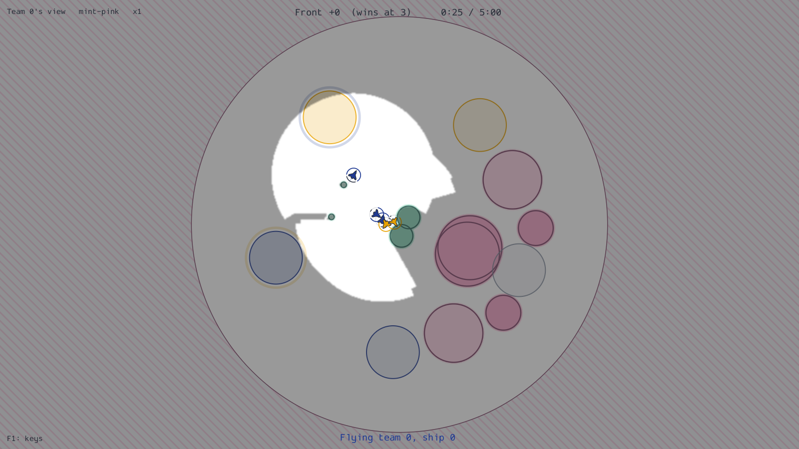

# The play shell

<!-- generated: section-status -->

The play shell (`bnb.play`) is a desktop window that plays one match at the display rate:
the realtime sim at its fixed tick underneath, the game drawn in shaders on top, and a
layer of Dear ImGui for the HUD and the panels. It adds no game rules. It reaches the game only through
`bnb.game.api`: it reads a tick through one pure function, `bnb.play.snapshot.snapshot`,
and draws the medium, the cores and the zones with the game's own functions. [Playing and spectating](../../guides/playing.md) covers the
keys, views, themes and offscreen renders.

## The match loop

`bnb.play.loop.MatchLoop` holds a `bnb.runtime.realtime.Realtime` match, compiled, at its
fixed tick. Every ship plays `bnb.controllers.scripted.Chaser`, except at most one, the
pilot, flown from the keyboard.

The loop runs on one thread with a fixed timestep:

1. Each frame adds the elapsed display time, times the time scale, to an accumulator.
2. The sim steps while the accumulator holds a whole tick.
3. The frame draws at `alpha = accumulator / tick` between the last two snapshots.

So the drawn state lags the sim by at most one tick. Pausing stops the accumulator, and
`MatchLoop.single_step` advances exactly one tick. A backlog beyond `CATCH_UP_TICKS` ticks
per unit of time scale is dropped, so a stall does not snowball.

The loop draws no random numbers. Given the same seed and the same per-tick actions, it
produces the same states as `Realtime` alone
(`tests/sections/test_play_loop.py::test_the_loop_gives_the_same_states_as_realtime_alone`).

## The snapshot and interpolation

`bnb.play.snapshot.Snapshot` is one tick of one match as numpy arrays: the ships, bullets,
fields and zones, the arena, the clock, the score or the front, and each team's
visibility from its own observation's `visible` column. `snapshot` copies every value, so
a snapshot does not change when the sim steps on. Its `fogged` flag says whether the
match has fog of war.

`bnb.play.interpolate.interpolate` gives the drawn state between two snapshots:

- positions, shields and energies are linear;
- headings take the shorter way round;
- a ship that spawned or respawned draws at its new state, with no interpolation across
  the teleport (an episode reset spawns every ship and clears every bullet);
- a bullet fired on the later tick draws from its launch point, the shooter's position at
  the earlier tick, where the game fires it from.

Rendering reads only snapshots and never imports torch
(`tests/sections/test_play_layers.py`). This keeps the renderer independent of the sim,
as the client design requires: the client sim is CPU torch, the agents run in ONNX
Runtime, and rendering is OpenGL.

## The passes

The renderer (`bnb.play.render.renderer.Renderer`) draws into a multisampled framebuffer
and resolves it onto the target, then draws the ImGui layer. The passes, in order:

| Pass | Draws |
|---|---|
| Sky | The sky inside the arena disc; beyond it the boundary damage zone, hatched in the theme's boundary colour, and a line on the edge. |
| Fields | A topographic map of the true refractive index: terraces filled by sign (thin air below ambient, thick air above), stronger with depth, and a contour at every third of a level. The core edge is drawn bold. |
| Zones | Frontline's zones, tinted with their owner's colour, with each defense zone's capture meter as an arc in the attacker's colour. |
| Trails | Each ship's recent path, a strip that tapers and fades with age, and in hard turns a faint vortex line from the inside wingtip. A dead ship's trail fades out where it ended. |
| Bullets | Short streaks along each bullet's direction, in the shooter's team colour. |
| Ships | Silhouettes from the Komet family, filled with the team colour, every ship outlined. A ship type without a silhouette of its own draws a plain dart. |
| Rings | One ring at the hitbox: the shield on an arc centred on the nose, the energy on an arc centred on the tail, each shrinking toward its centre as it empties. |
| Fog | In a team's view, everything the team cannot see is multiplied by the theme's fog colour: darker, with its saturation kept. |
| HUD | The clock, the score or the front, the flown ship's respawn timer, the view, theme and time scale. |

Ships, rings, bullets and trails keep a minimum size on screen, so they stay visible at the
full-arena zoom. Lines are antialiased in their shaders, and the ships by the multisampled
framebuffer.

### The index texture

The fields pass draws from a float texture of ln n on a grid over the map,
built by `bnb.play.index_map` with the game's own medium (`bnb.game.api.log_index`). Fields
are static within an episode, so the grid is built once per map. The grid is a square
over the arena and every field's outer edge (`bnb.play.index_map.grid_for`). Its texel is
`TEXEL_METRES` at map scale 1 and grows with the map, so maps whose fields stay inside the
arena all have a texture of one size, and a field that reaches past the arena makes the
texture larger. Only tiles that touch a field's outer edge are evaluated, each with only the
fields that touch it; beyond every outer edge ln n is exactly 0. A new map is built a
few tiles per frame (`IndexBuilder.run` with a time budget), so a map change does not stall
a frame.

The shader samples the texture with a bicubic (Catmull-Rom) filter through the texel
centres, which keeps the contours smooth at the closest zoom. The contours are lines of
the sampled ln n, antialiased with screen-space derivatives, and fade where they would be
closer together than a few pixels.

The bold line on each core edge is drawn from the field geometry, at
`bnb.game.api.core_radius`, the radius at which the game's sight test blocks a sight line
(`tests/sections/test_game_api_display.py::test_core_radius_is_where_the_sight_test_blocks`).

### The fog mask

In a team's view the renderer first draws a visibility mask in screen space, at
`MASK_SCALE` of the target's resolution: a fragment shader applies the sight rule of
`bnb.game.perception.sight.sighted` to the world point under each texel, against the team's
living ships and the field cores. A test holds the mask to `sighted` at every texel away
from the mask's edges
(`tests/sections/test_play_render.py::test_fog_mask_agrees_with_sighted`). The game's
own function on the CPU was too slow for a frame budget at large fleets; the shader runs
the same rule on the GPU.

Every bullet is drawn in every view; agents never see bullets, so this is an advantage
human players have. Ships come from the observation instead: a team's view draws only the
ships its observation shows (a ship that fires is visible while it fires, by the game's
sight rule). Each trail sample records which teams saw
the ship then, so a team's view draws only the parts of an enemy's path it saw; an enemy
revealed for a moment by firing does not show where it came from. Terrain (the arena, the
fields and the zones) stays drawn under the fog.

In a match without fog of war every ship is visible to both teams, so a team's
view has no fog: it draws everything and darkens nothing.

## Themes

A theme is a TOML file holding every colour the renderer uses, as hex codes, plus two
numbers (`bnb.play.themes.Theme`). The shipped themes, in `src/bnb/play/themes/`, are
read-only; the user's live in a per-user configuration directory
(`bnb.play.themes.Library`). The colours reach the shaders as uniforms each frame, so a
change shows on the next frame. The theme editor (`bnb.play.theme_editor.ThemeEditor`)
edits them live and saves new theme files to the user's directory.

## The keyboard pilot

`bnb.controllers.human.human_action` maps an input array, in `bnb.controllers.human.INPUTS`
order, to one ship's action. It is a pure function: the window fills the array from the
keyboard each frame, and the tests check that every power, stick level and shoot is
reachable. A pilot flies through the same action contract as any other controller.
