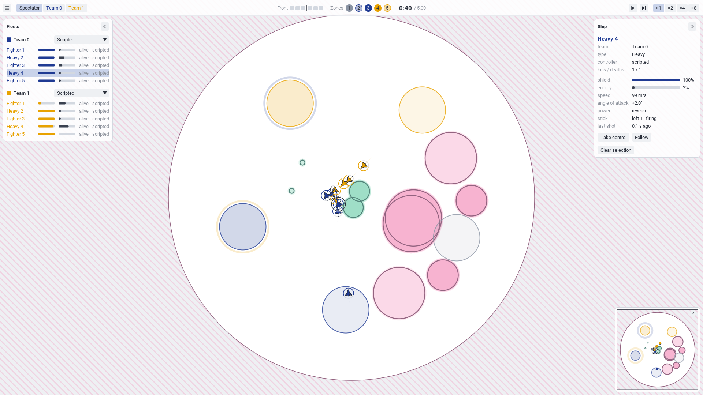
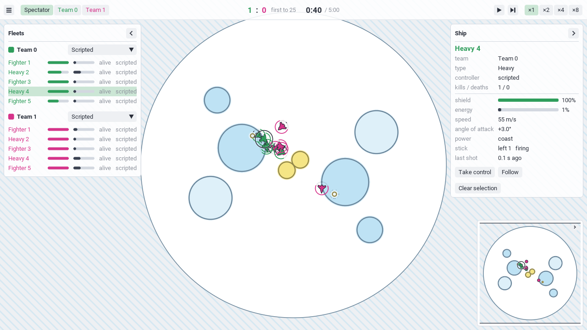
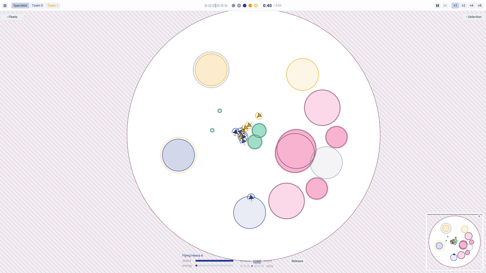
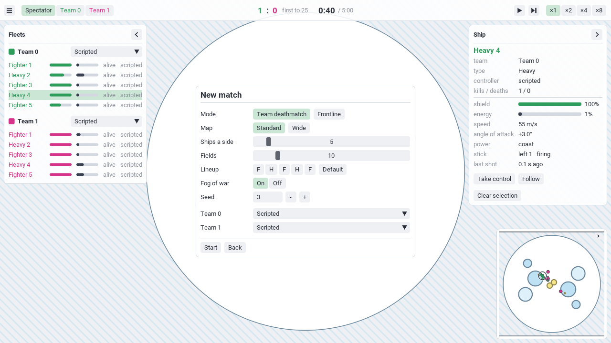
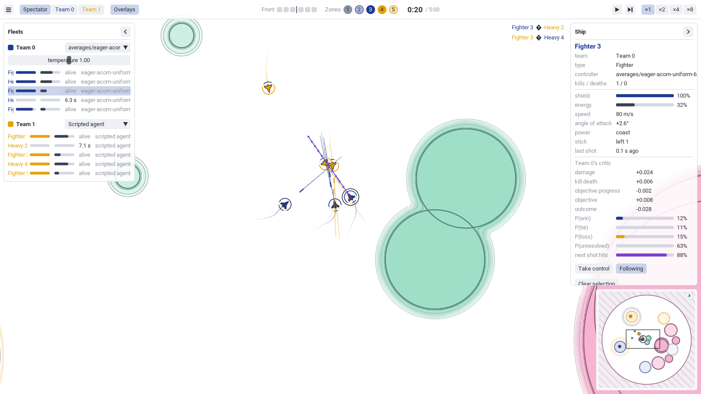
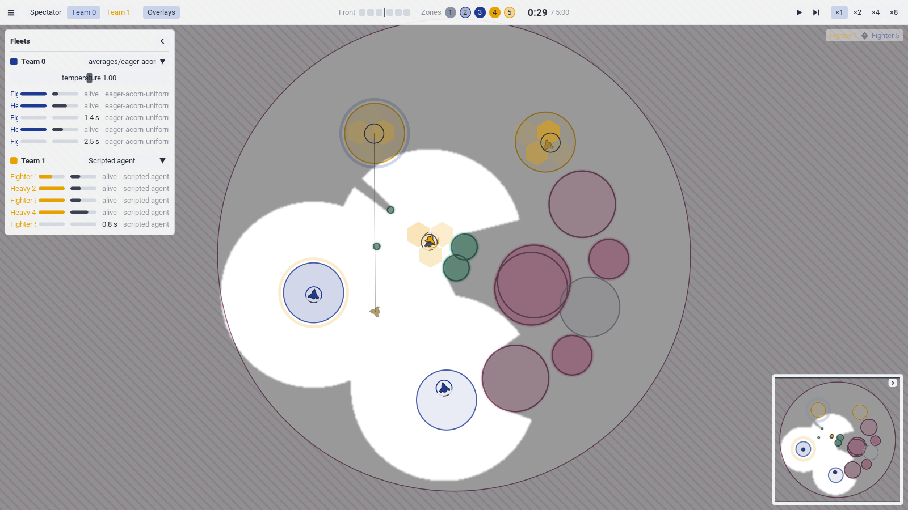
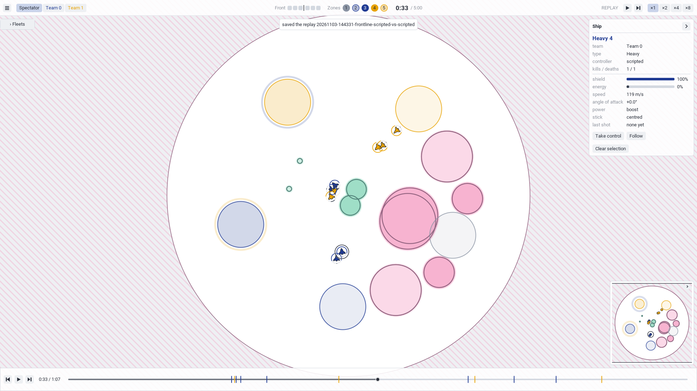

# Playing and spectating

The play shell opens a window on a match: watch it, fly any ship, pause and step it, play
it against a trained agent, and replay it afterwards. Everything has a control on screen;
the keys are optional shortcuts, and each control's tooltip names its key. How it works is
in [The play shell](../explanation/in-progress/play-shell.md).



## Start

<!-- not-runnable: opens a window -->
```bash
uv run bnb play
uv run bnb play --preset frontline --view team0 --seed 3
uv run bnb play --preset real_scale_frontline
uv run bnb play --agent1 runs/<run>/policy
```

The first match comes from the options (a preset, and the sizes that override it); every
later one from the menu's **New match**. A new kind of match starts at once and never
stalls the window: the first time a game (or a changed version of the code) is played, its
tick is built in a separate process (about 30 s) while the match runs the uncompiled tick,
which keeps up to ×2; the built tick is kept in the user's cache directory, so every later
match of that game starts compiled. The options:

<!-- generated: play-options -->

## The screen

- **The top bar** (always shown): the menu button, the view selector and the
  **Overlays** button (see [Prediction overlays](#prediction-overlays)) on the left; the
  score, or Frontline's front and zones (captioned "Front" and "Zones", each zone numbered
  in its owner's colour, with a tooltip saying what it shows), and the clock in the middle; the speed controls
  on the right: pause or play, one tick while paused, and ×1, ×2, ×4, ×8.
- **The fleets card** (left): each team's ships, with type, shield, energy, alive or the
  respawn wait, and who controls it. Click a row to select the ship. Each team's
  controller is chosen here (see below).
- **The selection card** (right): what you selected. A ship shows its live state (shield,
  energy, speed, angle of attack, power and stick, the last shot), kills and deaths, and
  the buttons **Take control** and **Follow**; a field its refractive index and core; a
  zone its owner, progress and the ships contesting it.
- **The minimap** (lower right): the whole arena, with the camera's view as a rectangle.
  Click or drag on it to move the camera.
- **The kill feed** (upper right): the last few kills, in team colours.

Each card's chevron collapses it to a slim tab on its edge; the tab opens it again.
Clicking a ship, field or zone on the battlefield, on the minimap or in a card selects it;
dragging the battlefield pans and the wheel zooms.



## Views

The view selector (or V) chooses:

- **Spectator:** no fog; every ship and every bullet is drawn.
- **Team 0** and **Team 1:** what that team sees. Fog of war is on by default
  (`--no-fog` turns it off): what the team cannot see is darker, its colours kept, and
  only the ships the team sees are drawn, with the parts of their trails it saw. The
  minimap shows the same. Every bullet is drawn in every view, above the fog at full
  brightness; agents never see bullets. In a team view only what the team sees can be
  selected.

Without fog of war every ship is visible to both teams (see
[Perception and fog](../explanation/game/perception.md)), so a team's view looks like the
spectator's.

## Flying a ship

Select a ship and press **Take control**. Its side keeps controlling every other ship. The
camera follows it, zoomed in from the whole-arena view, the cards collapse (their tabs open them), and a small HUD at the
bottom shows the shield, energy, power and stick:

- W and S: boost and reverse (neither: coast);
- A and D: turn left and right, Shift for the full turn, Ctrl for the lightest;
- Space: shoot.

**Release** (in the HUD or the selection card) hands the ship back.



## New match and trained agents

The menu (the top bar's menu button, or Escape) pauses a live match and offers **Resume**,
**Restart**, **New match**, **Replays**, **Save replay**, **Settings** and **Quit**.

**New match** chooses the mode, the map (**Standard**, **Wide**, or **Real scale**: the
[real-scale variant](../explanation/game/real-scale.md), where a metre is a metre and the
27 types are late-war fighters from the P-51D to the Me 262 and a few invented designs,
on a map three times the standard one), the ships a side, the
fields, the lineup (a dropdown per slot of the map's ship types, the same for both teams;
**Default** alternates the first two), fog, the seed, and
each side's controller: **Scripted** (the chaser), **Scripted agent** (the scripted agent
with its memory, `bnb.controllers.scripted.Scripted`: it remembers each enemy it saw and
dead reckons it while hidden; `--scripted0 scripted_agent` starts with it) or a trained
agent. A scripted agent needs its ship card's characteristics, measured once per card in a
separate process (about 15 s on a laptop CPU) and kept in the user's cache directory; until
they are measured the side plays on as it was and a notice says the agent will take over.
An agent that runs on the GPU captures its step aside the same way before it plays. The agent list is
every policy file of the local runs: `runs/*/policy/`, the training checkpoints and the
league's snapshots (`--runs` sets the directory). A policy plays only the game it was
trained on, with the same ship card and the default lineup; otherwise the shell says
what differs and keeps the match as it was. A policy trained on a mixed batch records the
batch's first game (frontline), so the shell plays it there;
[`bnb figures video`](figures.md#videos) plays it in any mode.

An agent runs on the GPU when there is one (the CPU otherwise) at one decision per tick, with its memory kept from tick to tick
as in training. Its card row has a temperature: 1 samples the policy as trained, lower is
more deterministic, 0 always takes its most likely action. A team's controller can also
be changed in the fleets card during a match.



## Prediction overlays

The **Overlays** button opens a submenu that draws, on the battlefield and while the match
plays, what an agent thinks beside what is true. Each overlay is on or off on its own, and
the submenu lists only those the sides being played can provide (`bnb.play.overlays`):

| Overlay | From | Draws |
|---|---|---|
| True bullet paths | the game, every match | each live bullet's flight ahead through the fields, by the game's own transport (`bnb.game.api.bullet_paths`, the learner's re-simulation of a shot) |
| Predicted shot path | a Yemong agent | the selected ship's next shot: the shot head's mean at each age from its launch point, a one-sigma circle at each age |
| Next-state ghosts | a Yemong agent | each ship's predicted pose one tick on, a translucent silhouette with its one-sigma circle |
| Belief ghosts | a Yemong agent | each hidden enemy's believed pose, with one- and two-sigma circles |
| Dead-reckoning ghosts | the scripted agent | each remembered enemy it cannot see, at its recalled position, with a line back to its last sighting; its opacity is the agent's weight on it (the memory states no sigma) |
| Density | a Yemong agent | the density head's expected ships per hex cell |
| Enemy action | a Yemong agent | in the selection card, for a selected enemy: the power, stick and shoot marginals, the action it took outlined |
| Value and outcome | a Yemong agent | in the selection card, for a selected own ship: the critic's value per reward level, the outcome head's P(win), P(tie), P(loss) and P(unresolved), and the next shot's P(enemy hit) |



Scripted against scripted (the chaser) offers the bullet paths only; a relational agent
provides nothing; a replay runs no controllers, so it offers the bullet paths only.

**Whose.** Each side's agent has its own predictions. An overlay draws the side picked
under **Whose**, or by default the selected ship's side when it provides that overlay,
else the other side (with nothing selected, the view's team first). Each entry names the
team it draws.

**Show the truth** adds the truth: a ring at each ghost's true position joined to the
ghost, and the density's **True** and **Error** maps (predicted minus true: over in the
theme's prediction colour, under in its truth colour). **Density** picks the predicting
side's enemy or ally cells. The truth draws in every view, so in a team view it shows
ships the team cannot see.

The predictions are those of the side's latest decision, made from the observation of the
tick before the one drawn, and decoded by the decoder layer as the figures decode them
(`bnb.models.yemong.decode`, see [Figures](figures.md)); the truth beside a ghost is that
tick's (for the next state, the tick it forecasts). While one of its overlays is on, a
Yemong agent decides with `Yemong.inspect`, the same decision with every head's output
from the same trunk pass, so the overlays do not change its play; an agent on a GPU then
steps eagerly instead of from its CUDA graph. Off, the overlays cost nothing.

With a Yemong agent and the scripted agent on the CPU (one torch thread, the tick
uncompiled), every overlay on adds about 5 ms a frame at ×1 (the predictions are made once
a tick: about 4 ms for the agent's heads and 4 ms for the bullet paths) to the shell's
12 to 14 ms.

`--overlays`, `--overlay-side` and `--truth` turn them on from the start:

<!-- not-runnable: opens a window, and needs a policy file -->
```bash
uv run bnb play --agent0 runs/<run>/policy --scripted1 scripted_agent \
    --overlays bullet_paths belief density --truth --view team0
```



## Replays

Every live match is recorded and saved when it ends, or when you quit, to
`replays/<date>-<mode>-<sides>/` (`--replays` sets the directory); the newest 50 are
kept. **Save replay** in the menu saves the match so far. **Replays** lists them; open
one, or start the shell on one with `--replay replays/<name>`.

A replay plays back by re-simulating the recorded actions, so it is exactly the match.
The bottom strip has a tick back, play or pause, a tick on, and the timeline: drag it to
seek, or click a marker (kills in the killer's colour, captures, the match's end) to watch
the seconds before it. Every view, selection and card works in a replay. **Take control**
in a replay starts a live match from that moment, with you flying the ship; the replay
itself is untouched.



## Settings and themes

**Settings** chooses the theme, fog in new matches, the interface scale (0.75 to 2; the
layout works from 1280 × 720 to 2560 × 1440) and shows the key list. The shipped themes
are in `src/bnb/play/themes/`; your own live in your configuration directory
(`bnb.play.themes.USER`; on Linux, ~/.config/boost-and-broadside/themes).

<!-- generated: play-themes -->

**Edit** (or E) opens the theme editor, with every colour of the current theme, the
cards' own included:

- Each colour shows its hex code. Click it and type a new one (`#1F3A93`, or `#RRGGBBAA`
  for the colours whose alpha matters); the swatch next to it opens a picker.
- A change draws on the next frame.
- **Save as theme** writes the colours to your themes as `<name>.toml`, under the name in
  the name field (lowercase words joined by hyphens). The shipped themes are read-only,
  so a shipped name is refused, and replacing one of your own themes asks first.
- **Revert** restores the colours from the theme's file.

To make a theme by hand, copy a file from `src/bnb/play/themes/` into your themes and
change its values; a file must list every value, and `bnb.play.themes.load` names any
value that is missing, unknown or malformed.

## Tuning the game

**Tune the game** in the menu (or F2) opens the tuning panel over a live match, at the
right below the top bar; drag or resize it like any window, and scroll it when it holds more
than fits. Every change takes effect while the match plays; pause first if you want to
compare.

- **Ships**: choose a ship type at the top. Each handle (cruise speed, sustained turn rate,
  climb time, half-lift drag, gun range, shield, ...) has a slider and, beside it, a number
  box showing 4 significant digits: click the box, type a value and press Enter. Hover a
  row for its full name and unit. The ships change within a frame or two, from an instant
  estimate of the card that meets the new values; when you stop, the exact card is solved
  in the background and swapped in, seconds later. A red dot after a box marks a handle the
  ships fly more than 0.5% off its set value; hover the dot for what they fly. The fire
  rate is a choice of the rates a ship can hold (whole shots per second, a whole number of
  ticks apart). The bleed rate is shown, not set: the half-lift drag (the drag of a
  half-stick turn over a full one) sets the drag's shape.
- The sliders show as soon as the panel opens: each type's handles come from its ship
  file, where its card was solved to them. What the ships actually fly is measured in the
  background, the chosen type first, then the types in the match, so a type's red dots
  appear a few seconds after you choose it (tens of seconds for a real-scale type); until
  then the dot's tooltip says "not measured yet". Once a type is measured, a change to a
  combat handle (hit damage, fire rate, gun range, shots per store, shield, ...) is exact
  at once: it does not change how the ship flies.
- **Save ships** writes every type to its file in the match's ship set (`src/bnb/game/ships/`
  for the standard set, `src/bnb/game/ships/real-scale/` for the real-scale one), tracked
  in git: the handles and the card, and the tuned flight constants and bullet life into
  the set's `rules.toml`, as the cards fly under them. **Add a copy as this name** copies the chosen type under the
  name in the field, and **Remove** deletes the chosen type after asking; each starts a new
  match. The last type cannot be removed.
- **Rules**, by group: the arena and the clocks, bullet life, the flight constants every
  type shares, spawns, and the current mode's rules (Frontline's zone radius and capture
  time, team deathmatch's kills to win). Each has a slider and a number box, and applies on
  the next tick; those marked with * are drawn at an episode's start. Hover a row for
  the game's value.
- Changing a flight constant re-measures the handles (the ships keep their card, so what
  they fly changes), each type when it is chosen or plays; a type's handles cannot be set
  until it is measured, a few seconds (tens of seconds for a real-scale type). **Save
  ships** and **Add** need every type's handles: they first measure the ones not yet
  measured, and say so; press again once the status line says exact.
- **Time scale**: **Apply** makes the whole game the given factor faster with the map's
  lengths fixed (speeds x k, gravity and accelerations x k^2, rates and fire rates x k,
  times / k, energies x k^2, so a store keeps its height). Fire rates snap to whole Hz that
  divide 30, and bullet life, clocks and shield delays to whole ticks; the message says
  what snapped. **Make this speed 1×** takes the playback speed (×¼ to ×8 in the top bar)
  as the factor and sets playback back to ×1: pick the speed at which the game feels
  right, then make it the game's own. Save ships and a preset keep the result.
- **Presets**: **Save** writes the ship set, the rule settings and the whole card to your
  configuration directory (`tunings/<name>.json`; the card is what training's `ship_card`
  takes). **Load** applies one to a match of the same set; **Game's numbers** goes back to
  the ship files' and the rules' own.

A new match or a restart keeps the tuning, unless it plays another ship set. Ship counts, fields and the lineup are set in
**New match**. A trained agent given a ship card or lineup it was not trained with plays,
with a warning. A tuned match is not recorded as a replay. The first time the panel opens
on a machine (and after a flight constant changes), the measurement's and the solver's
flights compile first (about a minute); after that they come from the cache.

## Keys

The keys are shortcuts for the controls above; F1 shows this list in the window. They do
nothing while you type into a field.

<!-- generated: play-keys -->

## Offscreen renders

`--offscreen DIR --frames N` renders N frames without a window, through an EGL context,
and writes them to `DIR/frame_0000.png` onwards, with any `--overlays` drawn. The match runs on a fixed clock, so a
seed gives the same frames each time.

<!-- not-runnable: needs an OpenGL 3.3 context (a GPU driver with EGL) -->
```bash
uv run bnb play --offscreen /tmp/frames --frames 120 --preset frontline --view team1
```

## Frame time

`python -m bnb.play.benchmark` measures the frame time offscreen at each game and view,
with every card open, with the [benchmark lock](benchmarking.md) held, and breaks it down
by pass and by stage (`--no-interface` measures the battlefield alone).

<!-- not-runnable: needs the GPU and the benchmark lock -->
```bash
uv run python -m bnb.play.benchmark --games deathmatch frontline --seconds 10
```
