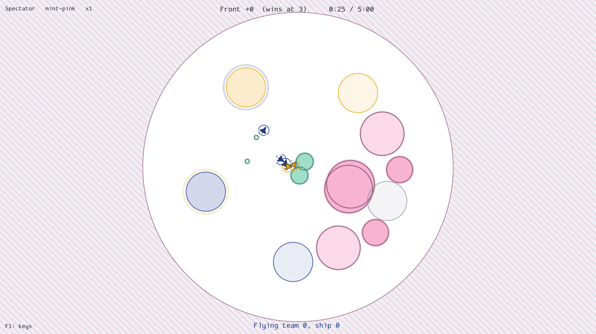
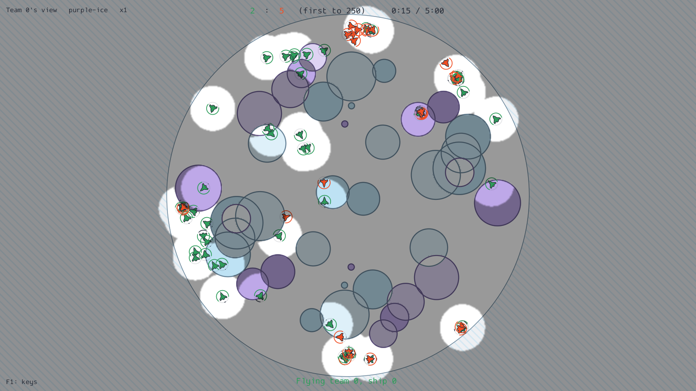
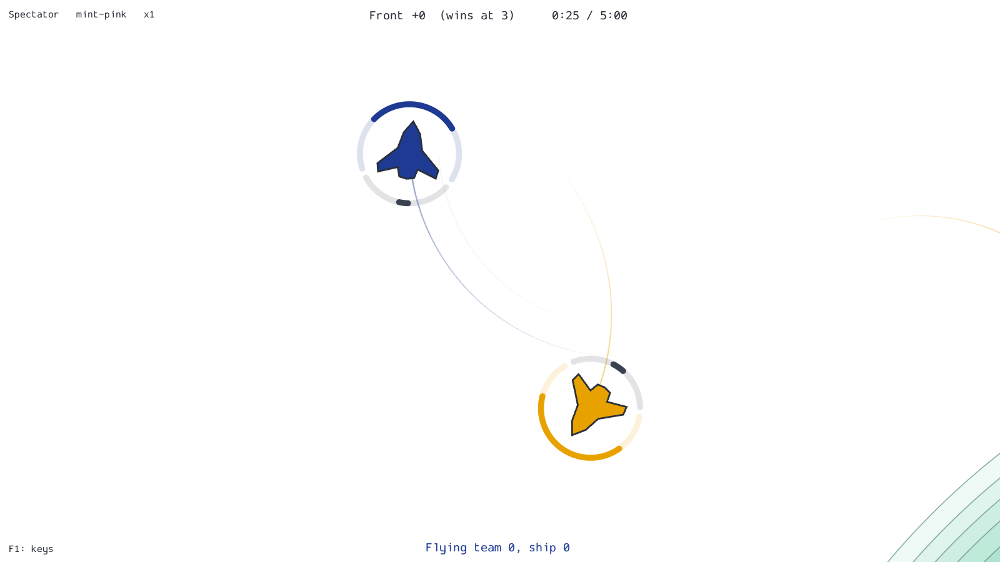
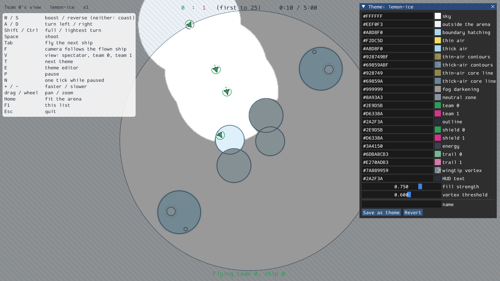

# Playing and spectating

The play shell opens a window and plays a scripted match: every ship flies the chaser,
except one that you fly from the keyboard. How it works is in
[The play shell](../explanation/in-progress/play-shell.md).



## Start a match

<!-- not-runnable: opens a window -->
```bash
uv run --no-sync python -m bnb.play
uv run --no-sync python -m bnb.play --preset frontline --fog --view team0 --seed 3
uv run --no-sync python -m bnb.play --ships-per-team 50 --fields 40 --arena-radius 8222
```

The game comes from a preset (see [Modes](../explanation/game/modes.md)), and the sizes
override the preset's. The first tick compiles the sim, which takes a few seconds;
`--no-compile` starts at once and runs each tick slower. The options:

<!-- generated: play-options -->

## Keys

<!-- generated: play-keys -->

F1 shows the same list in the window. Keys that act once (views, themes, the editor) do
nothing while an ImGui panel has the keyboard, such as while you type a hex code.

## Views

V cycles through three views:

- **Spectator:** no fog; every ship and every bullet is drawn.
- **Team 0** and **Team 1:** what that team sees. In a match with fog of war (`--fog`),
  what the team cannot see is darker, with its colours kept. Only the ships the team sees
  are drawn, with the parts of their trails it saw, its own bullets and the enemy bullets
  inside its sight. The arena, the fields and the zones are always drawn.

Without fog of war the game shows every ship to both teams (see
[Perception and fog](../explanation/game/perception.md)), so a team's view draws
everything and darkens nothing: it looks like the spectator's.



## Flying a ship

You fly team 0's first ship (`--no-fly` to only watch). Tab hands the keyboard to the
next ship in sim order; the ship you leave returns to the chaser. F makes the camera
follow the ship you fly. While the ship waits to respawn, the HUD shows the time left.



## Themes and the theme editor

T cycles through the themes in `src/bnb/play/themes/`.

<!-- generated: play-themes -->

E opens the theme editor, a panel with every colour of the current theme:

- Each colour shows its hex code. Click it and type a new one (`#1F3A93`, or `#RRGGBBAA`
  for the colours whose alpha matters); the swatch next to it opens a picker you drag.
- A change draws on the next frame.
- **Save as theme** writes the colours to `src/bnb/play/themes/<name>.toml` under the name
  in the name field (lowercase words joined by hyphens). The saved theme joins the T cycle.
- **Revert** restores the colours from the theme's file.



To make a theme by hand, copy a file in `src/bnb/play/themes/` and change its values; a
file must list every value, and `bnb.play.themes.load` names any value that is missing,
unknown or malformed.

## Offscreen renders

`--offscreen DIR --frames N` renders N frames without a window, through an EGL context,
and writes them to `DIR/frame_0000.png` onwards. The match runs on a fixed clock, so a
seed gives the same frames each time.

<!-- not-runnable: needs an OpenGL 3.3 context (a GPU driver with EGL) -->
```bash
uv run --no-sync python -m bnb.play --offscreen /tmp/frames --frames 120 --preset frontline --view team1 --fog
```

## Frame time

`python -m bnb.play.benchmark` measures the frame time offscreen at each game and view,
with the [benchmark lock](benchmarking.md) held, and breaks it down by pass and by
stage.

<!-- not-runnable: needs the GPU and the benchmark lock -->
```bash
uv run --no-sync python -m bnb.play.benchmark --games deathmatch frontline --seconds 10
```
