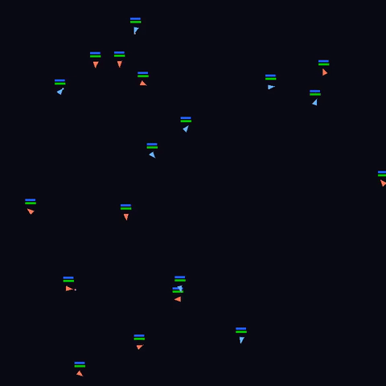
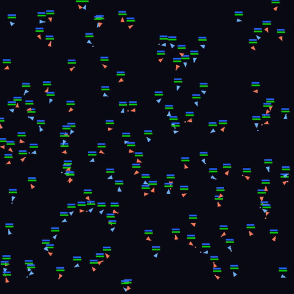

# Replays and qualitative results

These clips complement the aggregate results with examples of tactics at different fleet
sizes. In every `vs_scripted` replay, the learned fleet is blue and the scripted fleet is
red.

**These clips are from an earlier run.** All fifteen show `resilient-resonance-682`,
which was the reference run when they were captured. Every number on this page and in
[evaluation](evaluation.md) comes from `{{run_name}}`, which trained under different combat
physics, a different decision rate, frontal armour and refractive fields — so the footage
shows a policy playing a different game from the one the figures measure. Read them as
illustrations of what variable-cardinality fleet combat looks like, not as the run being
reported. Recapturing them against `{{run_name}}` is
[on the roadmap](../ROADMAP.md).

<!-- Clip slots: chosen wild-universe-731 clips go in docs/results/v1-731/clips/, each
named in docs/figures.yml (clip_hero is the first slot) and placed here with a figure
placeholder. -->

## Primary replay: 8 learned vs 11 scripted



The learned fleet starts three ships down and finishes with three ships to spare. The
matchup is compact and easy to follow, which is why it serves as the README hero.

The quantitative sweep of `{{run_name}}`'s final live checkpoint reports a
{{crossover_8_ships_vs_11_win_rate:.1%}} learned-team win rate at this 8-vs-11 matchup
({{crossover_8_ships_vs_11_wins}} wins, {{crossover_8_ships_vs_11_losses}} losses in
{{crossover_8_ships_vs_11_games}} games) and {{crossover_8_ships_vs_12_win_rate:.1%}} at
8-vs-12; see
[zero-shot crossover](evaluation.md#zero-shot-crossover) for the raw data and statistical
caveats. A clip is one qualitative realization, not the source of those aggregate rates.

## Large-scale transfer: 64 vs 80



The same variable-cardinality execution path at a much larger scale. `{{run_name}}`'s
stored crossover sweep locates the empirical boundary for 64 learned ships between
{{crossover_64_ships_beats_up_to}} and {{crossover_64_ships_crossover}} scripted ships, at a
{{crossover_64_ships_beats_up_to_win_rate:.1%}} win rate over
{{crossover_64_ships_beats_up_to_games}} games, so 80 scripted ships lie beyond what its
final live checkpoint beats on average; this clip is the earlier run's.

## Self-play

[View the 8-vs-8 self-play clip](results/replays/self_8v8_seed01.gif).

In self-play, both sides use the same weights. Team 1 receives a team-flipped observation
because the `ego_pass` policy is canonicalized to the team-0 perspective. Self-play
footage shows execution symmetry; it is not independent benchmark evidence. Additional
self-play clips at 2, 4, 16, 32, and 64 ships per side are in
[`docs/results/replays/`](results/replays/).

## Other asymmetric clips

- [4 learned vs 5 scripted, seed 00](results/replays/vs_scripted_4v5_seed00.gif)
  and [seed 04](results/replays/vs_scripted_4v5_seed04.gif) show qualitative variability
  near the native training scale.
- [16 vs 22, seed 02](results/replays/vs_scripted_16v22_seed02.gif) is an intermediate
  scale.
- [32 vs 44, seed 04](results/replays/vs_scripted_32v44_seed04.gif) is another asymmetric
  matchup near, but below, that size's measured crossover.

## How capture works

[`capture.py`](../src/boost_and_broadside/modes/capture.py):

- loads the final `step_*.pt` checkpoint from the selected run;
- accepts symmetric or asymmetric team-size specifications;
- seeds PyTorch and the environment for each match;
- writes an MP4 by piping rendered RGB frames to `ffmpeg`;
- optionally creates a palette-optimized, downscaled GIF;
- records the terminal winner in console output and holds the terminal state on screen.

For self-play, team 1 uses a second recurrent state and team-flipped observation but shares
the policy weights. For `vs_scripted`, team 1 actions come from the stochastic scripted
controller.

Generate the selected 8-vs-11 scenario with:

```bash
uv run bnb capture \
  --run resilient-resonance-682 \
  --scenarios vs_scripted \
  --sizes 8v11 \
  --seeds 3 \
  --gif
```

Capture writes to `out/`, which is scratch and is never tracked. The curated subset was
copied into `docs/results/replays/` and committed; those committed files are the clips.

## Provenance

A GIF encodes frames and nothing else, so a clip carries no record of where it came from.
Git carries it instead: the tracked file is the reviewed file, and its history says when
it changed and why.

All fifteen come from `resilient-resonance-682`'s final checkpoint, captured with the
command above and the seed named in each filename. The clips do not record their own
capture arguments — there is no sidecar and no poster frame — so the filename and this
page are what identify them.
