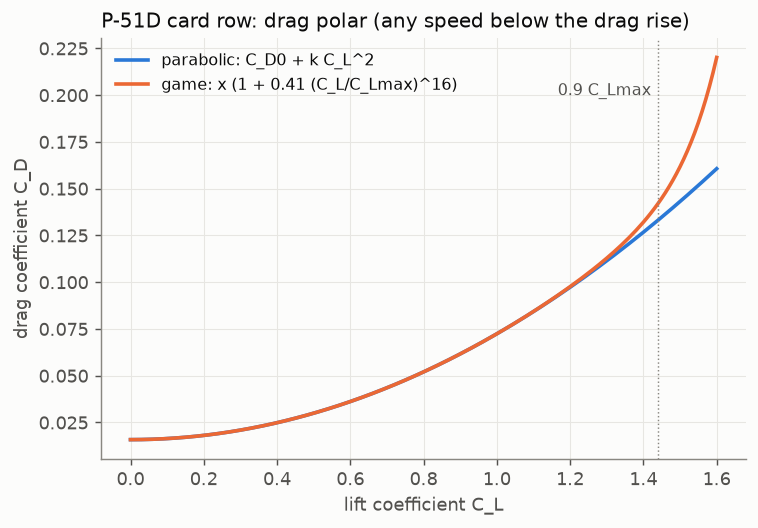
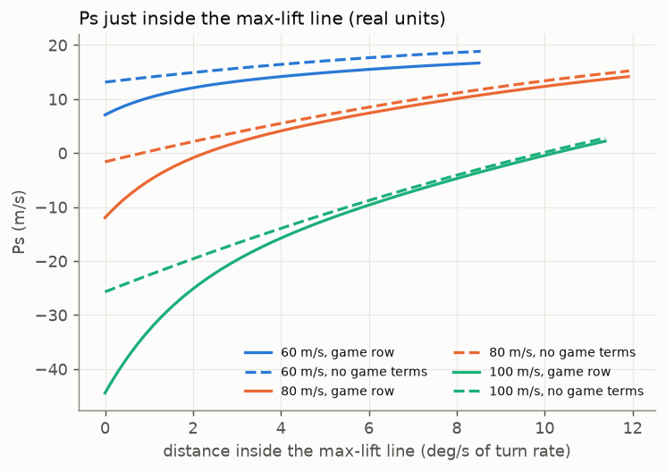
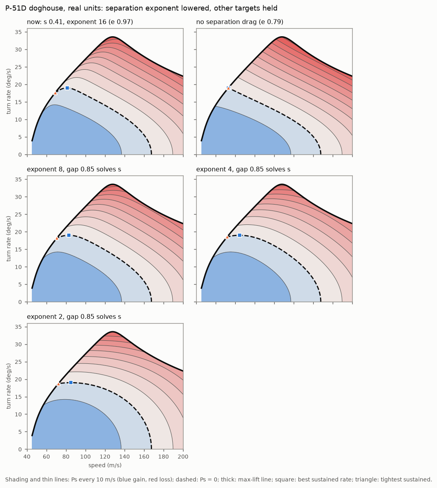
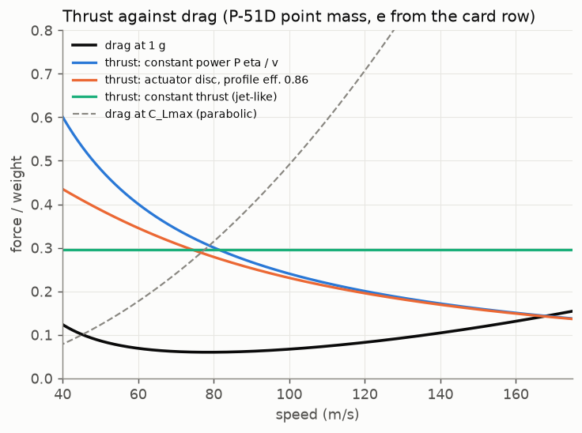
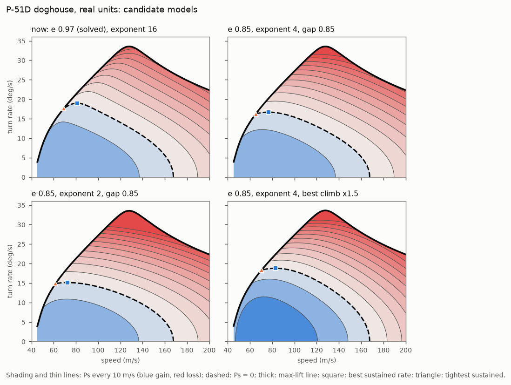

# Doghouse shape: contours at the max-lift line, and the gap

2026-11-24. An investigation on branch `investigate/doghouse-shape` (from `core` 4fd74f5a). No
defaults changed. Every number below was measured by
`docs/rewrite/physics-checks/doghouse_shape.py` with the game's own flight functions
(`core.steady_rates`, float64) on rows solved by `tuning.design_row`. The raw results are in
`physics-checks/doghouse_shape.json`.

Real units throughout (the game at 2x shown at 1x). "e" is Oswald e as `tuning.implied` reads
it back. "Gap" is the tightest sustained turn's speed over the best sustained rate's speed.

## The questions

The author noticed two things:

1. In real energy-manoeuvrability charts, Ps contours cross the max-lift (C_Lmax) line at real
   angles. In ours, every contour slides into the line almost tangentially.
2. The best sustained speed cannot be moved far right. In the performance-points profile,
   pushing it up and widening the gap makes the solve imply e near 4.

The hypothesis to test: the separation drag at a steep exponent (16-24) builds a drag wall
just inside maximum lift, and that wall makes both the tangency and the gap. If so, the gap
should come from thrust and induced drag instead.

## Verdict

- **Tangency: confirmed.** The separation wall causes it. The same row without separation
  drag crosses the line at about 105 degrees. The wall rows cross at 16-21 degrees.
- **The gap: the hypothesis is half right.** The wall does make the gap. But thrust cannot
  make one for a propeller. Prop thrust falls with speed, which pulls the best sustained turn
  *onto* the max-lift line (gap 1.0). A gap needs drag that grows faster than C_L^2 at high
  lift. The separation term is that drag. It just needs to be spread over the upper polar, not
  stacked in the last 10%.
- **e near 4 comes from the targets, not the term.** The 18.99 deg/s sustained-rate target is
  what a *parabolic* point mass at e 0.8 flies. Any extra high-lift drag, with that rate held,
  forces e above 0.8. A steep wall hides the cost, because it adds drag only where the
  tightest turn flies. Asking for a faster best sustained speed makes it worse: in this model
  that speed follows the point where the Ps = 0 line leaves the max-lift line, and the solver
  can only move that point by cutting induced drag.

## 1. The polar and Ps near the line

The game's drag polar is the same at any speed below the drag rise. The card row now has C_D0
0.0158, e 0.965 and separation drag 0.41 at exponent 16.

| | parabolic | game row |
|---|---|---|
| C_D at C_Lmax | 0.161 | 0.220 |
| slope dC_D/dC_L at C_Lmax | 1x | 4.70x |
| e of all lift drag at C_Lmax | 0.965 | 0.684 |

81% of the separation drag arrives in the last 10% of C_L (1 - 0.9^16).

How fast Ps rises as you move inward from the line, measured as a share of a 40 deg/s rate
axis. "No game terms" is the same row with its game terms switched off, not re-solved.

| at 80 m/s | Ps on line | +1% in | +5% in | +20% in |
|---|---|---|---|---|
| game row | -12.0 | +3.2 | +11.1 | +22.0 |
| no game terms | -1.6 | +0.8 | +3.8 | +12.8 |

| at 100 m/s | Ps on line | +1% in | +5% in | +20% in |
|---|---|---|---|---|
| game row | -44.4 | +5.3 | +19.3 | +39.7 |
| no game terms | -25.7 | +1.3 | +6.1 | +21.6 |

The first 1% of the axis (0.4 deg/s) carries 14% of the rise to 20% at 80 m/s on the game row.
On the row without game terms it carries 6%, close to linear. That gradient, normal to the line, is what
turns the contours parallel to it.

The thrust's tilt at the stall angle (thrust x cos alpha) costs 3.6% of the thrust at the
line. The row without game terms keeps that tilt and still crosses the line at about 105
degrees, so the tilt does not cause the tangency.

## 2. Contour angles

**How the angle is measured.** It is the angle between a Ps contour and the max-lift line,
where they meet. 0 means the contour runs along the line toward higher speed. 90 means it is
perpendicular. Over 90 means it leans back toward lower speed.

The chart is normalised square: speed 0-240 m/s by rate 0-40 deg/s. Each angle uses the
contour's chord from the line to 1% (or 5%) of the rate axis inside it. At 0.2% the angles are
smaller still, because the wall is thin (see the JSON).

### Exponent lowered, everything else held

Here the gap stays at 0.85, solved by the separation drag s. The other documents targets stay
too, including the 18.99 deg/s sustained rate. Angles are at 1% / 5% depth.

| exponent | s | e | Ps 0 | Ps -20 |
|---|---|---|---|---|
| 24 | 0.43 | 0.92 | 11 / 26 | 14 / 29 |
| 16 (now) | 0.41 | 0.97 | 16 / 32 | 20 / 35 |
| 8 | 0.45 | 1.08 | 29 / 43 | 35 / 49 |
| 4 | 0.66 | 1.32 | 42 / 54 | 50 / 60 |
| 2 | 1.63 | 2.20 | 52 / 61 | 59 / 67 |
| no separation | 0 | 0.79 | 104 / 108 | 106 / 108 |

Without separation the gap is 1.000: the best and tightest sustained turns are the same point,
on the line.

### e held at 0.8 or 0.9

Here the gap is again 0.85, solved by s, but e is fixed. The best sustained rate becomes a
readout. Other targets (top speed, climb and its speed, stall, g) are held.

| e | exponent | s | sustained rate, speed | Ps 0 | Ps -20 |
|---|---|---|---|---|---|
| 0.8 | 2 | 0.80 | 14.9 deg/s, 71.8 m/s | 52 / 65 | 67 / 76 |
| 0.8 | 4 | 0.49 | 16.4, 75.7 | 42 / 55 | 55 / 66 |
| 0.8 | 8 | 0.39 | 17.3, 77.4 | 29 / 43 | 37 / 52 |
| 0.8 | 16 | 0.39 | 17.8, 77.5 | 16 / 31 | 20 / 37 |
| 0.9 | 2 | 0.87 | 15.4, 73.3 | 52 / 64 | 66 / 75 |
| 0.9 | 4 | 0.53 | 17.0, 77.6 | 42 / 55 | 54 / 64 |
| 0.9 | 8 | 0.41 | 17.9, 79.6 | 29 / 44 | 37 / 51 |
| 0.9 | 16 | 0.40 | 18.6, 79.8 | 16 / 31 | 20 / 36 |

At a fixed e and gap, a higher exponent buys sustained rate and costs the contour angle. The
wall puts the drag where only the tightest turn flies and leaves the best-rate turn alone.
**The 18.99 deg/s target, a plausible e and a 0.85 gap can only be met together by a wall.**

With the gap released and s set directly:
- at exponent 2, s 0.25-0.5 leaves the gap at 0.98-1.00, and s 1.0 gives 0.79-0.94;
- at exponent 4, s 0.5 gives 0.85-0.90.

## 3. What moves the best sustained point, and where the gap comes from

### The parabolic picture

Take a level turn with a parabolic polar. The turn's own induced drag is k' omega^2. That does
not depend on speed. So the sustained turn obeys

  omega^2 = (T(v) - D_1g(v)) / k'

so the best sustained rate is at the speed of the most 1 g excess thrust, unless the max-lift
line cuts in first.

The Ps = 0 line leaves the max-lift line where the drag at C_Lmax equals the thrust. Every
term proportional to g cancels there: v^2 = T / (rho S / 2m x C_Dmax).

From the P-51D's coefficients (`part_prop`):

| thrust model | 1 g excess peaks at | leaves the line at | gap |
|---|---|---|---|
| constant power P eta / v | 45.3 m/s (stall) | 78.9 | 0.997 |
| game softmin (q 2.83) | 45.3 (stall) | 78.9 | 0.997 |
| actuator disc, profile eff. 0.86 | 45.3 (stall) | 76.7 | 0.997 |
| constant thrust (jet-like) | 78.7 (min drag) | 77.7 | 0.988 |

Prop thrust falls with speed, so 1 g excess thrust peaks at stall. Every prop curve puts the
best sustained turn on the line, at the point where the Ps = 0 line leaves it. Constant thrust
moves the peak only out to the minimum-drag speed. A real gap from thrust alone needs either
thrust that *rises* with speed (a jet's ram effect) or a lower thrust level, so the Ps = 0 line
leaves the line below the minimum-drag speed.

The same reasoning explains the author's high-power jets, without any wall. More thrust pushes
the point where the Ps = 0 line leaves the max-lift line toward corner speed.

### In the game model

Two sweeps, both with **no separation drag** and the sustained rate held:

- Static thrust 0.45-1.0 W with softness 1-4 (20 solves): gap 1.000 every time.
- Best sustained speed 73.0 m/s every time, with e 0.798-0.800.

With the best turn on the line, the rate target fixes its speed.

### Which levers move the best sustained speed

The base case: e 0.85, exponent 4, gap 0.85 solving s.

| change | best sustained speed | rate |
|---|---|---|
| base | 76.7 m/s | 16.7 deg/s |
| best climb x1.25 (power) | 80.1 | 17.9 |
| best climb x1.5 | 82.8 | 18.8 |
| best climb x2.0 | 86.6 | 20.0 |
| top speed x0.9 / x1.1 | 76.5 / 76.9 | 16.7 / 16.7 |
| stall speed x0.9 | 68.0 | 18.2 |
| stall speed x1.1 (lower C_Lmax) | 84.9 | 15.3 |
| static thrust 0.45-1.0 W, softness 1.5-8 | 76.0 | 16.4 |

In the static-thrust row the best-climb speed is a readout: 147.8-148.2 mph.

The strong levers are power and C_Lmax. Thrust *shape* (static thrust, softness) does almost
nothing at 60-80 m/s, because P/v is already well under the static thrust there.

### The author's push, reproduced

This is the performance-points profile, with the best sustained speed and the gap as inputs.

| best sustained (m/s) | gap | e | s (exp 16) | sustained rate |
|---|---|---|---|---|
| 81.2 | 0.85 | 0.97 | 0.41 | 19.0 deg/s |
| 90 | 0.85 | 1.47 | 0.49 | 21.6 |
| 100 | 0.85 | 2.31 | 0.59 | 24.3 |
| 100 | 0.75 | 2.09 | 1.19 | 23.2 |
| 113.5 | 0.85 | 4.17 | 0.78 | 28.0 |
| 113.5 | 0.75 | 3.80 | 1.54 | 26.8 |

Gap 0.75 at 81.2 and at 90 m/s did not converge.

The best sustained speed solves the induced drag. To move it right, the solver has to move
the point where the Ps = 0 line leaves the max-lift line (the tightest turn sits near there).
It can only do that by cutting the drag at C_Lmax, which means raising e. The sustained rate
rises with it, to 28 deg/s at 113.5 m/s.

## 4. Recommendation

**Model.** Keep the separation term. It is the game's only term that is drag growing faster
than C_L^2, and that is what a prop needs to have a gap at all. But spread it out:

- Lower the exponent to 4.
- At e 0.8-0.9 and gap 0.85, s solves to 0.49-0.53.
- Contours then meet the line at 42-55 degrees (Ps 0) and 54-66 degrees (Ps -20).
- Exponent 2 gives 52-76 degrees, but costs another 1.5 deg/s of sustained rate.

**Design inputs.**

1. **Oswald e becomes an input** in the documented range (0.78-0.93), the low-lift e. The best
   sustained rate becomes a **readout**. At e 0.85 and exponent 4 the P-51D flies 16.7 deg/s
   at 76.7 m/s, against 18.99 now. The 18.99 was never data: it is the parabolic point mass
   at an assumed e 0.8.
2. **The gap keeps solving the separation coefficient**, at a fixed exponent of 4. e at C_Lmax,
   e / (1 + s), is a readout: 0.54 at e 0.8 and 0.59 at e 0.9.
3. **Performance points: the best sustained speed should not solve the induced drag.** In this
   model that speed follows thrust and C_Lmax: it sits near (where the Ps = 0 line leaves the
   max-lift line) / gap. Make it a readout. To move it, use the power (best climb) or the stall
   speed. Best climb x2 reaches 86.6 m/s at a plausible e. A best sustained speed of 113.5 m/s
   has no plausible P-51D-like solution in this model.

## Open, for the author

- Whether to drop the sustained-rate target, about 2.3 deg/s lower at e 0.85 and exponent 4,
  or keep it and accept the wall.
- **Positive Ps still reaches the line.** In real charts positive-Ps contours often never touch
  the C_Lmax line. In every candidate here the +10 m/s contour still meets it, at 50-53 m/s,
  just above the 45 m/s stall. Not tested: what would stop that (more drag at C_Lmax, a lower
  usable C_Lmax).
- The lift softness (exponent 16) only rounds the corner. It was not examined here.
- Thrust rising with speed (jet ram) is the one thrust-side source of a gap. The game's
  thrust, softmin(P / v, T0), cannot express it.
