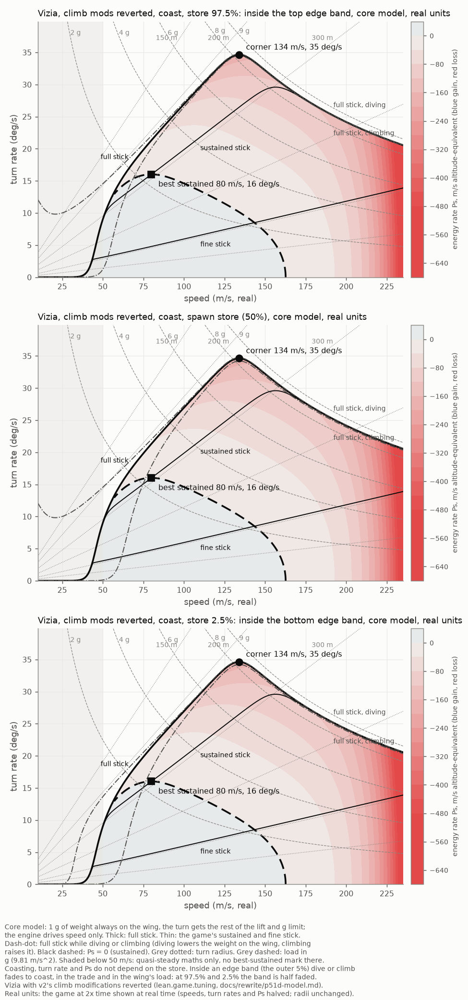
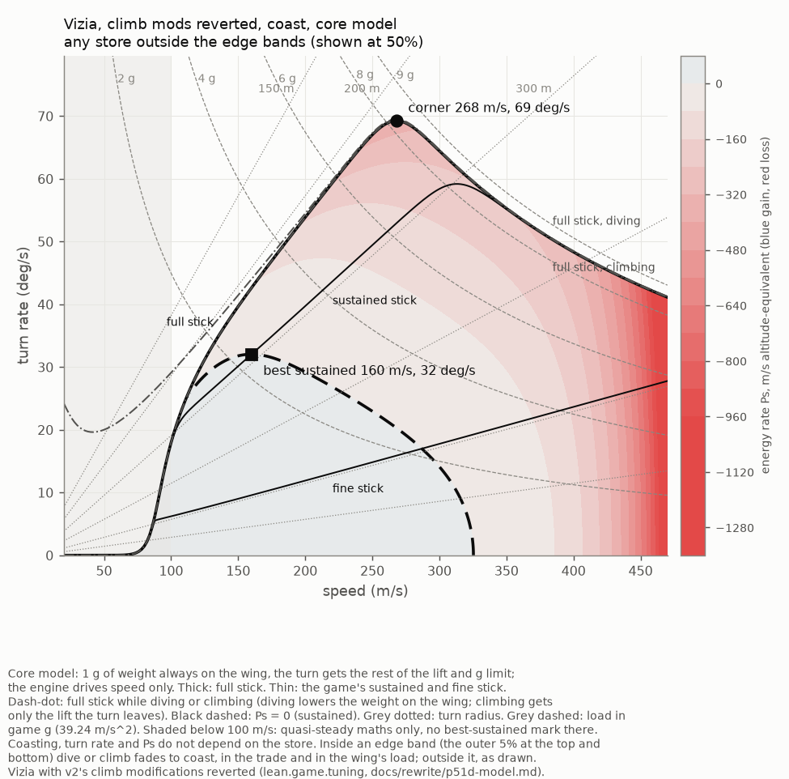

# The P-51D under the core flight model, and Vizia without its climb modifications

The author's request (2026-11-23): a P-51D model at the game's 2x time, with normal gravity,
engine power, drag, lift and g limit, to compare with real charts; the port of v2's tuning
code; and a Vizia with v2's climb modifications reverted.

Everything here is quasi-steady under `GameConfig.core()` (coasting, mid-store, no fields),
from the flight code's own functions (`core._setting`, `_lift_coefficient`, `_rates`), as
the doghouse charts are. Code: `lean/game/tuning.py`; tests: `lean/game/tests/test_tuning.py`;
charts: `docs/rewrite/sections/turns/doghouse.py`.

## Time scale

The game plays at 2x real time (v2's `real_scale.EQUIVALENT_FACTOR`). Lengths are real
metres, so in game units speeds are x2, accelerations x4 (gravity 39.24 = 4 x 9.81, normal
gravity), thrust power per kg x8 and turn rates x2. Turn radii, loads in g and the card's
per-metre lift and drag coefficients do not change. Real units below are game values
converted back: speeds, turn rates and Ps halved.

## What the tuning code does (`lean/game/tuning.py`)

Two routes to a card row. Neither changes `core.py`.

- **Airframe** (`airframe_row`): a direct conversion with no fitting. Lift and zero-lift drag
  per metre are rho S C / (2 m); the induced-drag factor is k / (rho S / 2 m) with
  k = 1 / (pi e AR); thrust power is shaft power x propeller efficiency / m; static thrust
  comes from momentum theory, (FM^2 P^2 2 rho A)^(1/3) / m with FM 0.75; the g limit times
  39.24; dive and climb trade at 1 g (a vertical dive or zoom). This is the October fit's
  conversion (`physics-checks/planes.py` `from_real`), at 2x time.
- **Handles** (`handles_row`): v2's handles, as v2's ship files hold them (x2 units). The
  direct fields use v2's closed forms (`solver._flight_card`'s direct ones and
  `weapons.combat_card`). C_max = g / stall^2; a_max = g_limit g; the store is the ceiling;
  the bullet life is whole ticks over the gun range; the reference bullet speed, the spread,
  drag, shield and armour scales, and the shot's cost are also closed form.
  v2 solved its seven flown handles by flying its own flight model. Under the core model,
  three of them still mean something, and they are solved quasi-steadily by Newton in log
  parameters with finite differences, as v2's solver does:
  - cruise speed sets the engine power;
  - low-speed acceleration (straight, at the stall speed, empty store) sets the static thrust;
  - the settled full-stick coasting turn sets the induced drag.
- `performance(row, plain=False)` gives a row's quasi-steady numbers: stall, corner, top
  speed, best climb (Ps), best sustained turn, minimum sustained radius, settled full-stick
  turn and low-speed acceleration. `plain=True` switches off the game terms (any row),
  which leaves a pure point mass.

How v2's flight model maps to the core model:

| v2 | core model |
|---|---|
| Two engine powers: `engine_power_full_store` drives speed, and the surplus (`engine_power` minus it) charges the store, fading above the engine knee | No charge. Thrust uses the full-store power only. The climb time, engine surplus, coast exchange and knee are inert. Rows made here set `engine_power = engine_power_full_store`. |
| Separate dive and climb exchange rates | Their mean. 1 g from an airframe. From handles, half the dive minus zoom acceleration at cruise, which is 1 g for v2's P-51D and Vizia. |
| Store = g x ceiling; spawn at 40%; shots cost store | Two vertical loops at corner speed; spawn at half; shots are free. The card's values are ignored. |
| Nose reversal (a placeholder for every v2 type), stick levels | Control feel, not physics. Both come from the base row (Vizia). |
| Weight paid from the store above 2% | Weight always on the wing. With the same card, v2's handles no longer fly under core: Vizia's settled turn falls from 19.3 to 12.5 deg/s. |

The flight terms v2 shared across types are per-type card columns (`card.FLIGHT_TERMS`, since
2026-11-23). v2's types keep v2's values; the P-51D's row has the four game terms below off
(`tuning.POINT_MASS_TERMS`), so under the core model it flies its point mass, the October fit.
With Vizia's values each term would cost the airframe some of its real performance (next
section; "with Vizia's terms" there):
- the drag rise above 394 m/s game (197 m/s real), exponent 12;
- the separation drag, which doubles the induced drag at full lift;
- the soft minimum of thrust against static thrust (exponent 2);
- the soft minimum of lift against the g limit (exponent 16).

## The P-51D card (type "p51d")

The airframe is the October fit to the author's flight-test data (`physics-checks/real_fit.py`,
decisions.md 2026-10-23):
- 4,427 kg and 1,630 hp (67 in Hg), as tested;
- wing area 21.83 m^2, aspect ratio 5.83;
- C_Lmax 1.50, from the clean 101-102 mph stall;
- Oswald e 0.8, an assumption: two test points cannot separate e from propeller efficiency;
- C_D0 0.0149 and propeller efficiency 0.82, fitted to the tested 375 mph and 3,600 ft/min at
  sea level;
- propeller diameter 3.40 m.

v2's research (`bnb.reference.real_planes`) adds the g limit (8), the stall angle (15.5 deg) and
the ceiling. v2's research has no engine power or mass, so the October fit is the only complete
physical set. Its power rating is 67 in Hg. v2's 364 mph cruise is at military power.

| Field (game units) | P-51D | Vizia | Real meaning (P-51D) |
|---|---|---|---|
| max_lift_coefficient (1/m) | 0.004530 | 0.004910 | C_Lmax 1.50 at 202.8 kg/m^2: stall 46.5 m/s (104 mph) |
| max_acceleration (m/s^2) | 313.92 | 353.16 | 8 g (Vizia 9 g) |
| zero_lift_drag (1/m) | 4.500e-5 | 4.967e-5 | C_D0 0.0149 (Vizia: Loftin's 0.0163 at 201 kg/m^2) |
| induced drag factor (m) | 22.60 (scale 0.3406) | 26.20 (0.3949) | k = 1 / (pi 0.8 5.83); Vizia's is e AR 3.98 (e 0.68 at AR 5.885) |
| engine_power_full_store (W/kg) | 1,801 | 2,038 | 225 W/kg real thrust power: 1,630 hp x 0.82; Vizia's 255 W/kg is about 1,810 hp at the same efficiency and 4,354 kg |
| engine_power (W/kg) | 1,801 | 10,293 | no surplus (Vizia's 8,254 charged the store in v2) |
| static_thrust (m/s^2) | 23.9 | 35.7 | 26.4 kN: 6.0 m/s^2 real (Vizia 8.9) |
| dive / climb exchange scale | 4.0 / 4.0 | 4.41 / 3.46 | 1 g each |
| stall_angle_scale | 1.0333 | 1.0333 | 15.5 deg |

The remaining fields are Vizia's: guns, shield, hit radius, nose frequency, stick levels and
vision. The P-51D therefore fights with today's game rules; its real half-span is 5.6 m, against
Vizia's 12 m hit radius. Under the core model its store is two loops at corner speed: 34,900 J/kg
in game units, a corner-turn radius of 222 m.

## Comparison with real figures (real units)

"Core": the type under `GameConfig.core()`. The P-51D's own row is now its point mass (the
game terms off), so "P-51D, with Vizia's terms" is the same airframe given Vizia's drag rise,
separation drag and soft minima (as the P-51D row was before 2026-11-23), and "P-51D, core"
is the point-mass column. Sustained figures are coasting, total energy rate >= 0.

| Quantity | Published figure (source) | P-51D, with Vizia's terms | P-51D, core (point mass) | Vizia, core | vizia_plain, core |
|---|---|---|---|---|---|
| Stall speed, clean, 1 g | 100 mph at ~10,100 lb (Loftin, NASA SP-468; v2 research, medium); 101-102 mph at 9,000-9,500 lb (author's data set 1) | 104 mph (46.5 m/s) at 9,760 lb | 104 mph | 100 mph | 100 mph |
| Top speed, sea level | 375 mph at 67 in Hg, 4,427 kg (flight test, author's set 1); 364 mph at military power (wwiiaircraftperformance.org test report; v2 research, good) | 361 mph (161.2 m/s) | 375 mph | 364 mph | 364 mph |
| Best climb, sea level | 3,600 ft/min at 67 in Hg (flight test, set 1); 3,410 ft/min WEP (NAA calc. NA-46-130); ~3,000 ft/min military (v2 research, estimated) | 3,079 ft/min at 176 mph | 3,599 ft/min at 142 mph | 3,683 ft/min | 3,683 ft/min |
| Best sustained turn | 18.6 deg/s at 167 mph, r 231 m, 360 in 19.4 s (the October fit's point-mass model of the tested airframe: a model, not a measurement); 360 in 18.2 s, r 215 m (author's set 2, E-M derived); 15.7 deg/s, 360 in 23.0 s (simulator compilations; v2 research, low) | 15.4 deg/s at 187 mph, r 311 m, 360 in 23.4 s | 18.6 deg/s at 169 mph, r 233 m, 19.3 s | 16.0 deg/s at 179 mph, r 286 m, 22.5 s | the same as Vizia |
| Minimum sustained radius | none found | 272 m at 143 mph | 233 m at 169 mph | 250 m at 136 mph | the same |
| Corner speed | none published; stall x sqrt(g limit) = 294 mph (derived) | 294 mph (131.6 m/s) | 294 mph | 300 mph (9 g) | 300 mph |
| Turn rate at corner | derived only | 31.3 deg/s | 34.0 deg/s | 34.6 deg/s | 34.6 deg/s |
| g limit | 8 (recalled standard figure; v2 research, medium) | 8 | 8 | 9 | 9 |
| Level acceleration at the stall speed | 2.73 m/s^2 (v2 research, estimated: its point-mass model at 1.1 x stall x 0.88) | 2.09 m/s^2 | 3.74 m/s^2 | 2.73 m/s^2 | 2.73 m/s^2 |

The point mass is the October fit, to the tests' tolerances: 375 mph, 3,599 ft/min, and
18.6 deg/s at 169 mph with r 233 m (`test_p51d_point_mass_is_the_october_fit`). The conversion
is therefore exact, and every gap between the two P-51D columns comes from Vizia's game terms. Each
term was switched off alone, P-51D with Vizia's terms:

| Term switched off | Top speed | Best climb | Best sustained turn | Turn at corner |
|---|---|---|---|---|
| none (Vizia's terms) | 361 mph | 3,079 ft/min | 15.4 deg/s at 187 mph | 31.3 deg/s |
| drag rise | 372 mph | 3,079 | 15.4 | 31.3 |
| separation drag | 361 | 3,080 | 17.6 at 164 mph | 31.3 |
| thrust soft minimum | 363 | 3,595 | 16.1 at 188 mph | 31.3 |
| lift soft minimum | 361 | 3,079 | 15.4 | 34.0 |

Effect of each term:
- **Top speed (-3.7%)**: mostly the drag rise, which adds 14% to the zero-lift drag at 375 mph.
  Real compressibility at Mach 0.49 is far smaller.
- **Climb (-14.5%)**: the thrust's soft minimum, which takes 10% of the thrust near the
  best-climb speed. Real propeller thrust there lies between the two models.
- **Sustained turn (-17%)**: mainly the separation drag, which doubles the induced drag at full
  lift, plus the thrust's soft minimum.
- **Corner rate (-8%)**: the lift's soft minimum against the g limit.

With Vizia's terms the P-51D's 15.4 deg/s happens to sit beside the simulator figure, 15.7 deg/s.

### Vizia against the P-51D

Against the P-51D airframe with Vizia's terms (the P-51D's own row now flies the point mass:
375 mph, 3,599 ft/min, 18.6 deg/s), in real units Vizia flies close to the P-51D on paper:
- top speed 364 against 361 mph;
- best climb 3,683 against 3,079 ft/min;
- best sustained turn 16.0 against 15.4 deg/s;
- corner speed 300 against 294 mph.

The ingredients differ more than the results. Compared with the P-51D, Vizia has:
- 8% more lift per metre (Loftin's stall at its lighter mass);
- 10% more zero-lift drag;
- 16% more induced drag;
- 13% more thrust power;
- 49% more static thrust;
- 9 g against 8.

Its extra drag and extra power roughly cancel, apart from the climb, which is 20% higher.

## Vizia's climb modifications

v2 changed the real-scale cards so the store would refill faster. The sources are v2's builder
(`bnb.game.real_scale` before b4dbbdee), `docs/explanation/game/real-scale-pacing.md`, the ship
files and the solver. Each modification, where it is set, its unmodified value and what the core
model does with it:

| Modification | Where set | Vizia's value (x2 units) | Unmodified (physical) | Under the core model |
|---|---|---|---|---|
| Climb pacing x4, set-wide: every researched climb rate times 4 | `real_scale_balance.json` "_rules" `climb_multiplier`, applied in `real_scale.target_handles` (pacing doc, "The choice") | the P-51D's 15.2 m/s became 60.8 m/s; its climb time 2,081 -> 520 s | 15.2 m/s (researched, estimated; climb time 2,081 s x2, 4,163 s real) | inert: no store charging |
| Vizia's own climb time | `vizia.toml` [handles] `climb_time`, the author's design (96d16d61, 2026-11-12): 600 s x1, 300 s x2 | 300 s: an initial charge of g x 105.5 m/s real, 6.9 times the researched climb | 2,081 s | inert |
| The engine surplus that pays for the charge | the solver: `engine_power = engine_power_full_store + m a_0 u_cruise` (`solver._flight_card`; direct charge since game v8) | 10,292.6 - 2,038.5 = 8,254 W/kg (Yongma 7,423, Jujak 9,178) | g x 15.2 m/s = 1,193 W/kg (x2) | dropped: thrust uses the full-store power only. vizia_plain sets `engine_power = engine_power_full_store` |
| Coast exchange (the store's charge while coasting) | `coast_exchange_scale` 23.27 on v2's card (rules `coast_exchange` 1.09) | 25.4 m/s^2 | the researched climb's | not in lean's card; inert under direct charge |
| Dive and climb exchange rates | the solver, from the dive and zoom acceleration handles (placeholders: the standard fighter's, scaled to the P-51D) | 4.41 / 3.46 (mean 0.983 g) | 1 g each (a vertical dive or zoom; also the handles' mean, 39.24 m/s^2) | used, as the mean: vizia_plain sets 1 g |
| Engine knee: the charge fades above half the store | rules.toml `flight.engine_knee` 0.5, `engine_knee_scale` 1 | 0.5 | not a climb boost: the pacing study left it at 0.5 | inert |
| Store size | g x ceiling (researched 12,680 m, not paced) | 497,563 J/kg | the same | replaced: two loops at corner speed |
| Spawn energy | the standard fighter's 40% of the store (placeholder) | 199,025 J/kg | | replaced: half the store |
| The shot's cost, tied to the climb charge | `shots_per_store`: continuous fire costs 14.5 x the researched initial climb charge | 575 J/kg a shot | | replaced: shots are free |
| Store fade band | rules.toml `flight.store_fade_band` 0.02 | 2% | | replaced: 5% smootherstep |

**Finding: under the core model, Vizia's climb modifications are already inert.** The core model
uses only the full-store power, which v2's solver set to hold the cruise handle; under core,
Vizia's top speed is 364 mph, exactly the researched value. The surplus, the climb time, the
coast exchange, the knee, the store, the spawn store and the shot's cost are all unused or
replaced. The only change that reaches the flight is the dive and climb trade: 0.983 g becomes
1 g. vizia_plain coasts exactly as Vizia does (`test_vizia_plain_flies_as_vizia_when_coasting`),
and its doghouse is Vizia's apart from the dive and climb lines.

Two Vizia changes are not climb-related, but they still separate it from the P-51D: the g limit
9 against the researched 8, and the sustained-turn handle, raised from 15.7 to 19.29 deg/s for
flight realism (game v8 to v11). Under the core model that handle is no longer met: Vizia's
settled full-stick turn is 12.5 deg/s, because the core model keeps the weight on the wing.
Re-solving Vizia's handles under core (`handles_row`) to fly 19.29 deg/s would need an induced
drag scale of 0.155, an e AR near 10: not physical.

## Charts

The core model's doghouse for the P-51D (its own row: the point mass) and for vizia_plain; the same
layout as `sections/turns/doghouse.py`. In real units, speeds, turn rates and Ps are halved;
radii and loads are unchanged.

| P-51D | Vizia, climb modifications reverted |
|---|---|
|  |  |
|  |  |

Dark variants: `doghouse-p51d-core-dark.png`, `doghouse-p51d-core-real-dark.png`,
`doghouse-vizia-plain-core-dark.png` and `doghouse-vizia-plain-core-real-dark.png`. Vizia's own
chart is `doghouse-vizia-core.png`.

    for theme in light dark; do THEME=$theme OMP_NUM_THREADS=1 PYTHONPATH=.:src \
        python docs/rewrite/sections/turns/doghouse.py; done

(The P-51D's charts. The vizia_plain and Vizia rows left the card at the game sign-off (G1,
2026-11-23); their charts are the records drawn before.)

The P-51D's chart reads "best sustained 76 m/s, 19 deg/s" (real) from its own grid; the tables
use a 0.05 m/s grid and bisect the stick (169 mph = 75.6 m/s, 18.6 deg/s). P-51D against Vizia
on shared axes, in game units and at 1x real time (with an mph axis):
`sections/turns/doghouse-p51d-vizia-core[-real][-dark].png` (drawn by doghouse_compare.py,
removed with the Vizia row at G1).

## Tests (`lean/game/tests/test_tuning.py`)

- v2's closed forms give v2's solved card, to float32 rounding:
  - for the P-51D's v16 file and Vizia's v20 file;
  - the P-51D's bullet life is left out: its file kept 10 ticks after it was carried to x2 by
    the similarity, while its handles give 11, as v2's re-solved Vizia has.
- The card's p51d and vizia_plain rows are exactly the tuning's output.
- The P-51D's point mass reproduces the October fit:
  - top speed and climb within 0.5%;
  - turn rate within 1%;
  - turn speed and radius within 2%.
- Under the core model the P-51D's own row flies its point mass (the same numbers as
  `plain=True`).
- With Vizia's game terms the P-51D airframe sits below the October fit by the measured costs,
  each held within 1.5 points:
  - top speed -3.7%;
  - climb -14.5%;
  - sustained turn -17.3%.
  - Stall and corner speed are exact.
- The required speed order (minimum radius, best sustained, corner) holds for both new types.
- vizia_plain coasts exactly as Vizia.
- `handles_row` meets v2's P-51D handles under core to 1e-6.

## Card count

`card.TYPE_NAMES` is now ("yongma", "jujak", "vizia", "p51d", "vizia_plain"), so
`lean/contract.py` has `SHIP_TYPES = 5`. The observation's type one-hot widens: `SHIP_FEATURES`
goes from 27 to 29, and a policy built for 27 ship features does not load. `test_parity_v2`
compares v2's three rows only. `GameConfig.core()` still flies Vizia; the new types are used only
when a lineup names them.
