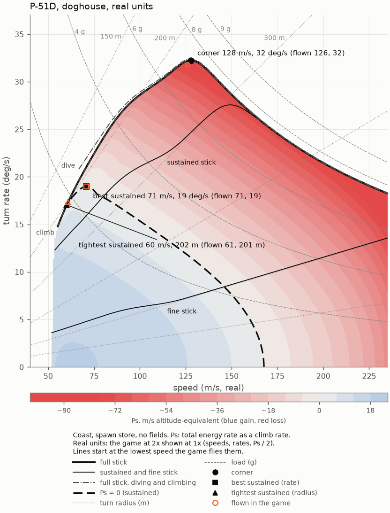
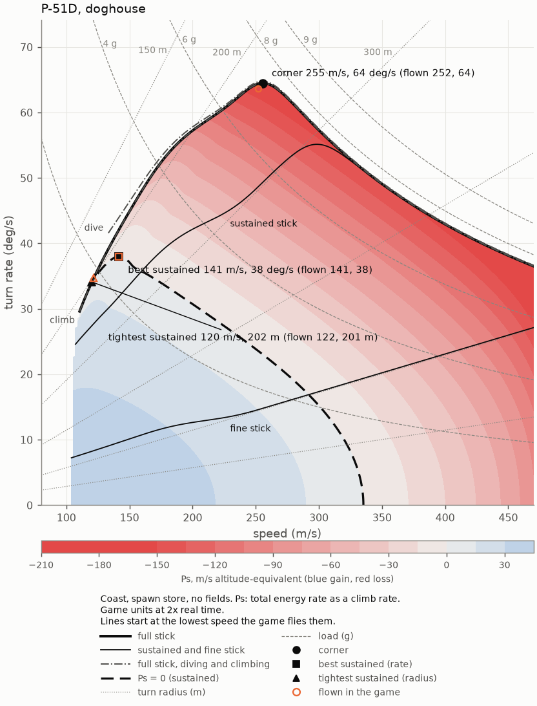

# The P-51D under the core flight model

The P-51D is the core game's ship. Its row is built from real data through the tuning route
(`lean/game/tuning.py`), with the game's flight terms on and the low-level coefficients solved
so it still flies the real aircraft's headline numbers (core-decisions.md, "Flight model
direction and shared code", 2026-11-24). History: the author's request of 2026-11-23 (a P-51D at
the game's 2x time, comparable with real charts) first produced its pure point mass, the
game terms off; step A1 (2026-11-24) rebuilt it with the game terms on; later on 2026-11-24
the flaps became demand-scheduled and the row derived at load (author, "Charts").

Everything here is quasi-steady under `GameConfig()` (coasting, mid-store, no fields), from the
flight code's own functions (`core.steady_rates`: `_wing`, `_setting`, `_lift_coefficient`,
`_rates`), as the doghouse charts and the web tool are. Code: `lean/game/tuning.py`; tests:
`lean/game/tests/test_tuning.py` and `test_flight.py`; charts:
`docs/rewrite/sections/turns/doghouse.py`.

## Time scale

The game plays at 2x real time (v2's `real_scale.EQUIVALENT_FACTOR`). Lengths are real
metres, so in game units speeds are x2, accelerations x4 (gravity 39.24 = 4 x 9.81, normal
gravity), thrust power per kg x8 and turn rates x2. Turn radii, loads in g and the card's
per-metre lift and drag coefficients do not change. Real units below are game values
converted back: speeds, turn rates and Ps halved.

## What the tuning code does (`lean/game/tuning.py`)

Routes to a card row. None changes `core.py`.

**The card is derived, not stored.** `lean/game/card.py` holds no numbers for a real
aircraft: on first use of `card.CARD`, `tuning.load_card` makes every type's row from its
targets (`REAL_AIRCRAFT`: the data, the flight test, the game terms) through `real_row`:
`fit_point_mass`, then `game_row`. The row is cached in memory and on disk
(`~/.cache/bnb-card/<type>-<key>.json`, or `$BNB_CARD_CACHE`), keyed by a hash of the targets,
the base fields and the flight model's source (`core.py`, `card.py`, `tuning.py`,
`contract.py`), so a physics change re-solves by itself and no stored copy goes stale. A solve
takes about 7.6 s on the laptop (once per source change and machine); a cached load about
1 ms. Every reader (the game, the web tool's presets, the charts, the evaluation store) reads
`card.CARD`; the evaluation store's game version now hashes `tuning.py` too, since it decides
the card.

- **Airframe** (`airframe_row`): a direct conversion with no fitting. Lift and zero-lift drag
  per metre are rho S C / (2 m); the induced-drag factor is k / (rho S / 2 m) with
  k = 1 / (pi e AR); thrust power is shaft power x propeller efficiency / m; static thrust
  comes from momentum theory, (FM^2 P^2 2 rho A)^(1/3) / m with FM 0.75; the g limit times
  39.24; dive and climb trade at 1 g (a vertical dive or zoom). This is the October fit's
  conversion (`physics-checks/planes.py` `from_real`), at 2x time. With the game terms off
  (`POINT_MASS_TERMS`) the row is the aircraft's **point mass**.
- **Point-mass fit** (`fit_point_mass`): C_D0 and the propeller efficiency set so the point
  mass flies a tested top speed and best climb (the October procedure,
  `physics-checks/real_fit.py`). Neither is measured data: a fit absorbs cooling drag, exhaust
  thrust and the Meredith effect into the two (aircraft-references.md, "CD0").
- **Game row** (`game_row`): the airframe converted with a type's game terms on, then its
  zero-lift drag, thrust power and induced drag (`GAME_SOLVED`) solved so it flies its point
  mass's top speed, best climb and best sustained turn rate (`GAME_TARGETS`). Newton in log
  parameters with finite differences (`_newton`, shared with the handles route), first with
  the flaps off and then with them from there: the flaps' part of the sustained turn is
  lift-limited, so no drag coefficient moves it, and a start whose clean best turn lies below
  it sees no way to the target. Kept as the airframe's: the lift and stall speed, the g limit
  and so the corner speed, the stall angle, the dive and climb trade, and the static thrust
  (no target sees it). The best sustained turn's speed is not solved; the terms are chosen to
  keep it near the point mass's. The P-51D's card row is `real_row(REAL_AIRCRAFT["p51d"])`;
  a test holds it to its targets.
- **Handles** (`handles_row`): v2's handles, as v2's ship files hold them (x2 units). The
  direct fields use v2's closed forms (`solver._flight_card`'s direct ones and
  `weapons.combat_card`). C_max = g / stall^2; a_max = g_limit g; the bullet life is whole
  ticks over the gun range; the reference bullet speed, the spread, drag, shield and armour
  scales, and the shot's cost are also closed form. Three flown handles still mean something
  under the core model and are solved quasi-steadily: cruise speed sets the engine power;
  low-speed acceleration (straight, at the stall speed, empty store) sets the static thrust;
  the settled full-stick coasting turn sets the induced drag. The web tool's sliders go
  through this route (with its fast path: Broyden updates, a coarser speed grid); the base
  row's flight terms, flaps included, are kept.
- `performance(row, plain=False)` gives a row's quasi-steady numbers: stall, corner (closed
  form, and flown: the peak full-stick rate), top speed, best climb (Ps), best sustained
  turn, minimum sustained radius, settled full-stick turn and low-speed acceleration.
  `plain=True` switches off the game terms (any row). `envelope` gives the (stick, speed)
  grid the doghouse and the web tool draw.

How v2's flight model maps to the core model:

| v2 | core model |
|---|---|
| Two engine powers: `engine_power_full_store` drives speed, and the surplus (`engine_power` minus it) charges the store, fading above the engine knee | No charge. Thrust uses the full-store power only. The climb time, engine surplus, coast exchange and knee are inert. |
| Separate dive and climb exchange rates | Their mean. 1 g from an airframe. |
| Store = g x ceiling; spawn at 40%; shots cost store | Two vertical loops at corner speed; spawn at half; shots are free. |
| Nose reversal, stick levels | Control feel, not physics: from `GAME_FIELDS` (v2's Vizia's). Nose damping 0.7 (v2's) kept. |
| Weight paid from the store above 2% | Weight always on the wing. |
| Flight terms shared across types | Per-type card columns (`card.FLIGHT_TERMS`), flaps included. |

## The P-51D's data (`tuning.P51D`)

| Quantity | Value | Source |
|---|---|---|
| Mass | 4,427 kg (9,760 lb), as tested | AAF TSCEP5E-1908 (A) |
| Power | 1,630 hp at 67 in Hg, war emergency rating (decided: the game's one power setting is set for an all-out fight) | the same test |
| Wing area | 21.67 m^2 (233.2 ft^2) | NACA ACR 4K02 (A); was 21.83 |
| Aspect ratio | 5.83 | the October fit (NACA gives 5.815 for the P-51B) |
| C_Lmax, clean | 1.6 | the AAF's power-on value behind its turn calculation; stall-derived values span 1.50-1.70 (aircraft-references.md); was 1.50 |
| Oswald e | 0.8 | assumed (two test points cannot separate e from propeller efficiency) |
| Propeller | Hamilton Standard, 3.40 m | the test report |
| g limit | 8 (decided) | v2's research (forum figure, at 8,000 lb) |
| Stall angle | 15.5 deg | v2's research |
| C_D0, propeller efficiency | 0.01504, 0.821 | `fit_point_mass` to 375 mph and 3,600 ft/min at sea level (A), run when the card is derived (`P51D` holds its start) |

The point mass: stall 101.2 mph, corner speed 286 mph (stall x sqrt 8), and, as a model, a best
sustained turn of 18.99 deg/s at 163.3 mph with radius 220 m.

## The game terms and the solve (`tuning.P51D_TERMS`)

| Term | P-51D | Why |
|---|---|---|
| Drag rise | the zero-lift drag doubles at Mach 0.77 (262 m/s real, `critical_speed` 524.06 game), exponent 20 | NACA ACR 4K02 Fig. 12 (P-51B, propeller off): C_D flat at about 0.0215 to M 0.68, then about 0.030 at M 0.735 and 0.036 at M 0.755 (read off the chart); 1 + (M / 0.77)^20 gives +15% at 0.70, +39% at 0.735, +68% at 0.755 (v2's exponent 12 at the same point would add 13% at M 0.65, where the figure is flat). At the game's speeds it is negligible: +0.013% at the sea-level top speed (M 0.49) |
| Separation drag | 0.1, exponent 8 (the induced drag +10% at the wing's maximum lift) | larger values move the best sustained turn's speed off the point mass's: with the flaps off, +4% at 0.2, +8% at 0.3, +22% at v2's 1.0, which also needs e 1.28 |
| Soft minimum, lift against the g limit | exponent 16 | v2's |
| Soft minimum, thrust against static thrust | exponent 8 | much less soft than v2's 2 (which took 10% of the thrust near the best-climb speed) |
| Automatic flaps | +15% maximum lift when the stick asks for more than the clean wing gives, blown back by the clean corner speed; flap drag 1.5 (Delta C_L)^2 with the flaps fully used | next section |
| Nose damping | 0.7 | v2's, kept |

Solved (`GAME_SOLVED`), as airframe equivalents:

| | point mass | game row |
|---|---|---|
| C_D0 | 0.01504 | 0.01503 |
| propeller efficiency | 0.821 | 0.820 |
| Oswald e | 0.8 | 0.819 |

The soft minimum of lift and the separation drag lower the turn near the lift limit, and the
flaps raise it at low speed (they now act in the best sustained turn: with them off the same
row's best sustained rate is 18.42 deg/s, not 18.99); the induced drag settles at e 0.819 to
hold the best sustained rate. (With the speed-scheduled flaps of before, which did not reach
the best sustained turn, it was e 0.900.)

## Automatic flaps (`core._wing`)

Scheduled by stick demand, as an F-16's automatic flaps are: the flaps come out when the stick
asks for more lift than the clean wing gives, at any speed up to the blow-back speed. No
control: they are part of what the stick means. Author's rules (core-decisions.md, "Charts"):
smooth to the curvature (C2) in speed and in demand, and the turn rate never falls with speed
below corner (the speed-scheduled flaps of before, which retracted between 1.3 and 1.6 x stall,
made a shelf there in the doghouse).

- **The bonus and its blow-back.** The full-flap maximum is the clean maximum times
  1 + `flap_lift` up to (1 - `card.FLAP_BLOWBACK_BAND`) x the blow-back speed, falling by a
  smootherstep in speed to the clean maximum at the blow-back speed itself,
  `flap_blowback_ratio` x the clean corner speed. The band is 40% (shared): the bonus's fall,
  steeper with a narrower band, must not turn the full-stick rate down.
- **The stick.** A stick level is a fraction of the full-flap maximum at that speed (full stick
  asks for all of it), as before.
- **Deployment.** The demanded lift coefficient: 1 g held (whatever the power) and the stick's
  fraction of the full-flap maximum across it, sqrt((g / v^2)^2 + (stick x full)^2). The flaps
  deploy by a smootherstep from `1 - card.FLAP_DEMAND_BAND` (90%) of the clean maximum to all of
  it, so a demand the clean wing gives flies clean (straight above the stall speed, gentle and
  sustained turns at speed) and one it cannot give has the flaps out as far as the speed allows.
  Everything that reads the wing's maximum reads this one: the lift budget, the lift curve (its
  peak at the stall angle), the nose's lift slope and the separation drag. Straight and slow,
  the 1 g alone deploys them: the 1 g stall with the flaps out is the clean one over
  sqrt(1.15).
- **Drag.** `flap_drag_scale` x the induced-drag factor x (extra lift)^3 / (the full bonus),
  on the lift coefficient beyond the clean maximum: zero while the clean wing suffices, equal
  to the old square law with the flaps fully used, and the cube keeps the curvature continuous
  where it starts.
- **Smoothness.** Smootherstep in speed and in demand (value, slope and curvature continuous);
  the cube in the drag. Tested by refinement (`test_flaps_are_smooth_in_speed_and_in_demand`):
  on a grid four times finer the largest neighbour-to-neighbour change of the finite-difference
  slope and curvature shrinks about fourfold, which a kink or a curvature step would not do.
- **Cost in the step.** Per half-kick (the flaps held through it at its starting speed and
  stick): one smootherstep of speed, a square root of the demand and one smootherstep of it, a
  few multiplies; in each drag evaluation a square root, a clamp and a cube.
- **Per type.** `flap_lift`, `flap_blowback_ratio` (a multiple of the clean corner speed, so it
  carries across time scales and the web tool's sliders), `flap_drag_scale`. Off:
  `flap_lift` 0. Shared: the two bands. A large bonus with the 40% band could turn the
  full-stick rate down in the blow-back (the test holds every card type).

**The P-51D's values are a game choice:** the P-51D had no combat flap setting. +15%
(Delta C_L 0.24), blown back by the clean corner speed (fully out to 0.6 x corner, 172 mph), so
the corner and the corner rate are the airframe's; Delta C_D = 1.5 (Delta C_L)^2 with the flaps
fully used (0.086 at the full bonus). The drag is set so the tightest sustained turn stays
clearly slower than the best sustained rate (the author's 10% margin): a sweep of the drag
(2026-11-24, the row re-solved each time) gave the tightest turn's speed over the best rate's
as 0.958 at 0.2 (the old value, which fails the margin), 0.921 at 0.5, 0.882 at 1.0, 0.852 at
1.5 and 0.865 at 2.0; +25% with 1.0 gave 0.815. The 1 g stall with the flaps out is 94.3 mph
(clean 101.2).

What they do to the P-51D (the same solved row, flaps off against on):
- tightest sustained turn 202 m at 135.0 mph, against 224 m at 161.2 mph without them: 10%
  tighter at a speed 16% lower;
- the best sustained rate rises from 18.42 to 18.99 deg/s (the solve's target) and its speed
  falls from 161.3 to 158.4 mph: the flaps reach the sustained turn now;
- the full-stick rate rises with speed all the way to the corner (14.3 deg/s at 1.2 x stall,
  18.3 at 1.4, 21.6 at 1.6, 26.9 at 2.0, 32.2 at 2.8; no shelf);
- the flap drag costs speed in a slow full-stick turn (at 1.35 x stall, d speed / dt -0.49
  against 2.89 m/s^2 game without it).

## Comparison with real figures (real units)

"Before": the card row until 2026-11-24 (the October point mass: 21.83 m^2, C_Lmax 1.50, the
game terms off). "Point mass": the referenced airframe above, game terms off. "Game row": the
card now. Sustained figures are coasting, total energy rate >= 0. The radii at multiples of
the stall speed use each row's own clean stall speed (sustained; full stick where different).

| Quantity | Published figure (source) | Before | Point mass | Game row |
|---|---|---|---|---|
| Stall speed, clean, 1 g | 100 mph at ~10,100 lb (Loftin); 101-102 mph at 9,000-9,500 lb (author's set 1); about 100.5 mph IAS at 9,800 lb (AN 01-60JE-1) | 104.1 mph | 101.2 mph | 101.2 mph (94.3 with the flaps) |
| Top speed, sea level | 375 mph at 67 in Hg, 4,427 kg (flight test) | 375.1 mph | 375.0 | 375.0 |
| Best climb, sea level | 3,600 ft/min at 67 in Hg (flight test); 3,410 (NAA calculation) | 3,599 ft/min at 142 mph | 3,600 at 142 | 3,600 at 144 |
| Corner speed | none published; stall x sqrt(g limit) (derived) | 294.4 mph | 286.1 | 286.1 (the flown peak at 285.9) |
| Turn rate at corner | derived only | 34.0 deg/s | 35.0 | 32.2 |
| Best sustained turn | no test value. Models: the October fit's 18.6 deg/s at 167 mph, r 231 m; author's set 2 (E-M derived) 360 in 18.2 s, r 215 m (19.8 deg/s); simulator compilations 15.7 deg/s | 18.63 deg/s at 169.4 mph, r 233 m | 18.99 at 163.3, r 220 | 18.99 at 158.4, r 214 |
| Tightest sustained turn | none found | 233 m at 169.3 mph | 220 m at 163.2 | 202 m at 135.0 |
| Tightest / best-rate speed | | 0.998 | 0.998 | 0.852 |
| Radius at 1.2 x stall | | 292 m (125 mph) | 276 m (121 mph) | 218 m (121 mph) |
| Radius at 1.5 x stall | | 239 m (156 mph) | 226 m (152 mph) | 207 m sustained, 194 m full stick (152 mph) |
| Radius at 2 x stall | AAF calculation: 883 ft (269 m) at 4 g, 10,000 ft, P-51B (not comparable at sea level) | 331 m sustained, 225 m full stick (208 mph) | 316 m, 212 m (202 mph) | 312 m, 193 m (202 mph) |
| Level acceleration at the stall speed | 2.73 m/s^2 (v2 research, estimated) | 3.74 m/s^2 | 3.83 | 3.69 |

The game row with the speed-scheduled flaps (A1, earlier on 2026-11-24): best sustained 18.99
deg/s at 165.5 mph, r 223 m; tightest sustained 202 m at 136.7 mph (ratio 0.826); corner
32.2 deg/s at 286 mph.

Reading:
- Top speed, climb and best sustained rate are the solve's targets and match the flight test
  and the point mass to 1e-6. The best sustained speed is 3.0% below the point mass's (not
  solved; the flaps now reach the sustained turn), between the point mass and the speed of
  the tightest turn.
- The corner speed is exact (closed form from C_Lmax and the g limit), and the flaps are blown
  back there, so the corner rate is the clean wing's: 8% below the point mass's, as before
  (the soft minimum of lift against the g limit, exponent 16, holds the full stick below the
  hard limit near the corner).
- With the flaps, the radius at 1.2 x stall is 21% tighter than the point mass's, and the
  tightest sustained turn sits 15% slower than the best rate: a one-circle fight asks for a
  different speed than a two-circle fight.

## Charts

The P-51D's doghouse, its card row (game terms on, flaps), drawn from `tuning.envelope`. In real
units speeds, turn rates and Ps are halved; radii and loads are unchanged. Marks: the corner
(circle), the best sustained turn (square), the tightest sustained turn (triangle), each with a
small hollow marker where the game flies it (`lean.tool.flown`). Each line starts at the
lowest speed the game flies it (game m/s: full stick 109.9, sustained 105.8, fine 104.0, dive
132.0, climb 109.8; the stall speed is 90.4), nothing below; how they were found:
`lean/tool/NOTES.md`.

| Real units (1x) | Game units (2x) |
|---|---|
|  |  |

Dark variants: `doghouse-p51d-core-dark.png`, `doghouse-p51d-core-real-dark.png`; the
comparison panels (rate, radius, sustained 360 time against speed):
`doghouse-comparison-core[-dark].png`.

    for theme in light dark; do THEME=$theme OMP_NUM_THREADS=4 PYTHONPATH=.:src \
        uv run --no-sync python docs/rewrite/sections/turns/doghouse.py; done

The vizia_plain and Vizia charts (`doghouse-vizia-plain-core*.png`, `doghouse-vizia-core*.png`)
and `sections/turns/doghouse-p51d-vizia-core*.png` are records drawn before G1 (2026-11-23),
when Vizia left the card; they show the P-51D's earlier point mass.

## Tests

`lean/game/tests/test_tuning.py`:
- the point mass, fitted when the card is derived, flies the flight test (375 mph and 3,600
  ft/min to 1e-6);
- every card row meets its targets: the flight test's top speed and climb and the point
  mass's best sustained rate (1e-6), its best sustained speed within 5% of the point mass's,
  the same stall and corner speeds (the flown peak within 0.1%), the terms on;
- derived rows are cached by their targets and the source (a second load reads the disk
  without solving; another target or another source is another key);
- the handles route recovers the row from its flown handles; another time scale flies the
  same aircraft; the scripted agent's references are the flown numbers (P-51D: quarter turn
  2.37 s, store turn 2.30 rad).

`lean/game/tests/test_flight.py`:
- every card type's tightest sustained turn is at least 10% slower than its best sustained rate,
  which is below its corner (P-51D: 120.70, 141.65 and 255.65 m/s game, ratio 0.852);
- the turn rate never falls with speed from half the stall speed to the corner, at full stick
  and at the sustained stick, for every card type;
- the flaps deploy by demand (clean flying straight above the stall speed, the full bonus at
  full stick below the blow-back band, clean from the blow-back speed, out below the 1 g speed
  flying straight), are C2 in speed and in the stick (by refinement, a check that itself fails
  the old square law's curvature step), and cost drag only for lift beyond the clean wing.

The web tool (`lean/tool`) reads the same functions (`tuning.envelope`, `performance`,
`handles_row`) and its presets read the derived card (`tuning.row_of`).

## Record: Vizia's climb modifications (2026-11-23)

Kept as the record of the request of 2026-11-23; Vizia and vizia_plain left the card at the
game sign-off (G1).

v2 changed the real-scale cards so the store would refill faster. The sources are v2's builder
(`bnb.game.real_scale` before b4dbbdee), `docs/explanation/game/real-scale-pacing.md`, the ship
files and the solver. Each modification, where it is set, its unmodified value and what the core
model does with it:

| Modification | Where set | Vizia's value (x2 units) | Unmodified (physical) | Under the core model |
|---|---|---|---|---|
| Climb pacing x4, set-wide: every researched climb rate times 4 | `real_scale_balance.json` "_rules" `climb_multiplier`, applied in `real_scale.target_handles` (pacing doc, "The choice") | the P-51D's 15.2 m/s became 60.8 m/s; its climb time 2,081 -> 520 s | 15.2 m/s (researched, estimated; climb time 2,081 s x2, 4,163 s real) | inert: no store charging |
| Vizia's own climb time | `vizia.toml` [handles] `climb_time`, the author's design (96d16d61, 2026-11-12): 600 s x1, 300 s x2 | 300 s: an initial charge of g x 105.5 m/s real, 6.9 times the researched climb | 2,081 s | inert |
| The engine surplus that pays for the charge | the solver: `engine_power = engine_power_full_store + m a_0 u_cruise` (`solver._flight_card`; direct charge since game v8) | 10,292.6 - 2,038.5 = 8,254 W/kg (Yongma 7,423, Jujak 9,178) | g x 15.2 m/s = 1,193 W/kg (x2) | dropped: thrust uses the full-store power only. vizia_plain sets `engine_power = engine_power_full_store` |
| Coast exchange (the store's charge while coasting) | `coast_exchange_scale` 23.27 on v2's card (rules `coast_exchange` 1.09) | 25.4 m/s^2 | the researched climb's | not in lean's card; inert under direct charge |
| Dive and climb exchange rates | the solver, from the dive and zoom acceleration handles (placeholders: the standard fighter's, scaled to the P-51D) | 4.41 / 3.46 (mean 0.983 g) | 1 g each (a vertical dive or zoom; also the handles' mean, 39.24 m/s^2) | used, as the mean: vizia_plain sets 1 g |
| Engine knee: the charge fades above half the store | rules.toml `flight.engine_knee` 0.5, `engine_knee_scale` 1 | 0.5 | not a climb boost: the pacing study left it at 0.5 | inert |
| Store size | g x ceiling (researched 12,680 m, not paced) | 497,563 J/kg | the same | replaced: two loops at corner speed |
| Spawn energy | the standard fighter's 40% of the store (placeholder) | 199,025 J/kg | | replaced: half the store |
| The shot's cost, tied to the climb charge | `shots_per_store`: continuous fire costs 14.5 x the researched initial climb charge | 575 J/kg a shot | | replaced: shots are free |
| Store fade band | rules.toml `flight.store_fade_band` 0.02 | 2% | | replaced: 5% smootherstep |

**Finding: under the core model, Vizia's climb modifications are already inert.** The core model
uses only the full-store power, which v2's solver set to hold the cruise handle; under core,
Vizia's top speed is 364 mph, exactly the researched value. The surplus, the climb time, the
coast exchange, the knee, the store, the spawn store and the shot's cost are all unused or
replaced. The only change that reaches the flight is the dive and climb trade: 0.983 g becomes
1 g. vizia_plain coasts exactly as Vizia does (`test_vizia_plain_flies_as_vizia_when_coasting`),
and its doghouse is Vizia's apart from the dive and climb lines.

Two Vizia changes are not climb-related, but they still separate it from the P-51D: the g limit
9 against the researched 8, and the sustained-turn handle, raised from 15.7 to 19.29 deg/s for
flight realism (game v8 to v11). Under the core model that handle is no longer met: Vizia's
settled full-stick turn is 12.5 deg/s, because the core model keeps the weight on the wing.
Re-solving Vizia's handles under core (`handles_row`) to fly 19.29 deg/s would need an induced
drag scale of 0.155, an e AR near 10: not physical.

