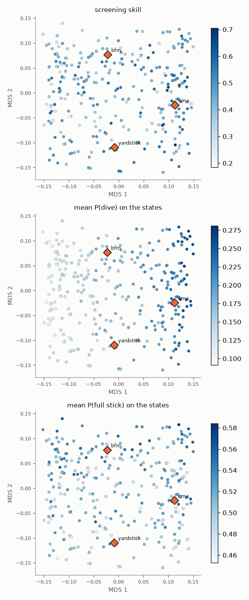

# Behavioural divergence of scripted configurations (2026-11-24)

The decision (core-decisions.md, author 2026-11-24): behavioural variety of scripted
configurations is measured as the Jensen-Shannon divergence of their action distributions on a
fixed set of stored states, beside the per-game style counters. Skill alone does not decide
which parameters to freeze. This page measures it over the screening's space
(scripted-screening.md). Scripts and results: docs/rewrite/sections/scripted-screening/
(`divergence.py`, `divergence_analyse.py`, `divergence.json`). Code: core at cd768d72.

## Findings

1. Behaviour and skill rank the rows differently. fight_speed is the largest behaviour row
   (it moves the power: dive against climb) but fourth for skill. engage_range, temperature and
   three_nine_line change behaviour clearly and skill barely. aligned and closing_time matter
   for skill more than for behaviour.
2. Of the 22 rows flat in skill, one changes behaviour clearly (engage_range), five change it a
   little (level_three, merge_speed, weakest_weight, spend_share, speed_band), and 16 do not.
   The 16 are the ones to freeze.
3. The overshoot rule acts on 5 of the 98,014 stored ship-states. Its three rows have no
   measurable effect on behaviour or skill because the rule almost never fires (the
   track-crossing gate). This is a finding about the mechanism, not about its thresholds.
4. No behavioural families. 300 configurations form one continuum: the best clustering has a
   silhouette of 0.08 (k = 2, one outlier). The first two MDS axes are the power balance
   (fight_speed) and the stick's aim (lead_gain, then lead_turn_scale, yo_yo_time and
   plan_threshold).
5. Scale: a typical screening configuration is 0.115 nats (17% of ln 2) from the yardstick.
   The CMA-ES candidate is 0.066 (10%) from it, and the design BFM persona 0.129 (19%).

## Style counters: sanity round robin

Yardstick, CMA-ES candidate and BFM persona, a round robin of 2,048 games a pair (4v4, core
game; `lean.eval styles`). Scores, row against column:

| pair | score |
|---|---|
| yardstick v cma | 0.410 +- 0.011 |
| yardstick v bfm | 0.737 +- 0.010 |
| cma v bfm | 0.828 +- 0.008 |

Styles over each agent's 4,096 games:

| measure | yard. | cma | bfm |
|---|---|---|---|
| turning | 0.746 | 0.742 | 0.753 |
| two-circle | 0.570 | 0.586 | 0.573 |
| store | 0.250 | 0.218 | 0.300 |
| speed | 0.730 | 0.741 | 0.729 |
| shots/min | 185 | 196 | 127 |
| hit range | 0.315 | 0.325 | 0.258 |
| climb | 0.129 | 0.092 | 0.152 |
| dive | 0.174 | 0.169 | 0.172 |

The counters agree with the divergence below. The candidate climbs less and keeps less store:
its fight_speed is higher, and fight_speed works through the power. The BFM persona shoots
about a third less and from closer in. Its lead turn and yo-yo change where it points (both
are stick rows).

## Method

**State set** (`divergence.py states`; data/scripted-screening/states.pt, 65 MB). 2,640 games
of the core game: 440 for each (arena radius 3,000, 4,200 or 6,000 m; mixed or sides spawn),
with 3v3, 4v4 and 5v5 in turn. Each seat is the yardstick with probability 1/4, the CMA-ES
candidate 1/4, or else one of the screening's first 30 Sobol configurations. Each game is
sampled sparsely: the first snapshot comes 30 to 230 ticks in, then one every 150 to 250
ticks (uniform). Every living ship of a snapshot is one ship-state, stored with its scripted
memory (kept target, drawn side, turn sense, last pass). This gives 98,014 ship-states in
17,705 snapshots. Bullets are not stored: the scripted agent does not read them (checked:
identical marginals).

**Distribution.** A configuration's joint action distribution on a ship-state is stick (7) x
power (3) x fire (2): the product of `decide`'s marginals, as the BC teacher's
`teacher_joint`. Every parameter is a per-ship tensor row (`rows_of`), so 8 to 12
configurations go in one batched call. A configuration costs about 16 ms on the laptop GPU.

**Divergence.** Jensen-Shannon, natural log, per ship-state, averaged over ship-states with
equal weight. The maximum is ln 2 = 0.693 nats. Each state's stored memory is used as is, so
this measures the decision only. A row that acts through memory over later ticks (the plan
switch, the overshoot's sense reversal) shows only where it changes the current decision. The
error over states, clustered by snapshot, is about 0.0008 nats (median over the 4,000).
Per-head divergences (stick, power, fire) are recorded too.

**Three measures of a row's effect on behaviour:**

- **One-row redraw.** From Saltelli's sample (base 1,024, 36,864 configurations): the mean JS
  between a point A and AB_i, which is A with row i alone redrawn on its box. This is a direct
  "how much does this row alone change behaviour, anywhere in the space". The reference value
  is a redraw of every row: JS(A, B) has mean 0.125 (5% to 95%: 0.081 to 0.177).
- **Sobol indices of the JS from the yardstick**, direct, from the same Saltelli sample.
- **The same, from a surrogate** fitted to the 4,000 screening configurations, as the
  screening did for skill: gradient-boosted trees, held-out R^2 0.953, first-order indices
  summing to 0.945.

**Verdict thresholds** (a choice, stated here). A row changes behaviour when its one-row
redraw has a mean of at least 0.005 nats, 4% of a whole redraw. It changes behaviour a little
from 0.002 to 0.005, and not at all below 0.002.

## Rows by behaviour against skill

Redraw: one-row redraw JS (nats). B-ST: the total Sobol index of the JS from the yardstick
(direct). S-ST: the screening's total index of skill (surrogate).

| row | redraw | B-ST | S-ST |
|---|---|---|---|
| fight_speed | 0.030 | 0.25 | 0.05 |
| lead_gain | 0.027 | 0.15 | 0.14 |
| lead_turn_scale | 0.020 | 0.25 | 0.58 |
| yo_yo_time | 0.017 | 0.13 | 0.12 |
| three_nine_line | 0.015 | 0.03 | 0.01 |
| plan_threshold | 0.011 | 0.10 | 0.04 |
| engage_range | 0.011 | 0.05 | 0.00 |
| temperature | 0.010 | 0.05 | 0.00 |
| in_range | 0.009 | 0.02 | 0.03 |
| closing_time | 0.007 | 0.01 | 0.05 |
| nose_tail | 0.005 | 0.01 | 0.02 |
| level_two | 0.004 | 0.00 | 0.00 |
| aligned | 0.002 | 0.00 | 0.01 |

The head each row moves: power for fight_speed, closing_time and nose_tail. Fire for aligned
(and part of in_range). Stick for the rest.

The two Sobol estimates agree. Surrogate ST: fight_speed 0.23, lead_gain 0.16,
lead_turn_scale 0.27, yo_yo_time 0.14, plan_threshold 0.11, engage_range 0.05, temperature
0.04. The JS from the yardstick correlates with skill at -0.40 (Spearman -0.38): the farther a
configuration flies from the yardstick, the weaker it is on average.

## The 22 rows flat in skill

| row | redraw | verdict |
|---|---|---|
| engage_range | 0.0112 | changes |
| level_three | 0.0034 | a little |
| merge_speed | 0.0032 | a little |
| weakest_weight | 0.0031 | a little |
| spend_share | 0.0028 | a little |
| speed_band | 0.0028 | a little |
| turn | 0.0017 | no |
| yo_yo_scale | 0.0010 | no |
| power_scale | 0.0009 | no |
| turning_floor | 0.0005 | no |
| spend_range | 0.0005 | no |
| relax_angle | 0.0005 | no |
| spend_need | 0.0005 | no |
| scissors_range | 0.0005 | no |
| boundary_margin | 0.0004 | no |
| switch_gain | 0.0004 | no |
| defend_range | 0.0003 | no |
| speed_floor | 0.0002 | no |
| cash_angle | 0.0002 | no |
| overshoot_range | < 0.0001 | no |
| overshoot_rate | < 0.0001 | no |
| overshoot_crossing | < 0.0001 | no |

Notes:

- engage_range has a total index of 0.05 for behaviour and 0.000 for skill. It moves the
  stick and some power: when a ship counts as disengaged.
- power_scale has a small one-row redraw but a direct ST of 0.007. It acts with temperature:
  both divide the power law's sharpness.
- weakest_weight never exceeds 0.01 nats in any of the 1,024 redraws (maximum 0.0095).
- The overshoot rule acts on 5 of 98,014 stored states (yardstick). Along the rule's
  conditions: the target is aft with a sense held on 26.7% of states; crossing toward my turn
  on 4.3%; faster than one sustained rate on 1.2%; inside 0.67 sustained radii on 0.66%; with a
  track-crossing angle under 1 radian on 0.005%. A commit (where switch_gain can act) happens
  on 0.5% of states.

Through the yardstick (one row at a time, at 0, 1/4, 3/4 and 1 of its box; `sweep.npz`), the
largest JS among the 22 is engage_range at the bottom of its box (0.0059) and weakest_weight at
the top (0.0097). Every other one is below 0.009.

## Families

Pairwise JS of 300 configurations: the yardstick, the candidate, the BFM persona, the panel's
six personas and the screening's first 291. Mean 0.126 nats (5% to 95%: 0.082 to 0.176).

- Classical MDS of sqrt(JS), which is a metric: the first two axes hold 14% and 9% of the
  variance. Behaviour is high-dimensional.
- Average-linkage clusters, 2 to 8, scored by silhouette: the best is 0.08 (k = 2), and it
  splits off a single configuration. There are no families, only a continuum.
- Axis 1 correlates with fight_speed at 0.97, with mean P(dive) at 0.93 and with P(climb) at
  -0.94. It is the power balance. Skill correlates with it at 0.27.
- Axis 2 correlates with lead_gain at 0.80, lead_turn_scale 0.37, plan_threshold -0.25,
  yo_yo_time 0.21 and level_two -0.20, and with mean P(full stick) at 0.43. It is where the nose
  points and how hard the stick pulls.

## Recommendations

**Persona sampling, for behaviour.** Vary the rows whose one-row redraw is at least 0.005 nats:

| row | also skill? |
|---|---|
| fight_speed | yes |
| lead_gain | yes |
| lead_turn_scale | yes, always down |
| yo_yo_time | yes, always down |
| three_nine_line | little |
| plan_threshold | yes |
| engage_range | no |
| temperature | little |
| in_range | yes |
| closing_time | yes |
| nose_tail | yes |

- fight_speed and lead_gain give the most variety per row. Their skill effect is a slope, so a
  narrow-skill population should centre them on a good value and vary them moderately.
- engage_range, three_nine_line and temperature give variety at almost no skill cost. They are
  the natural "style" knobs.
- lead_turn_scale and yo_yo_time are large behaviour rows. In the screening, every value above
  0 lowered skill (the lead-turn and yo-yo review is re-measuring that on fixed code). As persona
  knobs they buy variety with skill.

**Freezing.** Freeze only rows flat in both skill and behaviour. These are the 16 "no" rows:
turn, yo_yo_scale, power_scale, turning_floor, spend_range, relax_angle, spend_need,
scissors_range, boundary_margin, switch_gain, defend_range, speed_floor, cash_angle and the
three overshoot rows.

- Freeze power_scale together with temperature in mind: it interacts with it.
- Keep engage_range sampled for personas. It is out of the skill search, which it does not
  affect.
- The five "a little" rows (level_three, merge_speed, weakest_weight, spend_share, speed_band)
  can be frozen for the skill search. For personas, they add little: each is under 3% of a
  whole redraw.
- The overshoot rule needs a decision about the mechanism (fix the crossing gate, or remove
  the rule). Its thresholds are not the question.

**Caveats.**

- The measure is per decision, with the stored memory. Small per-decision differences can
  compound over a game. The style counters are the game-level check.
- The states come from a mix centred on the yardstick and the candidate. A row that acts only
  in situations this mix rarely reaches is underweighted.
- 3v3 to 5v5 are pooled.
- The lead-turn and yo-yo fix (on the review branch, not on core) changes those two rows'
  behaviour. Their numbers here are core's.

## Reproduce

With the repository root on PYTHONPATH and the tools extra installed (SALib, scikit-learn,
scipy, matplotlib), DATA = ~/avesnova/boost-and-broadside/data/scripted-screening:

    divergence.py DATA states
    divergence.py DATA check
    divergence.py DATA sweep
    divergence.py DATA screen
    divergence.py DATA pairwise --count 300
    divergence.py DATA elementary --base 1024
    divergence_analyse.py DATA
    divergence_analyse.py DATA --figure docs/rewrite/scripted-divergence-embedding.png

`saltelli --base 512` is an earlier direct run (18,432 configurations). Its indices are in
divergence.json ("direct") and agree with the base-1,024 run ("elementary_direct").

GPU unit time (laptop RTX 4070, shared with the other agent's CPU jobs): sanity round robin
1.8 min, state set 20.4 min, sweep + screen + pairwise + Saltelli 512 9.6 min, Saltelli 1,024
with one-row redraws 12.9 min. About 45 minutes in all.
