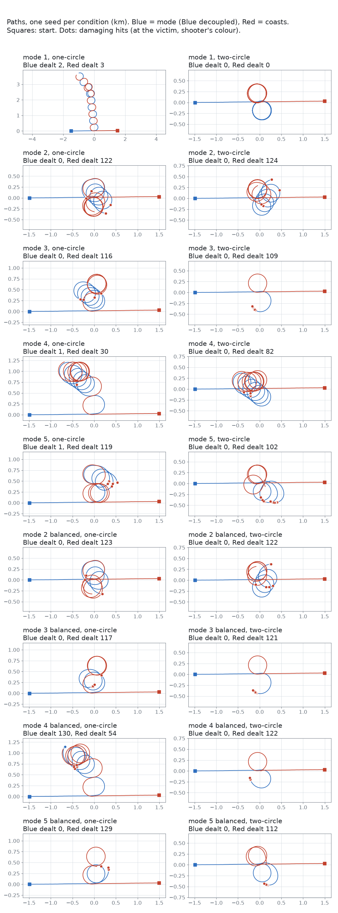
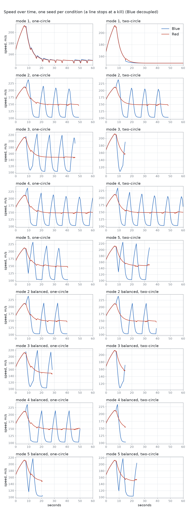
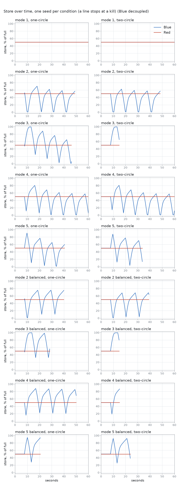
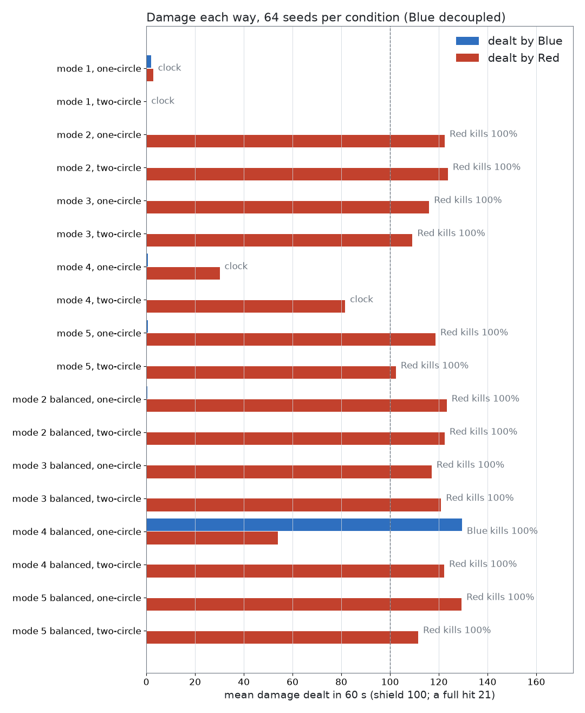

# Energy duel, decoupled: climb and dive at full stick

Question (author, 2026-11-25): the first energy duel ([energy-duel.md](energy-duel.md)) found
that at full stick a climb gains nothing, because the game gives the climb only the lift the
turn leaves. What if the climb and the dive are independent of the turn's lift, so a ship can
always buy altitude (climb: speed into store) or spend it (dive: store into speed) at full
stick? An experiment only: the game's default is unchanged.

Script: `bench/energy_duel.py --decoupled`, charts `bench/energy_duel_charts.py`; data in
[decoupled/](decoupled/) (`results.json`). CPU, a few minutes.

## The coupling, and the switch

In `lean/game/core.py` `_setting` (lines as on this branch):

- The climb's lift is what the turn leaves. A climb holds 1 g first (`first`, l.606;
  `held`, l.607), the stick takes its fraction of the rest as lateral acceleration
  (`lateral_size`, l.611), and the climb's extra lift gets only what is left of the budget
  (`room_left`, `left`, `vertical`, l.613-615). The climb's unmet demand is subtracted from
  the trade (`unmet`, `exchange`, l.631-634). At full stick `left` is zero, so the climb
  trades nothing.
- The dive adds turn through its demand. Its row of `demand_table` is g - the exchange,
  softened (l.167, l.184), so a dive holds almost nothing before the turn (`first = demand`,
  l.606). The stick then gets a larger lateral share, sqrt(budget^2 - held^2) instead of
  sqrt(budget^2 - g^2) (l.611).

The switch is a `GameConfig` flag, `decoupled_exchange` (default False, l.125). The change is
small: one Python bool (or, for this bench, a per-slot mask) passes through `flight_tick` into
`_setting`. With the flag off, the branch is never taken, so the compiled path keeps today's
code. With the flag on, the trade (unmet climb and sink, l.624-634) reads the straight-stick
vertical, `held` plus the climb's extra lift from `budget - held`. The wing itself is
unchanged: the turn, the vertical it holds and so the drag. The dive's trade and its extra turn
are unchanged too (a dive's vertical does not depend on the stick). The climb is still limited
near stall (author's clarification): its lift comes from the budget at its speed, which
shrinks toward the 1 g speed. The test is
`test_decoupled_exchange_is_off_by_default_and_trades_as_straight` in
`lean/game/tests/test_flight.py`. Re-running the coupled experiment on this branch with the
flag off reproduces the committed `results.json` exactly (largest difference 0).

## Exchange rates, read from the code

`core.steady_rates` at half store, full stick unless stated (`exchange_vs_speed` in
`results.json`; g is 39.24 m/s^2 in the game's units, and the trade is speed x 39.24 per
second). With the flag on, the full-stick climb's store rate equals today's straight-stick
climb at every speed. The test checks this from the 1 g speed (90.4 m/s) to 3 times it, for
every power.

| speed (m/s) | coast full stick: turn (deg/s), d speed/dt (m/s^2) | dive full stick: turn, d speed/dt, store/s | climb full stick today: turn, d speed/dt, store/s | climb full stick decoupled: turn, d speed/dt, store/s | climb straight today: store/s |
|---|---|---|---|---|---|
| 90 | 7.7, +16.3 | 28.2, +53.1, -3,549 | 7.7, +16.3, -150 | 7.7, +14.6, -0 | -0 |
| 99 | 16.5, +12.7 | 30.3, +51.2, -3,904 | 16.5, +12.7, -11 | 16.5, +4.3, 819 | 819 |
| 109 | 22.7, +10.4 | 32.4, +49.2, -4,259 | 22.7, +10.4, -1 | 22.7, -6.8, 1,873 | 1,873 |
| 118 | 27.4, +8.2 | 34.6, +47.0, -4,614 | 27.4, +8.2, -0 | 27.4, -18.9, 3,182 | 3,182 |
| 127 | 31.2, +5.9 | 36.9, +44.8, -4,969 | 31.2, +5.9, -0 | 31.2, -30.8, 4,646 | 4,646 |
| 136 | 34.7, +3.5 | 39.1, +42.4, -5,323 | 34.7, +3.5, -0 | 34.7, -35.7, 5,314 | 5,314 |
| 145 | 37.8, +1.0 | 41.4, +40.0, -5,678 | 37.8, +1.0, 0 | 37.8, -38.2, 5,678 | 5,678 |
| 154 | 40.8, -1.5 | 43.8, +37.5, -6,033 | 40.8, -1.5, 0 | 40.8, -40.8, 6,033 | 6,033 |
| 163 | 43.6, -4.1 | 46.1, +34.9, -6,388 | 43.6, -4.1, 0 | 43.6, -43.4, 6,388 | 6,388 |
| 172 | 46.4, -6.8 | 48.5, +32.3, -6,743 | 46.4, -6.8, 0 | 46.4, -46.0, 6,743 | 6,743 |
| 181 | 49.1, -9.6 | 50.8, +29.5, -7,098 | 49.1, -9.6, 0 | 49.1, -48.8, 7,098 | 7,098 |
| 190 | 51.7, -12.4 | 53.2, +26.7, -7,453 | 51.7, -12.4, 0 | 51.7, -51.6, 7,453 | 7,453 |
| 199 | 54.3, -15.3 | 55.6, +23.8, -7,808 | 54.3, -15.3, 0 | 54.3, -54.5, 7,808 | 7,808 |
| 208 | 56.9, -18.3 | 58.0, +20.9, -8,163 | 56.9, -18.3, 0 | 56.9, -57.5, 8,163 | 8,163 |
| 217 | 59.4, -21.3 | 60.4, +17.8, -8,518 | 59.4, -21.3, 0 | 59.4, -60.6, 8,518 | 8,518 |
| 226 | 61.9, -24.4 | 62.8, +14.8, -8,872 | 61.9, -24.4, 0 | 61.9, -63.6, 8,872 | 8,872 |

At the fight speeds (150-210 m/s) a full-stick climb now moves about 5,900-8,200 store/s
(every number in the rows is speed x 39.24) and takes about 39 m/s^2 off the coast's speed rate.
A dive does the opposite, adds about 39 m/s^2, and gives 1-4 deg/s more turn. The climb's
trade fades below about 135 m/s and is zero at the 1 g speed. Between 99 and 109 m/s a
full-stick climb holds its speed (the engine pays for the climb), turning at 16-23 deg/s
against the coast's 41-44 deg/s at 154-163 m/s.

## Is equal halves net zero?

No. Blue circling alone at full stick (`solo_net`, circles 2-4):

| mode | switch (deg) | exchange per circle without edges | realised store per circle | total energy per circle | store reached an edge band |
|---|---|---|---|---|---|
| 2 | 180.0 | -5,894 | -174 | -174 | bottom |
| 3 | 180.0 | -3,784 | -2,729 | -3,838 | bottom |
| 4 | 90.0 | -4,977 | -1,909 | -1,910 | bottom |
| 5 | 90.0 | -4,632 | -1,175 | -1,826 | bottom |
| 2 | 159.1 | 93 | 367 | 367 | bottom |
| 3 | 199.1 | -53 | -258 | -466 | top |
| 4 | 79.9 | 133 | -59 | -59 | no |
| 5 | 100.0 | -132 | -324 | -282 | no |

Equal halves lose 3,800-5,900 store per circle without the edges. The 180 deg climb takes
speed from about 220 to about 103 m/s within a few seconds (speed chart). There the climb's
trade is mostly gone, so the climb's half returns less than the dive's half spends. (In the
first run's measure the climb was counted at its full rate. The bench now reads the game's
own trade at mid store, `exchange_rate`, so the stall fade is counted.)

**Balanced variants**, all at full stick, with the switch found by the same three grid passes
on the exchange without edges. Each lands on a dive arc of about 160 deg of 360 (200 deg of
climb): mode 2 dives 0-159 deg; mode 3 climbs 0-199 deg; mode 4 dives within 80 deg of the
merge direction; mode 5 climbs within 100 deg of it. The realised store of modes 2 and 3
still touches an edge each circle; modes 4 and 5 stay off the edges.

## Results

Same setup as the first run: 1v1, no fields, fog off, the same head-on start at 167.7 m/s and
half store, Red always coasts, both at full stick toward the lead point, Blue commits one- or
two-circle at each merge, the same firing rule, 64 environments x 1,800 ticks. Blue flies
decoupled; Red flies today's rule.

**Side by side with the coupled run.** The balanced rows differ in kind: coupled is a
middle-stick climb with a ~232 deg dive arc; decoupled is a full-stick climb with a ~160 deg
dive arc.

| condition | coupled: dive switch | coupled: Blue kill / Red kill / clock | coupled: damage by Blue / Red | decoupled: dive switch | decoupled: Blue kill / Red kill / clock | decoupled: damage by Blue / Red |
|---|---|---|---|---|---|---|
| mode 1, one-circle | - | 0% / 0% / 100% | 2.0 / 2.8 | - | 0% / 0% / 100% | 2.0 / 2.8 |
| mode 1, two-circle | - | 0% / 0% / 100% | 0.0 / 0.0 | - | 0% / 0% / 100% | 0.0 / 0.0 |
| mode 2, one-circle | 180 | 0% / 0% / 100% | 1.1 / 12.8 | 180 | 0% / 100% / 0% | 0.2 / 122.4 |
| mode 2, two-circle | 180 | 0% / 0% / 100% | 61.6 / 0.0 | 180 | 0% / 100% / 0% | 0.0 / 123.7 |
| mode 3, one-circle | 180 | 0% / 0% / 100% | 6.4 / 3.8 | 180 | 0% / 100% / 0% | 0.0 / 116.0 |
| mode 3, two-circle | 180 | 0% / 0% / 100% | 84.5 / 0.0 | 180 | 0% / 100% / 0% | 0.0 / 109.2 |
| mode 4, one-circle | 90 | 0% / 0% / 100% | 2.3 / 3.3 | 90 | 0% / 0% / 100% | 0.6 / 30.1 |
| mode 4, two-circle | 90 | 0% / 0% / 100% | 78.6 / 0.0 | 90 | 0% / 0% / 100% | 0.0 / 81.6 |
| mode 5, one-circle | 90 | 0% / 0% / 100% | 3.4 / 3.3 | 90 | 0% / 100% / 0% | 0.6 / 118.6 |
| mode 5, two-circle | 90 | 0% / 0% / 100% | 57.0 / 0.0 | 90 | 0% / 100% / 0% | 0.1 / 102.4 |
| mode 2 balanced, one-circle | 234 | 0% / 100% / 0% | 0.1 / 114.4 | 159 | 0% / 100% / 0% | 0.3 / 123.3 |
| mode 2 balanced, two-circle | 234 | 0% / 100% / 0% | 0.0 / 121.5 | 159 | 0% / 100% / 0% | 0.0 / 122.4 |
| mode 3 balanced, one-circle | 129 | 0% / 100% / 0% | 0.0 / 114.2 | 199 | 0% / 100% / 0% | 0.0 / 117.1 |
| mode 3 balanced, two-circle | 129 | 0% / 100% / 0% | 0.2 / 114.7 | 199 | 0% / 100% / 0% | 0.0 / 120.9 |
| mode 4 balanced, one-circle | 117 | 0% / 100% / 0% | 0.0 / 113.9 | 80 | 100% / 0% / 0% | 129.5 / 54.0 |
| mode 4 balanced, two-circle | 117 | 0% / 100% / 0% | 0.0 / 112.1 | 80 | 0% / 100% / 0% | 0.0 / 122.2 |
| mode 5 balanced, one-circle | 64 | 0% / 100% / 0% | 0.0 / 107.8 | 100 | 0% / 100% / 0% | 0.0 / 129.3 |
| mode 5 balanced, two-circle | 64 | 0% / 100% / 0% | 0.0 / 123.1 | 100 | 0% / 100% / 0% | 0.0 / 111.6 |

**Decoupled, full table** (the columns of the first run's table):

| condition | dive switch (deg) | Blue kill / Red kill / clock | damage by Blue / Red | first damaging hit Blue / Red (s) | speed Blue / Red (m/s) | turn rate Blue / Red (deg/s) | Blue store per circle: realised / without edges | Blue total energy per circle | Blue angles off, passes 2-4 (deg) |
|---|---|---|---|---|---|---|---|---|---|
| mode 1, one-circle | - | 0% / 0% / 100% | 2.0 / 2.8 | - / - | 159 / 158 | 37.8 / 37.1 | 0 / 0 | -11,498 | 184, 183, 182 |
| mode 1, two-circle | - | 0% / 0% / 100% | 0.0 / 0.0 | - / - | 158 / 158 | 40.6 / 40.6 | 0 / 0 | -2,202 | 178, 181, 182 |
| mode 2, one-circle | 180 | 0% / 100% / 0% | 0.2 / 122.4 | - / 15.8 | 151 / 161 | 36.1 / 39.5 | 722 / -3,673 | -4,741 | 182, 241, 253 |
| mode 2, two-circle | 180 | 0% / 100% / 0% | 0.0 / 123.7 | - / 31.8 | 150 / 161 | 36.4 / 39.8 | 818 / -5,137 | -4,749 | 237, 249, 256 |
| mode 3, one-circle | 180 | 0% / 100% / 0% | 0.0 / 116.0 | - / 11.4 | 155 / 162 | 38.6 / 40.3 | -3,912 / -3,494 | -4,385 | 233, 246, 253 |
| mode 3, two-circle | 180 | 0% / 100% / 0% | 0.0 / 109.2 | - / 14.2 | 169 / 186 | 39.9 / 43.3 | - / - | - | - |
| mode 4, one-circle | 90 | 0% / 0% / 100% | 0.6 / 30.1 | - / 16.3 | 149 / 159 | 36.3 / 39.0 | -1,653 / -3,989 | -2,907 | 193, 219, 247 |
| mode 4, two-circle | 90 | 0% / 0% / 100% | 0.0 / 81.6 | - / 14.7 | 151 / 159 | 37.4 / 39.2 | -1,828 / -4,320 | -2,878 | 214, 241, 265 |
| mode 5, one-circle | 90 | 0% / 100% / 0% | 0.6 / 118.6 | - / 21.4 | 155 / 164 | 37.1 / 39.7 | -1,474 / -2,488 | -6,273 | 182, 198, 192 |
| mode 5, two-circle | 90 | 0% / 100% / 0% | 0.1 / 102.4 | - / 22.8 | 157 / 165 | 37.7 / 38.3 | -452 / -875 | -6,877 | 198, 183, 169 |
| mode 2 balanced, one-circle | 159 | 0% / 100% / 0% | 0.3 / 123.3 | - / 15.9 | 150 / 164 | 35.2 / 39.7 | 3,912 / 1,909 | -4,283 | 184, 242, 256 |
| mode 2 balanced, two-circle | 159 | 0% / 100% / 0% | 0.0 / 122.4 | - / 25.5 | 151 / 164 | 36.3 / 40.4 | 2,031 / 309 | -3,536 | 245, 250, 269 |
| mode 3 balanced, one-circle | 199 | 0% / 100% / 0% | 0.0 / 117.1 | - / 11.4 | 159 / 170 | 38.8 / 41.3 | -2,494 / 1,284 | -2,529 | 235, 246 |
| mode 3 balanced, two-circle | 199 | 0% / 100% / 0% | 0.0 / 120.9 | - / 14.1 | 167 / 186 | 39.1 / 43.1 | - / - | - | - |
| mode 4 balanced, one-circle | 80 | 100% / 0% / 0% | 129.5 / 54.0 | 49.9 / 16.4 | 146 / 161 | 34.7 / 39.1 | 863 / 1,057 | -1,585 | 196, 237, 288 |
| mode 4 balanced, two-circle | 80 | 0% / 100% / 0% | 0.0 / 122.2 | - / 14.6 | 171 / 185 | 39.2 / 43.5 | - / - | - | - |
| mode 5 balanced, one-circle | 100 | 0% / 100% / 0% | 0.0 / 129.3 | - / 11.4 | 162 / 177 | 38.1 / 42.1 | 6,220 / 6,463 | -8,175 | 170 |
| mode 5 balanced, two-circle | 100 | 0% / 100% / 0% | 0.0 / 111.6 | - / 23.5 | 161 / 173 | 38.5 / 40.6 | 7,250 / 7,504 | -8,837 | 206 |

**Reference: Red decoupled too.** Every condition was flown again with Red also decoupled (same
seeds and batch). Every summary number is identical (largest difference 0). Red only ever
coasts, and for coast the decoupled trade reads the same vertical as today's, so the flag
cannot touch it.

## What it shows

- **A full-stick climb is now a heavy speed brake.** It takes speed x 39.24 per second out of
  the speed and into the store. Within one 160-200 deg climb arc Blue falls from about
  210-235 m/s to about 103 m/s, where the climb holds its speed and Blue turns at roughly half
  of Red's rate. Blue's mean turn rate is below Red's in every climbing mode (34.7-39.9
  against 38.3-43.5 deg/s), and so is its mean speed (146-171 against 159-186 m/s).
- **Climbing loses.** Red kills Blue in all 64 seeds of 13 of the 16 climbing conditions. In
  modes 4 one- and two-circle (dive near Red, equal halves) the clock runs out with Red
  ahead (30 and 82 damage against about 0). The fastest losses are two-circle fights that climb
  through most of the first circle (mode 3 and mode 3 balanced climb first; mode 4 balanced
  climbs after an 80 deg dive). Blue is shot at about 14-15 s, before completing a circle.
- **One exception: mode 4 balanced, one-circle** (dive within 80 deg of the merge direction,
  climb elsewhere): Blue kills in 64 of 64 seeds, late (first damaging hit 49.9 s, the kill
  0.2 s later, mean 129.5 damage in one burst) after taking 54. Red is ahead in angles off at
  passes 2-4 (196, 237, 288 deg), so this is a single high-speed snapshot, not a won fight. It
  holds for switches from 75 to 82 deg, where Blue kills in every seed, always late (49.5-59.8
  s). At 70 deg Red kills, and at 85 and 90 deg the clock runs out (16 seeds per switch,
  measured separately, not in `results.json`).
- **Against the coupled run:** there, equal halves spent the store once, and in the two-circle
  fight that bought 20-35 deg of angles off and 57-85 damage, with no loss. Decoupled, the
  same schedules keep refilling the store by climbing at full stick, and the refill costs the
  turn. Coast against coast is unchanged (Blue's physics only changes when it climbs).

So making the climb independent of the turn's lift does not give Blue a usable net-zero cycle
in these physics. The climb's exchange (1 g of deceleration at the fight speeds) is large
against the speed band (stall 90 m/s, fight speeds about 150 m/s). A 160-200 deg climb at full
stick empties the speed down to the climb's own stall limit, and the turn rate goes with it.
