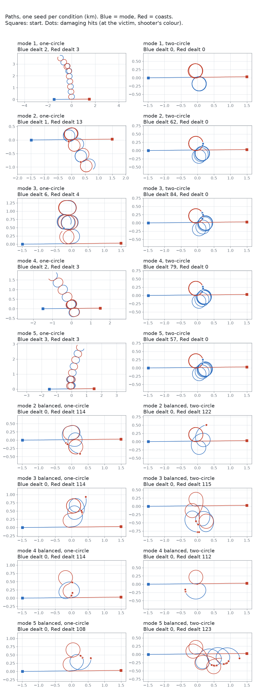
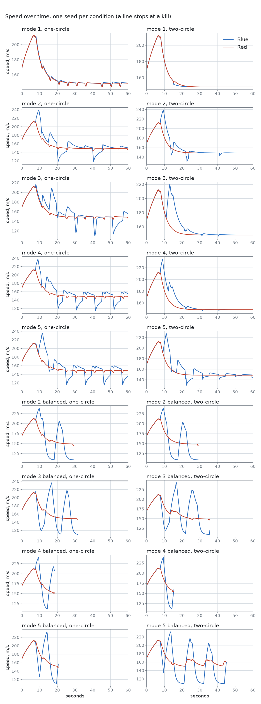
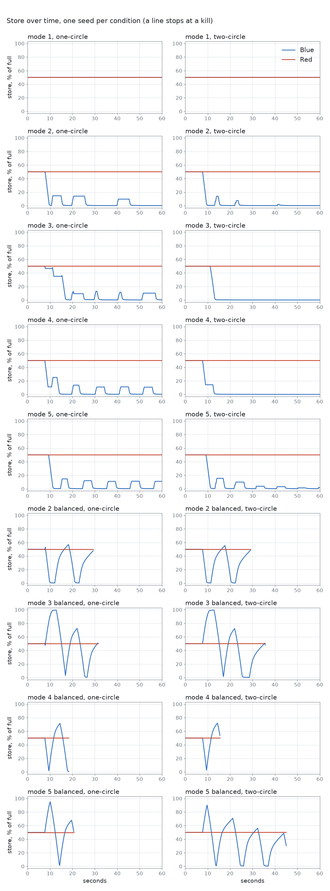
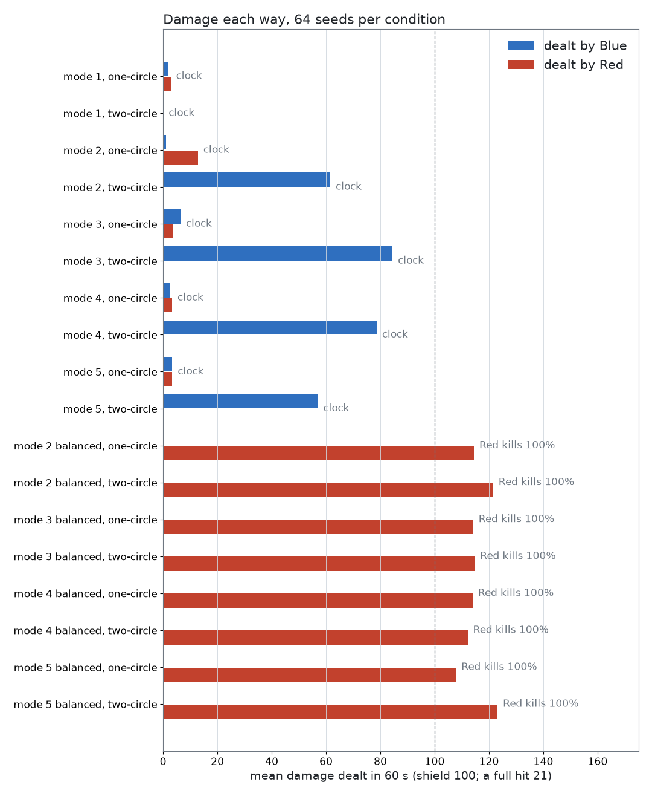

# Energy duel: can the store break a head-on stalemate?

Question (author, 2026-11-25): with identical ships, a kinematic model (constant speed and turn
rate) shows head-on duels stalemate. In the real game physics, can managing the store (power 1
dive: store into speed; power 2 climb: speed into store; power 0 coast) break it?

Script: `bench/energy_duel.py` (the fight, the solo balance search, `results.json`,
`traces.pt`); charts: `bench/energy_duel_charts.py`. CPU, about a minute in all.

## Setup

- Lean game, 1v1, no fields, **fog off**. Every number is read from the game (ship card,
  `GameConfig`) or the scripted agent's yardstick (`ScriptedConfig`).
- Blue at (-1.5 km, 0) nose east, Red at (+1.5 km, 30 m) nose west: 3 km apart, nose to
  nose. The 30 m offset gives the pass a side (left to left); without it the side is set by
  rounding. Not the evaluation's spawn (that is random, not head-on).
- Start speed: the card's best sustained-turn speed, 167.7 m/s; store at half (16,489 of
  32,979, the deal's spawn store); full shield (100).
- Steering: full stick toward the scripted agent's lead point (its drag-law time of flight,
  lead gain 1.22 and cap), straight while the nose is within the gun tolerance of it.
- Gun tolerance: the scripted agent's, 0.977 x the target's angular size (2 atan(12 m /
  range), at least 1 deg); fire when within it and inside gun range (697 m). The gun fires
  every tick; a full hit is 21 points; the card's head-on fraction is 0, so a nose-on hit does
  no damage.
- Red: coasts all game. Blue: like Red until the merge (Red more than 90 deg off its nose),
  then commits a turn (two-circle: toward Red's side; one-circle: away) at full stick until
  its nose is within 10 deg of the lead point, then tracks like Red. It commits again at each
  later merge. Circle phase: Blue's heading change since the first merge in the first
  committed sense, modulo 360 deg. Before the first merge Blue coasts.
- 64 environments per condition, 1,800 ticks (60 s). The repeats differ only in bullet spread
  (3.1 m/s on a 2,084 m/s bullet), so the fights are nearly identical across seeds: the
  standard deviation of damage across seeds is at most 11 points (one condition), mostly
  under 4.
- A "damaging hit" is one tick's damage of at least 1 point. A pass is a closest approach
  under 1.5 km; "angles off" is the scripted agent's measure (aspect + |bearing|, 180 deg
  neutral, under 180 Blue has gained) read 1 s after each pass.

## The climb does nothing at full stick

At full stick the turn takes the whole lift budget, and the game gives a climb only the lift
the turn leaves (`lean.game.core._setting`). So with both ships always at full stick, power 2
is the same as power 0: no store is gained (`steady_rates` at 160 m/s: climb and coast both
42.8 deg/s, -3.3 m/s^2, store rate 0). A dive at full stick drains speed x 39.24 per second
(about 6,300/s at 160 m/s) and adds 2.6 deg/s of turn.

So the equal-halves modes 2-5 are not net zero: they spend the store once. Solo (Blue circling
alone), the commanded exchange per circle is about -26,700 for each of modes 2-5; the
realised store empties within the first circle after the merge and then sits near zero (it
refills only on the few ticks Blue flies straight on a solution while climbing).

**Balanced variants.** No switch point can balance a full-stick climb, so the balanced
variants climb at the middle stick (2/3), where a climb does fill the store at the same rate a
dive drains it. With the equal split that gains about +20,700 per circle; one switch per mode
was found by three grid passes on Blue circling alone, balancing the store's exchange without
its edges (dive -, middle-stick climb +, speed x 39.24). Every mode lands on a dive arc of about
232 deg (the four modes are the same 180/180 schedule rotated by 90 deg steps):

| mode | schedule | balanced switch |
|---|---|---|
| 2 | dive 0 to s, climb s to 360 | 234 deg |
| 3 | climb 0 to s, dive s to 360 | 129 deg |
| 4 | dive within s of the merge direction (0 to s, 360-s to 360) | 117 deg |
| 5 | climb within s of the merge direction, dive elsewhere | 64 deg |

Even balanced, a 230 deg dive at full stick moves about 27,000 of the 33,000 store, so the
realised store still swings from edge to edge each circle (chart b).

## Results

"Without edges" is the commanded exchange (what the store would do without its taper at the
ends); "realised" is the store's actual change. Both are means over completed circles.
Total energy is store + v^2/2 (per unit mass, the game's units). A dash: none measured (no
damaging hit, or no completed circle before the kill).

| condition | dive switch (deg) | Blue kill / Red kill / clock | damage by Blue / Red | first damaging hit Blue / Red (s) | speed Blue / Red (m/s) | turn rate Blue / Red (deg/s) | Blue store per circle: realised / without edges | Blue total energy per circle | Blue angles off, passes 2-4 (deg) |
|---|---|---|---|---|---|---|---|---|---|
| mode 1, one-circle | - | 0% / 0% / 100% | 2.0 / 2.8 | - / - | 159 / 158 | 37.8 / 37.1 | 0 / 0 | -11,498 | 184, 183, 182 |
| mode 1, two-circle | - | 0% / 0% / 100% | 0.0 / 0.0 | - / - | 158 / 158 | 40.6 / 40.6 | 0 / 0 | -2,202 | 178, 181, 182 |
| mode 2, one-circle | 180 | 0% / 0% / 100% | 1.1 / 12.8 | - / 25.3 | 162 / 159 | 40.1 / 38.3 | -2,304 / -16,894 | -3,819 | 181, 177, 193 |
| mode 2, two-circle | 180 | 0% / 0% / 100% | 61.6 / 0.0 | 13.4 / - | 162 / 158 | 41.2 / 40.7 | -3,278 / -24,624 | -5,477 | 150, 151, 146 |
| mode 3, one-circle | 180 | 0% / 0% / 100% | 6.4 / 3.8 | 19.7 / - | 162 / 158 | 38.4 / 37.3 | -2,455 / -21,596 | -5,071 | 181, 173, 191 |
| mode 3, two-circle | 180 | 0% / 0% / 100% | 84.5 / 0.0 | 13.9 / - | 164 / 158 | 41.3 / 40.7 | -3,289 / -28,625 | -5,489 | 155, 147, 147 |
| mode 4, one-circle | 90 | 0% / 0% / 100% | 2.3 / 3.3 | - / - | 161 / 158 | 37.6 / 36.7 | -5,177 / -18,318 | -8,654 | 181, 180, 190 |
| mode 4, two-circle | 90 | 0% / 0% / 100% | 78.6 / 0.0 | 13.6 / - | 163 / 158 | 41.3 / 40.7 | -3,289 / -27,956 | -5,489 | 147, 145, 145 |
| mode 5, one-circle | 90 | 0% / 0% / 100% | 3.4 / 3.3 | - / - | 161 / 158 | 37.5 / 36.8 | -1,605 / -14,439 | -3,390 | 177, 188, 178 |
| mode 5, two-circle | 90 | 0% / 0% / 100% | 57.0 / 0.0 | 13.5 / - | 162 / 158 | 41.1 / 40.7 | -3,201 / -24,024 | -5,437 | 158, 158, 155 |
| mode 2 balanced, one-circle | 234 | 0% / 100% / 0% | 0.1 / 114.4 | - / 15.5 | 167 / 169 | 35.7 / 40.7 | 1,442 / -5,492 | -14,035 | 183, 251, 310 |
| mode 2 balanced, two-circle | 234 | 0% / 100% / 0% | 0.0 / 121.5 | - / 28.9 | 164 / 168 | 35.8 / 41.8 | 1,798 / -1,088 | -14,271 | 249, 274 |
| mode 3 balanced, one-circle | 129 | 0% / 100% / 0% | 0.0 / 114.2 | - / 11.5 | 173 / 177 | 36.7 / 42.2 | -7,875 / -2,604 | -9,184 | 260, 266 |
| mode 3 balanced, two-circle | 129 | 0% / 100% / 0% | 0.2 / 114.7 | - / 14.9 | 167 / 168 | 35.0 / 37.2 | 109 / 4,553 | -7,935 | 170, 155 |
| mode 4 balanced, one-circle | 117 | 0% / 100% / 0% | 0.0 / 113.9 | - / 10.8 | 184 / 180 | 42.3 / 42.9 | -7,468 / -1,798 | -10,662 | 242 |
| mode 4 balanced, two-circle | 117 | 0% / 100% / 0% | 0.0 / 112.1 | - / 14.9 | 181 / 185 | 40.0 / 43.3 | - / - | - | - |
| mode 5 balanced, one-circle | 64 | 0% / 100% / 0% | 0.0 / 107.8 | - / 11.5 | 176 / 178 | 38.8 / 42.6 | -3,925 / -4,257 | -13,201 | 185 |
| mode 5 balanced, two-circle | 64 | 0% / 100% / 0% | 0.0 / 123.1 | - / 23.7 | 158 / 167 | 33.8 / 36.1 | -1,863 / -377 | -7,043 | 199, 176, 172 |

All fights start with the same approach: the engine takes both ships from 168 to about
212 m/s before the merge at 7.7 s (closest approach 15 m, crossing 180 deg); the coasting
full-stick fight then settles at about 148 m/s.

## What it shows

- **Coasting against coasting stalemates**, as in the kinematic model. Two-circle: every pass
  crosses at 178-180 deg, no damage either way. One-circle: the ships pass nearly nose to nose
  every 4-5 s, a few points of damage each way, never a kill.
- **Spending the store wins angles in the two-circle fight** (modes 2-5, equal halves).
  The extra turn and speed of the first dive gives Blue 22-35 deg of angles off by the second
  or third pass, which it keeps after the store is empty (equal turn rates hold the geometry). Blue
  lands 57-85 points, Red none, the first damaging hit at 13-14 s. No kill in 60 s: the
  shots come at high crossing angles and long range, where little damage lands.
- **Spending the store does nothing useful in the one-circle fight**: the passes stay near
  180 deg, damage stays at a few points each way (mode 2 gives Red 13 points).
- **Climbing at the middle stick loses every time** (all balanced variants): in the climb
  phase Blue turns slower than Red (mean 34-42 against 36-43 deg/s), and Red kills Blue in
  all 64 seeds of every balanced condition, between 15 and 45 s. In most of them Red is
  70-130 deg ahead by the second or third pass; in mode 3 and mode 5 two-circle Blue is
  slightly ahead at the passes (155-176 deg) and still dies, shot during its slow climbing
  turn between passes.

So in these physics the store breaks the stalemate only as a one-off spend in a two-circle
fight, and it buys position, not a kill within the minute. A net-zero dive/climb cycle cannot
be flown at full stick, and paying for it with turn is fatal against a ship that keeps full
stick.

The same experiment with the climb and dive independent of the turn's lift (an experiment-only
switch): [decoupled.md](decoupled.md).

The same experiment with the trade at a 45 deg flight path (0.707 g) in both physics:
[exchange45.md](exchange45.md).
