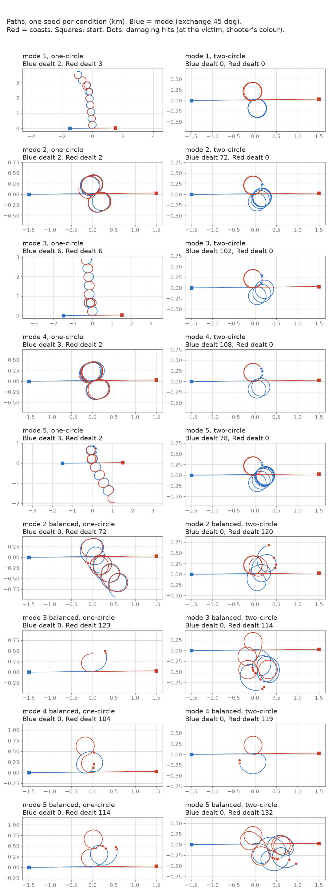
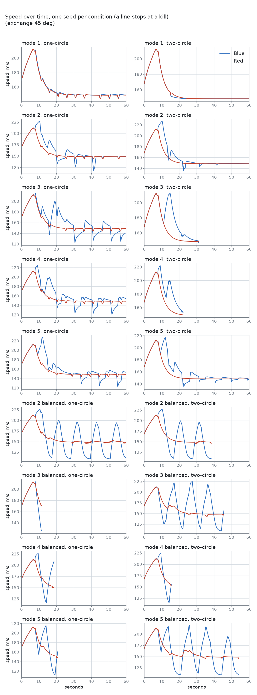
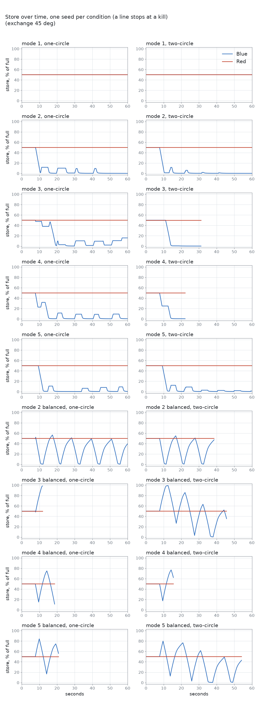
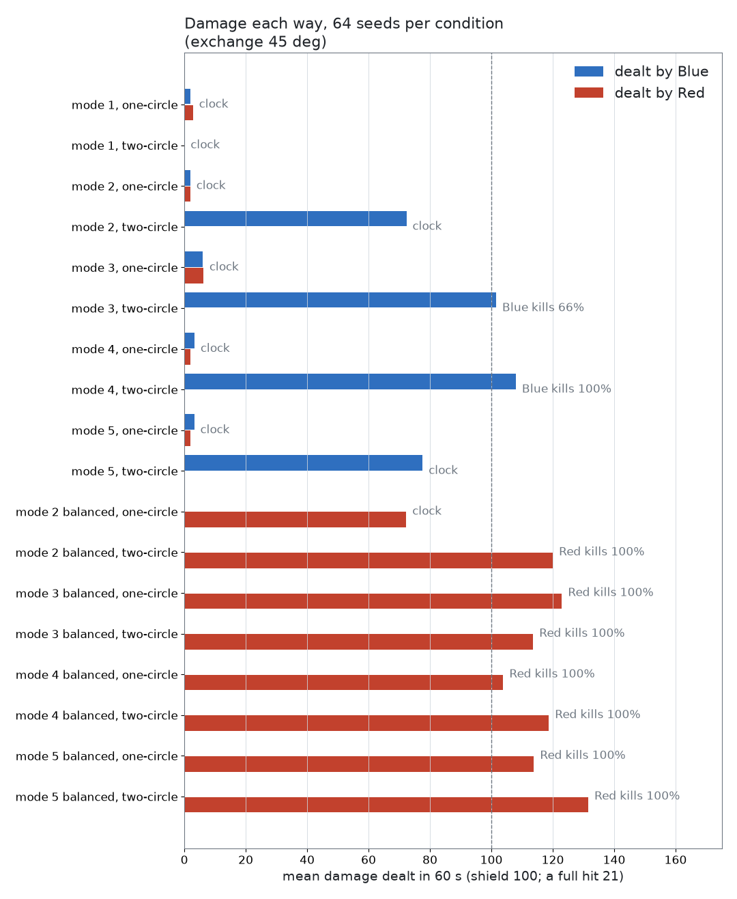
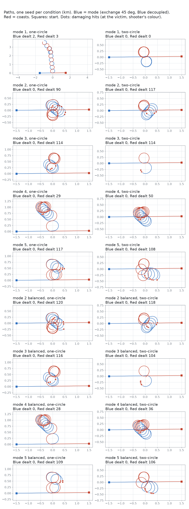
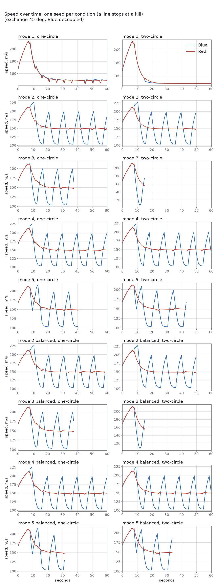
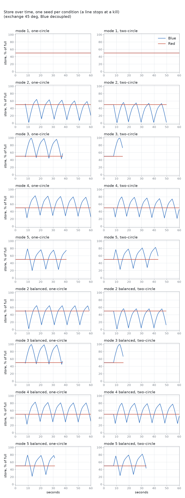
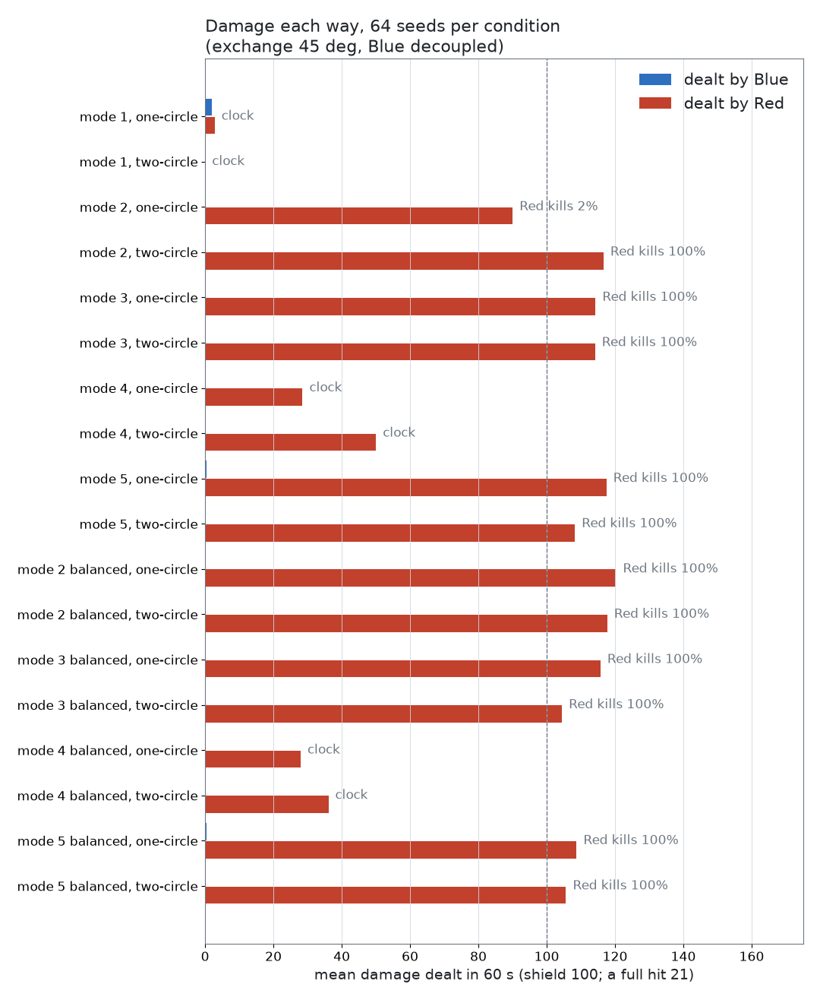

# Energy duel, exchange at 45 degrees

Question (author, 2026-11-25): the card trades speed and store at 1 g (`exchange_acceleration`
= `card.GRAVITY`, a vertical zoom or dive; `lean/game/tuning.py` `airframe_row`). What if the
climb and dive are a single 45 deg flight path, so the trade is g x sin 45 deg = 0.707 g? Both
physics: coupled (today's rule: the climb gets only the lift the turn leaves) and decoupled
(`GameConfig.decoupled_exchange`, [decoupled.md](decoupled.md)). An experiment only. The
game's card and default are unchanged.

Script: `bench/energy_duel.py --exchange-angle 45 [--decoupled]`, charts
`bench/energy_duel_charts.py`; data in [exchange45/coupled/](exchange45/coupled/) and
[exchange45/decoupled/](exchange45/decoupled/) (`results.json`). Steady rates:
`exchange45/steady.json` (45 deg) and `exchange45/reference-1g/steady.json` (the card as is),
from `--steady-only`. CPU, a few minutes per run.

## How the override is done

`override_exchange(angle)` in the bench runs first in `main`, before any ship card is built. It
reads the derived card (`card.CARD`, `lean.game.tuning.load_card`) and replaces the in-memory
`card.CARD` with a copy whose `exchange_acceleration` is `card.GRAVITY x sin(angle)`. It also
clears the built ship cards (`core._SHIP_CARDS`) and the bench's own cached constants.
Everything the game derives from the exchange (the dive and climb rows of `commanded_table` and
`demand_table`, `lean/game/core.py` `_per_type`) then follows for that process only. Nothing on
disk changes. The bench reads the value back from the built constants: 27.75 m/s^2 = 0.7071 g
(the card's own value, read before the override: 39.24 = 1 g). Red and Blue fly the same card.

## Steady rates at corner and sustained speed

`core.steady_rates`, full stick, half store. Turn rate in deg/s, d speed/dt in m/s^2, store in
per second. Corner speed 255.8 m/s, best sustained-turn speed 167.7 m/s; full store 32,979.

| speed | power | 1 g coupled | 1 g decoupled | 45 deg coupled | 45 deg decoupled |
|---|---|---|---|---|---|
| corner | coast | 67.2, -29.4, 0 | 67.2, -29.4, 0 | 67.2, -29.4, 0 | 67.2, -29.4, 0 |
| corner | dive | 67.8, +9.8, -10,038 | 67.8, +9.8, -10,038 | 67.7, -1.6, -7,098 | 67.7, -1.6, -7,098 |
| corner | climb | 67.2, -29.4, 0 | 67.2, -68.6, +10,038 | 67.2, -29.4, 0 | 67.2, -57.1, +7,098 |
| sustained | coast | 45.1, -5.6, 0 | 45.1, -5.6, 0 | 45.1, -5.6, 0 | 45.1, -5.6, 0 |
| sustained | dive | 47.4, +33.5, -6,581 | 47.4, +33.5, -6,581 | 47.1, +22.0, -4,654 | 47.1, +22.0, -4,654 |
| sustained | climb | 45.1, -5.6, 0 | 45.1, -44.8, +6,581 | 45.1, -5.6, 0 | 45.1, -33.3, +4,654 |

- At corner speed the 45 deg dive nearly holds speed (-1.6 m/s^2, against the coast's -29.4).
- **Diving at corner speed** at the mid-store rate (without the store's edge taper), a half
  store lasts 2.32 s and a full store 4.65 s at 45 deg; 1.64 s and 3.29 s at 1 g.
- The dive's extra turn is smaller at 45 deg (+0.5 deg/s at corner, +2.0 at sustained; at 1 g
  +0.6 and +2.3): its demand row is g - 0.707 g instead of about zero.
- **Coupled, a full-stick climb still trades nothing** at 45 deg (store rate 0, the same turn
  and d speed/dt as coasting). So the coupled balanced variants again climb at the middle stick
  (2/3), as in the first run.

## Is equal halves net zero?

Blue circling alone (`solo_net`, circles 2-4), exchange per circle without the store's edges:

- **45 deg coupled, full-stick climb:** -18,830 to -18,890 per circle for modes 2-5 (1 g:
  about -26,700). The store empties and sits at the bottom, as at 1 g.
- **45 deg coupled, middle-stick climb:** +12,760 to +14,640 per circle. Balanced (middle-stick
  climb, three grid passes): switches 230 / 133 / 114 / 66 deg for modes 2 / 3 / 4 / 5 (1 g:
  234 / 129 / 117 / 64), a dive arc of about 230 deg. The realised store still touches the
  bottom band every circle (check rows: realised -440 to -3,140 per circle).
- **45 deg decoupled, full-stick climb:** -260 to -610 per circle (1 g: -3,800 to -5,900).
  Equal halves are now close to net zero. Balanced at full stick: switches 178 / 182 / 89 / 91
  deg (1 g: 159 / 199 / 80 / 100). Modes 4 and 5 stay off the edge bands; modes 2 and 3 touch
  one edge per circle.

## Results

Same setup as the first two runs: 1v1, no fields, fog off, head-on start at 167.7 m/s and half
store, Red coasts, both at full stick toward the lead point, Blue commits one- or two-circle at
each merge, 64 environments x 1,800 ticks. Decoupled: Blue decoupled, Red today's rule (Red
decoupled too gives identical summaries, largest difference 0, as at 1 g).

**Four ways.** Each cell: dive switch (deg); Blue kill / Red kill / clock; damage by Blue / by
Red. Balanced rows: coupled climbs at the middle stick, decoupled at full stick.

| condition | 1 g coupled | 1 g decoupled | 45 deg coupled | 45 deg decoupled |
|---|---|---|---|---|
| mode 1, one-circle | -; 0/0/100%; 2.0 / 2.8 | -; 0/0/100%; 2.0 / 2.8 | -; 0/0/100%; 2.0 / 2.8 | -; 0/0/100%; 2.0 / 2.8 |
| mode 1, two-circle | -; 0/0/100%; 0.0 / 0.0 | -; 0/0/100%; 0.0 / 0.0 | -; 0/0/100%; 0.0 / 0.0 | -; 0/0/100%; 0.0 / 0.0 |
| mode 2, one-circle | 180; 0/0/100%; 1.1 / 12.8 | 180; 0/100/0%; 0.2 / 122.4 | 180; 0/0/100%; 1.9 / 1.9 | 180; 0/2/98%; 0.3 / 90.0 |
| mode 2, two-circle | 180; 0/0/100%; 61.6 / 0.0 | 180; 0/100/0%; 0.0 / 123.7 | 180; 0/0/100%; 72.3 / 0.0 | 180; 0/100/0%; 0.0 / 116.6 |
| mode 3, one-circle | 180; 0/0/100%; 6.4 / 3.8 | 180; 0/100/0%; 0.0 / 116.0 | 180; 0/0/100%; 6.0 / 6.2 | 180; 0/100/0%; 0.0 / 114.3 |
| mode 3, two-circle | 180; 0/0/100%; 84.5 / 0.0 | 180; 0/100/0%; 0.0 / 109.2 | 180; **66**/0/34%; 101.5 / 0.0 | 180; 0/100/0%; 0.0 / 114.2 |
| mode 4, one-circle | 90; 0/0/100%; 2.3 / 3.3 | 90; 0/0/100%; 0.6 / 30.1 | 90; 0/0/100%; 3.3 / 1.9 | 90; 0/0/100%; 0.3 / 28.5 |
| mode 4, two-circle | 90; 0/0/100%; 78.6 / 0.0 | 90; 0/0/100%; 0.0 / 81.6 | 90; **100**/0/0%; 108.0 / 0.0 | 90; 0/0/100%; 0.0 / 50.0 |
| mode 5, one-circle | 90; 0/0/100%; 3.4 / 3.3 | 90; 0/100/0%; 0.6 / 118.6 | 90; 0/0/100%; 3.2 / 1.9 | 90; 0/100/0%; 0.4 / 117.5 |
| mode 5, two-circle | 90; 0/0/100%; 57.0 / 0.0 | 90; 0/100/0%; 0.1 / 102.4 | 90; 0/0/100%; 77.6 / 0.0 | 90; 0/100/0%; 0.2 / 108.2 |
| mode 2 balanced, one-circle | 234; 0/100/0%; 0.1 / 114.4 | 159; 0/100/0%; 0.3 / 123.3 | 230; 0/0/100%; 0.1 / 72.3 | 178; 0/100/0%; 0.3 / 120.3 |
| mode 2 balanced, two-circle | 234; 0/100/0%; 0.0 / 121.5 | 159; 0/100/0%; 0.0 / 122.4 | 230; 0/100/0%; 0.0 / 120.0 | 178; 0/100/0%; 0.0 / 117.7 |
| mode 3 balanced, one-circle | 129; 0/100/0%; 0.0 / 114.2 | 199; 0/100/0%; 0.0 / 117.1 | 133; 0/100/0%; 0.0 / 122.9 | 182; 0/100/0%; 0.0 / 115.7 |
| mode 3 balanced, two-circle | 129; 0/100/0%; 0.2 / 114.7 | 199; 0/100/0%; 0.0 / 120.9 | 133; 0/100/0%; 0.0 / 113.6 | 182; 0/100/0%; 0.0 / 104.5 |
| mode 4 balanced, one-circle | 117; 0/100/0%; 0.0 / 113.9 | 80; **100**/0/0%; 129.5 / 54.0 | 114; 0/100/0%; 0.0 / 103.8 | 89; 0/0/100%; 0.3 / 28.0 |
| mode 4 balanced, two-circle | 117; 0/100/0%; 0.0 / 112.1 | 80; 0/100/0%; 0.0 / 122.2 | 114; 0/100/0%; 0.0 / 118.7 | 89; 0/0/100%; 0.0 / 36.1 |
| mode 5 balanced, one-circle | 64; 0/100/0%; 0.0 / 107.8 | 100; 0/100/0%; 0.0 / 129.3 | 66; 0/100/0%; 0.0 / 113.8 | 91; 0/100/0%; 0.0 / 108.7 |
| mode 5 balanced, two-circle | 64; 0/100/0%; 0.0 / 123.1 | 100; 0/100/0%; 0.0 / 111.6 | 66; 0/100/0%; 0.0 / 131.5 | 91; 0/100/0%; 0.1 / 105.7 |

**45 deg coupled, full table** (columns as in the first run; a dash: none measured):

| condition | dive switch (deg) | Blue kill / Red kill / clock | damage by Blue / Red | first damaging hit Blue / Red (s) | speed Blue / Red (m/s) | turn rate Blue / Red (deg/s) | Blue store per circle: realised / without edges | Blue total energy per circle | Blue angles off, passes 2-4 (deg) |
|---|---|---|---|---|---|---|---|---|---|
| mode 1, one-circle | - | 0% / 0% / 100% | 2.0 / 2.8 | - / - | 159 / 158 | 37.8 / 37.1 | 0 / 0 | -11,498 | 184, 183, 182 |
| mode 1, two-circle | - | 0% / 0% / 100% | 0.0 / 0.0 | - / - | 158 / 158 | 40.6 / 40.6 | 0 / 0 | -2,202 | 178, 181, 182 |
| mode 2, one-circle | 180 | 0% / 0% / 100% | 1.9 / 1.9 | - / - | 163 / 158 | 38.3 / 37.2 | -3,235 / -15,092 | -5,488 | 179, 180, 187 |
| mode 2, two-circle | 180 | 0% / 0% / 100% | 72.3 / 0.0 | 13.4 / - | 162 / 158 | 41.3 / 40.7 | -3,275 / -17,216 | -5,474 | 148, 146, 145 |
| mode 3, one-circle | 180 | 0% / 0% / 100% | 6.0 / 6.2 | 19.9 / 35.4 | 162 / 158 | 38.4 / 37.0 | -2,522 / -6,687 | -4,179 | 181, 177, 186 |
| mode 3, two-circle | 180 | 66% / 0% / 34% | 101.5 / 0.0 | 14.0 / - | 173 / 164 | 42.7 / 41.7 | -5,412 / -20,876 | -8,740 | 156, 144, 146 |
| mode 4, one-circle | 90 | 0% / 0% / 100% | 3.3 / 1.9 | - / - | 162 / 158 | 37.7 / 36.8 | -3,151 / -15,147 | -5,342 | 181, 178, 189 |
| mode 4, two-circle | 90 | 100% / 0% / 0% | 108.0 / 0.0 | 13.8 / - | 188 / 175 | 45.2 / 43.4 | -16,229 / -20,317 | -18,359 | 148 |
| mode 5, one-circle | 90 | 0% / 0% / 100% | 3.2 / 1.9 | 14.9 / - | 163 / 158 | 38.6 / 37.4 | -2,335 / -12,305 | -3,858 | 176, 187, 179 |
| mode 5, two-circle | 90 | 0% / 0% / 100% | 77.6 / 0.0 | 13.6 / - | 163 / 158 | 41.2 / 40.7 | -3,166 / -16,803 | -5,422 | 154, 153, 149 |
| mode 2 balanced, one-circle | 230 | 0% / 0% / 100% | 0.1 / 72.3 | - / 15.4 | 159 / 159 | 34.9 / 36.7 | -256 / -992 | -4,193 | 184, 262, 318 |
| mode 2 balanced, two-circle | 230 | 0% / 100% / 0% | 0.0 / 120.0 | - / 29.4 | 163 / 164 | 36.2 / 40.2 | 120 / -645 | -7,902 | 231, 248, 253 |
| mode 3 balanced, one-circle | 133 | 0% / 100% / 0% | 0.0 / 122.9 | - / 11.4 | 185 / 192 | 38.1 / 44.0 | - / - | - | - |
| mode 3 balanced, two-circle | 133 | 0% / 100% / 0% | 0.0 / 113.6 | - / 14.8 | 169 / 163 | 35.5 / 36.3 | 241 / 1,846 | -5,103 | 171, 155, 155 |
| mode 4 balanced, one-circle | 114 | 0% / 100% / 0% | 0.0 / 103.8 | - / 10.9 | 184 / 180 | 42.6 / 43.0 | -1,862 / -678 | -7,887 | 239 |
| mode 4 balanced, two-circle | 114 | 0% / 100% / 0% | 0.0 / 118.7 | - / 14.9 | 182 / 185 | 40.3 / 43.2 | - / - | - | - |
| mode 5 balanced, one-circle | 66 | 0% / 100% / 0% | 0.0 / 113.8 | - / 11.4 | 178 / 178 | 39.5 / 42.0 | -1,922 / -1,842 | -10,532 | 182 |
| mode 5 balanced, two-circle | 66 | 0% / 100% / 0% | 0.0 / 131.5 | - / 23.6 | 163 / 161 | 34.6 / 36.5 | -1,506 / -2,710 | -5,181 | 197, 170, 157 |

**45 deg decoupled, full table:**

| condition | dive switch (deg) | Blue kill / Red kill / clock | damage by Blue / Red | first damaging hit Blue / Red (s) | speed Blue / Red (m/s) | turn rate Blue / Red (deg/s) | Blue store per circle: realised / without edges | Blue total energy per circle | Blue angles off, passes 2-4 (deg) |
|---|---|---|---|---|---|---|---|---|---|
| mode 1, one-circle | - | 0% / 0% / 100% | 2.0 / 2.8 | - / - | 159 / 158 | 37.8 / 37.1 | 0 / 0 | -11,498 | 184, 183, 182 |
| mode 1, two-circle | - | 0% / 0% / 100% | 0.0 / 0.0 | - / - | 158 / 158 | 40.6 / 40.6 | 0 / 0 | -2,202 | 178, 181, 182 |
| mode 2, one-circle | 180 | 0% / 2% / 98% | 0.3 / 90.0 | - / 15.7 | 152 / 159 | 37.7 / 39.1 | 467 / 455 | -2,840 | 179, 218, 248 |
| mode 2, two-circle | 180 | 0% / 100% / 0% | 0.0 / 116.6 | - / 41.1 | 155 / 160 | 39.0 / 40.5 | 238 / -209 | -3,934 | 201, 230, 244 |
| mode 3, one-circle | 180 | 0% / 100% / 0% | 0.0 / 114.3 | - / 11.3 | 156 / 165 | 38.7 / 40.4 | -599 / -267 | -1,571 | 223, 243, 249 |
| mode 3, two-circle | 180 | 0% / 100% / 0% | 0.0 / 114.2 | - / 14.3 | 170 / 186 | 40.2 / 43.4 | - / - | - | - |
| mode 4, one-circle | 90 | 0% / 0% / 100% | 0.3 / 28.5 | - / 16.2 | 150 / 159 | 37.1 / 39.5 | 323 / 440 | -1,352 | 191, 216, 248 |
| mode 4, two-circle | 90 | 0% / 0% / 100% | 0.0 / 50.0 | - / 14.8 | 151 / 159 | 38.2 / 39.8 | -81 / 35 | -1,626 | 208, 240, 265 |
| mode 5, one-circle | 90 | 0% / 100% / 0% | 0.4 / 117.5 | - / 21.2 | 155 / 164 | 37.1 / 39.7 | -93 / 18 | -4,464 | 180, 196, 206 |
| mode 5, two-circle | 90 | 0% / 100% / 0% | 0.2 / 108.2 | - / 22.9 | 152 / 162 | 36.7 / 37.9 | 1,170 / 1,279 | -3,499 | 193, 182, 174 |
| mode 2 balanced, one-circle | 178 | 0% / 100% / 0% | 0.3 / 120.3 | - / 15.7 | 150 / 159 | 37.1 / 39.2 | 844 / 861 | -2,464 | 180, 218, 247 |
| mode 2 balanced, two-circle | 178 | 0% / 100% / 0% | 0.0 / 117.7 | - / 40.9 | 154 / 160 | 38.7 / 40.4 | 476 / 282 | -3,697 | 202, 232, 249 |
| mode 3 balanced, one-circle | 182 | 0% / 100% / 0% | 0.0 / 115.7 | - / 11.3 | 155 / 165 | 38.5 / 40.3 | -335 / 75 | -1,332 | 224, 242, 249 |
| mode 3 balanced, two-circle | 182 | 0% / 100% / 0% | 0.0 / 104.5 | - / 14.3 | 170 / 185 | 40.3 / 42.8 | - / - | - | - |
| mode 4 balanced, one-circle | 89 | 0% / 0% / 100% | 0.3 / 28.0 | - / 16.2 | 149 / 159 | 37.0 / 39.5 | 485 / 602 | -1,215 | 191, 217, 249 |
| mode 4 balanced, two-circle | 89 | 0% / 0% / 100% | 0.0 / 36.1 | - / 14.8 | 151 / 159 | 38.0 / 39.7 | 157 / 273 | -1,388 | 209, 243, 272 |
| mode 5 balanced, one-circle | 91 | 0% / 100% / 0% | 0.4 / 108.7 | - / 21.3 | 158 / 168 | 37.4 / 40.1 | 471 / 579 | -6,085 | 180, 196, 205 |
| mode 5 balanced, two-circle | 91 | 0% / 100% / 0% | 0.1 / 105.7 | - / 22.8 | 157 / 166 | 37.7 / 39.0 | 1,815 / 1,922 | -5,616 | 194, 185 |

Coupled charts:

Decoupled charts:

## What it shows

- **45 deg coupled, two-circle, equal halves: the one-off spend now wins.** Mode 4 (dive within
  90 deg of the merge direction) kills Red in 64 of 64 seeds (first damaging hit 13.8 s, mean
  fight 22.2 s, 108 damage, none taken). Mode 3 (climb first half, dive second) kills in 66%
  (101.5 damage, none taken). Modes 2 and 5 land 72 and 78 with no loss, more than at 1 g (62
  and 57). At 1 g no equal-halves condition killed. In mode 4 two-circle, Blue's mean speed and
  turn rate are above Red's (188 against 175 m/s, 45.2 against 43.4 deg/s), and angles off at
  the second pass is 148 deg. In its store trace the store falls from 50% to 25% in the first
  dive, holds through the coasting climb (a full-stick climb trades nothing), and empties in the
  second dive by about 15 s.
- **One-circle stays a stalemate** in coupled physics (2-6 damage each way).
- **Climbing at the middle stick still loses** (coupled balanced): Red kills in 7 of 8, and
  mode 2 balanced one-circle runs out the clock with Red ahead (72 against 0.1). Blue's turn rate
  is below Red's in every balanced condition (34.6-42.6 against 36.3-44.0 deg/s).
- **45 deg decoupled: equal halves are nearly net zero, and climbing still loses.** Red kills in
  all 64 seeds of 11 of 16 climbing conditions (mode 2 one-circle: 2% Red kill, 98% clock with
  Red 90 damage ahead). Modes 4 and 4 balanced (dive near Red) run out the clock with Red 28-50
  damage ahead. Blue deals at most 0.4. Blue's speed cycles between about 103 and 200 m/s each
  circle (speed chart), against 150 m/s for Red; Blue's mean turn rate is below Red's in every
  climbing condition (36.7-40.3 against 37.9-43.4 deg/s). The 1 g decoupled exception (mode 4
  balanced one-circle, Blue kill at about 50 s at switch 75-82 deg) does not appear: at 45 deg
  that schedule balances at 89 deg and runs out the clock.

So at 45 deg, the coupled game makes a single spend of the store a winner in the two-circle
fight (mode 4: a kill in every seed), since a dive now lasts longer at corner speed (a half
store in 2.32 s against 1.64 s) and nearly holds that speed. A net-zero cycle still cannot be
flown at full stick in coupled physics. Decoupled, it can (equal halves lose only 260-610 per
circle), but the full-stick climb's speed brake (-33 m/s^2 at sustained speed) still costs
more turn than the dive gives, and Red, coasting, wins.
