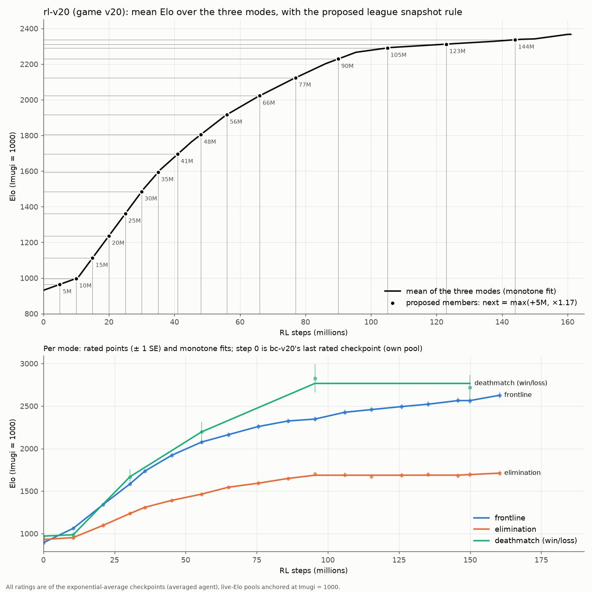

# League snapshot schedule from rl-v20's Elo curve (2026-11-15, proposal)

Data: the live-Elo pools of rl-v20 (game v20), exponential-average checkpoints (the averaged agent), anchored at Imugi = 1000: frontline and elimination at 17 steps, deathmatch scored win/loss at 5 steps (wide errors). Step 0 is bc-v20's last rated checkpoint, rated in its own pool. Each mode gets a monotone (isotonic) fit; the curve is their mean. Run `analyse.py`, then `rules.py` / `rules2.py` / `plot.py`, in this directory.

- 10M to 25M: Elo is about linear in steps, roughly 100 Elo per 5M.
- 25M to 90M: Elo is about linear in log(steps); ×1.17 in steps is about 100 Elo.
- After 95M the mean flattens: elimination is flat from 95M, and deathmatch has only two points there (95M and 150M).

**Proposed rule:** the first member at 5M, then next = previous + max(5M, 0.17 × previous). That gives 5, 10, 15, 20, 25, 30, 35, 41, 48, 56, 66, 77, 90, 105, 123, 144M, then 169, 197, 231, 270, 316, 370 and 433M (23 members to 500M). Elo gaps 10M to 90M: 101–124. Gaps 5M to 10M: 33. After 90M: 21–62.
