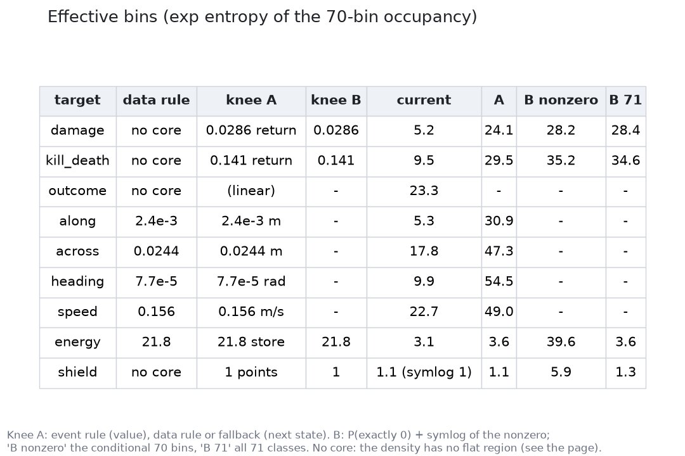
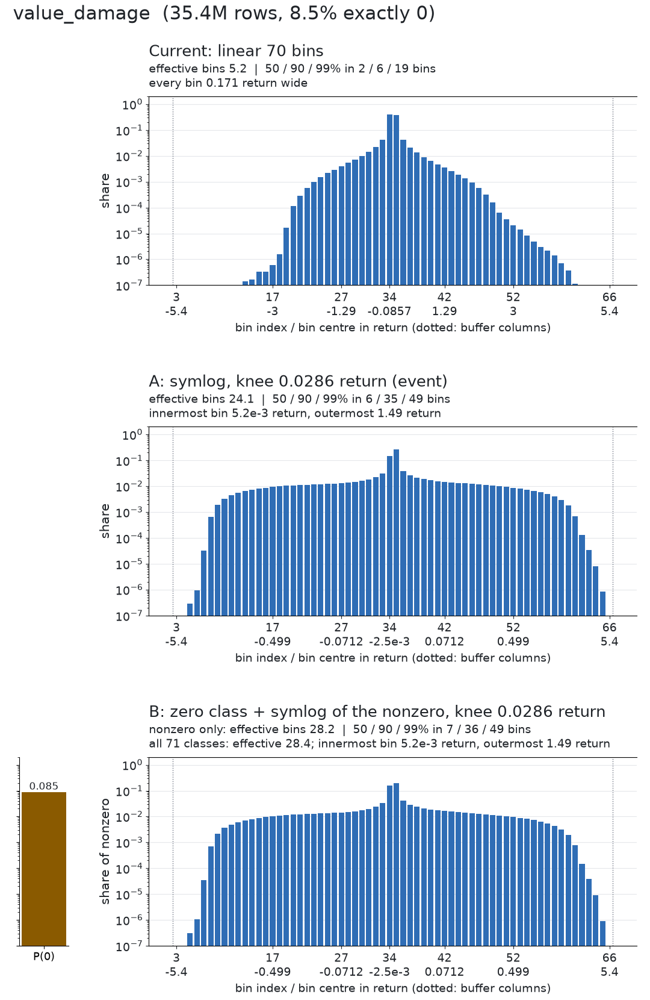
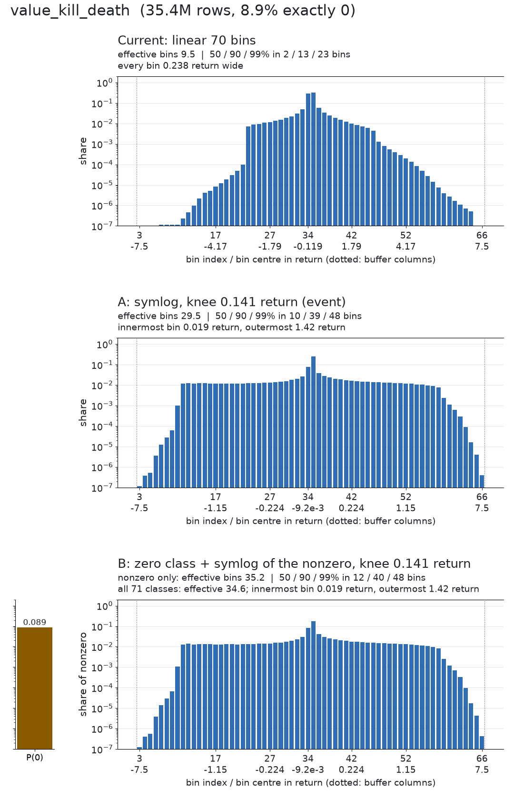
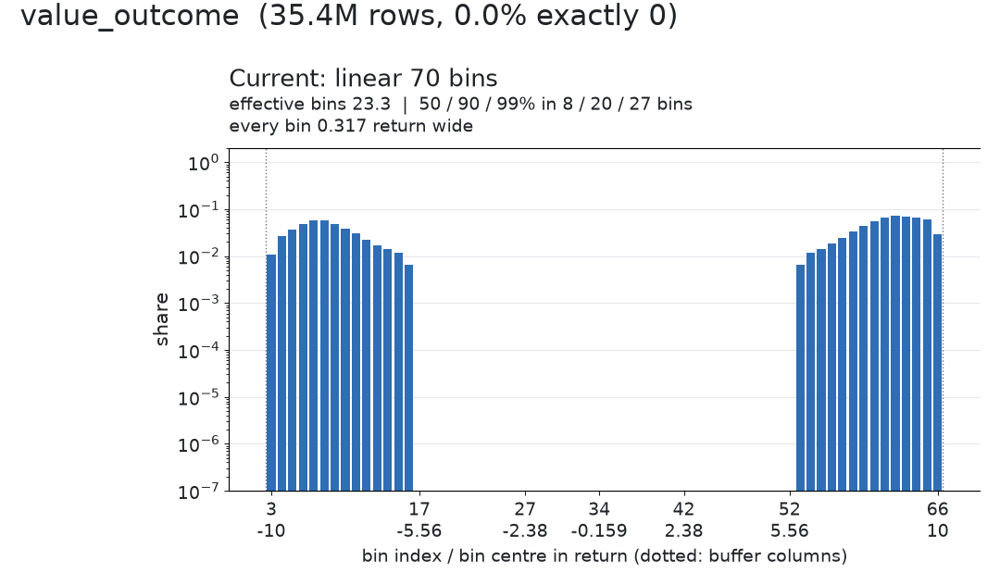
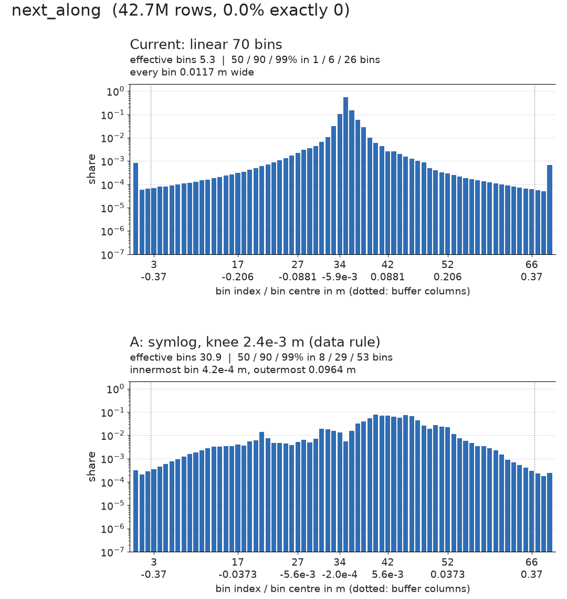
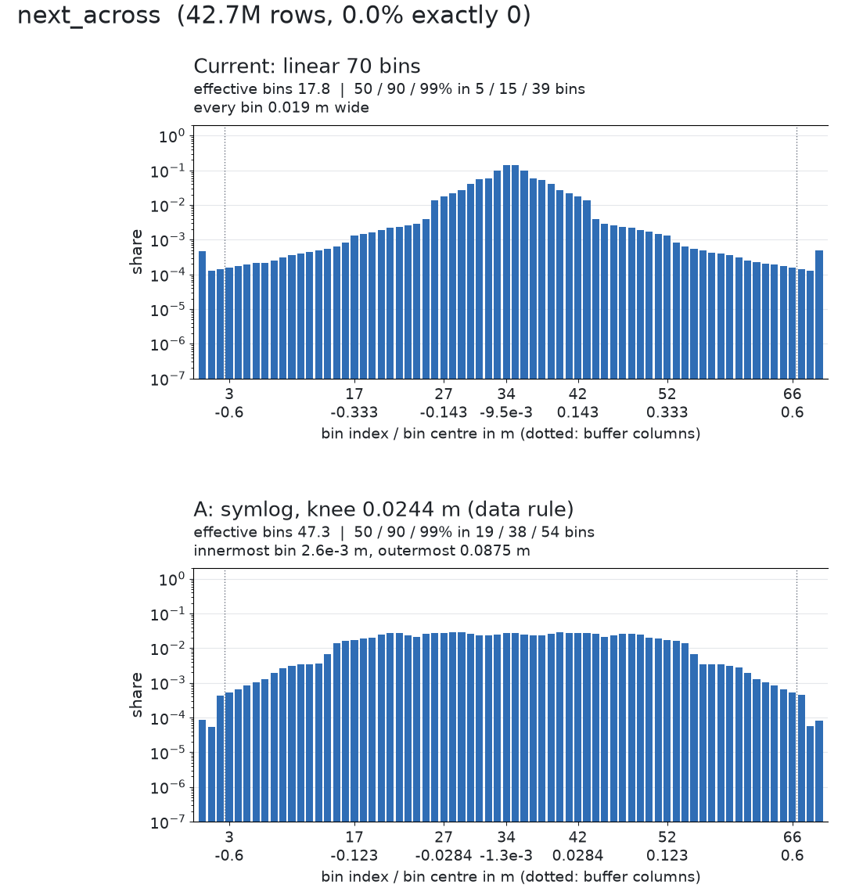
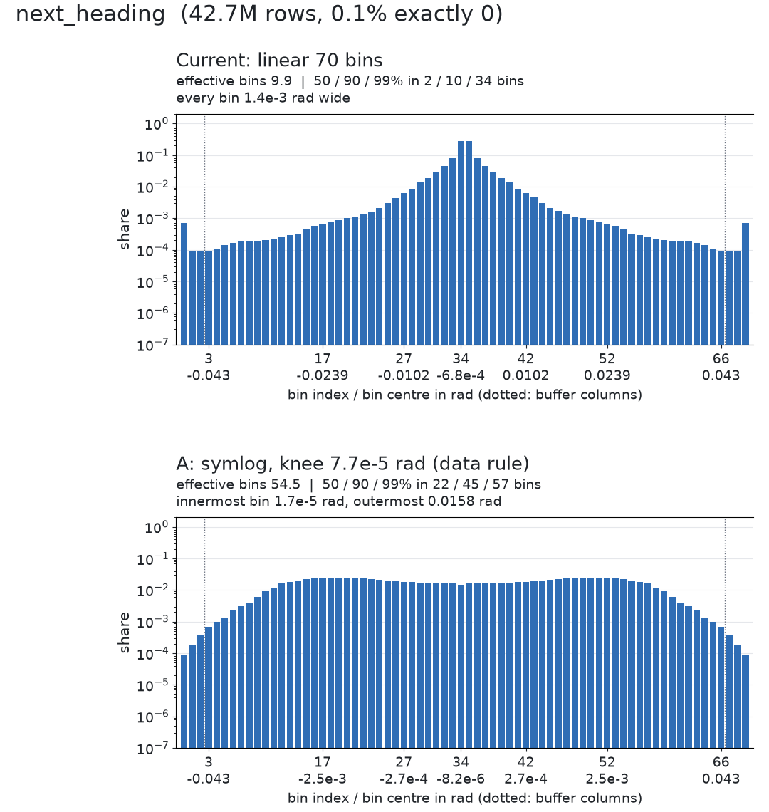
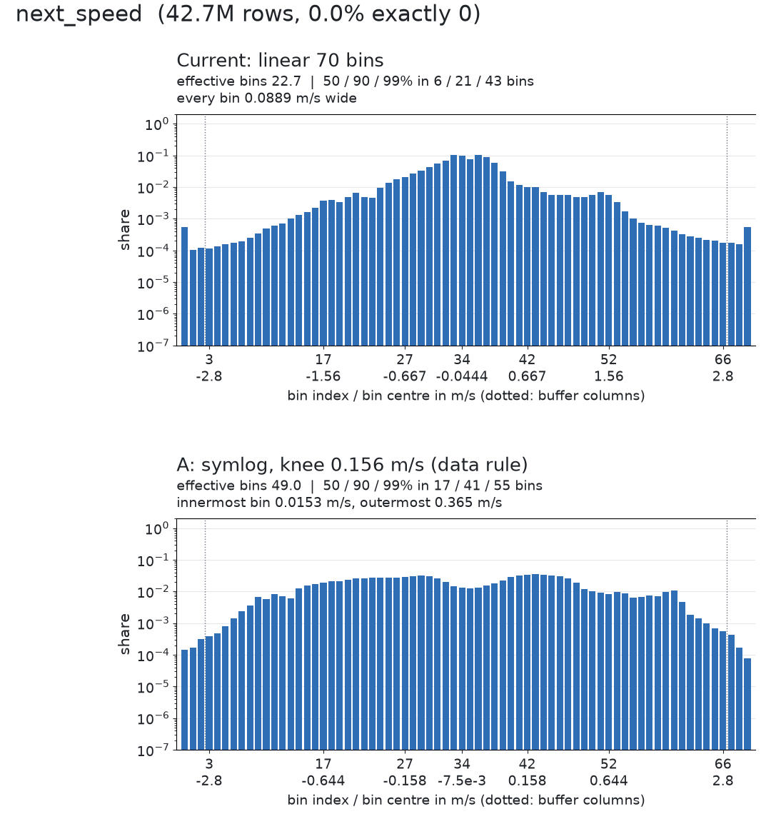
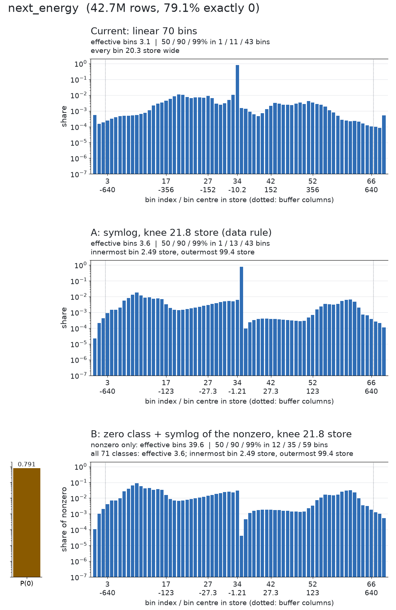
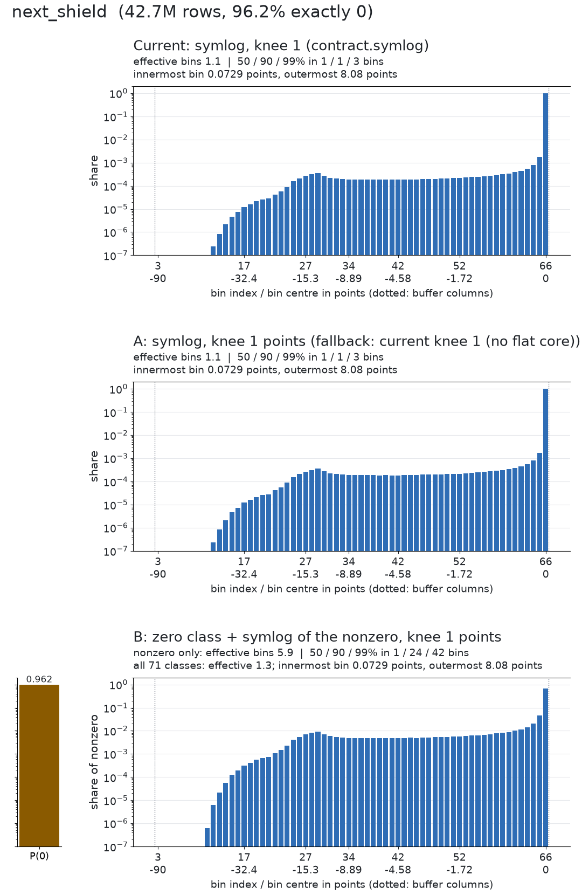

# Symlog preview (2026-11-25)

What the 70-bin categorical supports (64 measured columns + 3 buffer columns each end,
`lean/model/value.py`) would look like under two proposals. Measurement and pictures only:
no model or game code changed.

- A: bins uniform in s(x) = sign(x) knee log1p(|x| / knee) over the same measured range, same
  64 + 3 + 3 layout.
- B: one extra class for "exactly 0" in front of the 70 symlog bins, which then hold only the
  nonzero values.

Collection: `symlog_preview.py collect` (target_histograms.py's collection: scripted yardstick
on both teams, `GameConfig(training_spawn=True)`, 4v4, 2,048 environments x 3,600 ticks, seed
0), keeping every raw target: 35.4M value rows (Monte Carlo returns, lambda = 1, of the 6,661
episodes that ended), 42.7M next-state rows. RTX 4070 laptop GPU, power profile `performance`,
48 s. This tree has the 12-tick bullets (561fb001), which came after target-histograms.md's
collection, so its numbers differ slightly (6,661 episodes against 6,592; damage exactly 0 on
8.5% of rows against 9.1%). The raw values (float32 .npy) and `stats.json` (every number here,
per-bin shares, the slope profiles) are in `data/symlog-2026-11-25/`, outside git. Occupancy is
exact: every row is assigned to its nearest centre, as `target_histograms.py` does.

## The knees

Event rule (value levels): one reward event's size x e^-3, the value of an event three
discount horizons ahead. From the code: a hit is `hit_damage` 21 points (`lean/game/card.py`
CARD, one ship type; at the bullet's reference speed, full closeness and aspect), / 100
(`damage_unit`) x 2.74 = 0.575 damage units, so 0.0286; a kill or a death is 2.83
kill_death units, so 0.141.

Data rule (next-state columns, and as a cross-check for the value levels), fixed before the
knees were looked at: for each sign of the nonzero values, a histogram of log10 |x| at 40
bins a decade; density = count / bin width; the local slope is the least-squares slope of log
density against log |x| over a half-decade window; scanning upward from the 0.1st percentile of
the nonzero |x|, the knee is the first |x| where the slope reaches -0.5. Added after the first
look, because some targets have no flat region at all: a side counts only when the decade below
its knee (at least half a decade of it inside the scan) averages a slope above -0.25 ("flat
core"). The knee is the mean |x| of the sides that have one. A target with no flat core falls
back: the event knee for a value level, the current knee 1 for the shield.

| Target | Negative side | Positive side | Knee used (A) | Source |
|---|---|---|---|---|
| value damage | no core | no core | 0.0286 | event |
| value kill_death | no core | no core | 0.141 | event |
| value outcome | - | - | linear | stays linear |
| next along (m) | 4.9e-4 | 4.3e-3 | 2.4e-3 | data rule, mean of sides |
| next across (m) | 0.0244 | 0.0244 | 0.0244 | data rule |
| next heading (rad) | 7.7e-5 | 7.7e-5 | 7.7e-5 | data rule |
| next speed (m/s) | 0.130 | 0.183 | 0.156 | data rule, mean of sides |
| next energy (store) | no core | 21.8 | 21.8 | data rule, positive side only |
| next shield (points) | no core | (1.9% of nonzero, all below 3e-6) | 1 | fallback: current |

The value knees from the two rules do not agree: the data rule finds no knee. On the nonzero
returns the density falls as about |x|^-0.6 to |x|^-0.85 from the smallest values (1e-11 for
damage, 1e-8 for kill_death, events up to 1,800 ticks away discounted) up to about 1, with no
flat region anywhere; the rule's crossings land at the bottom of the scan (1e-11, 1e-6 to
1e-8). So the event knee is a choice of resolution (below it the critic stops resolving when
the event comes), not a feature of the density.

## Effective bins

Effective bins: exp of the entropy of the 70-bin occupancy. B nonzero: the conditional
occupancy of the nonzero values; B 71: all 71 classes.

| Target | Current | A (symlog) | B nonzero | B 71 | Bins for 50 / 90 / 99%: current, A, B nonzero |
|---|---|---|---|---|---|
| value damage | 5.2 | 24.1 | 28.2 | 28.4 | 2/6/19, 6/35/49, 7/36/49 |
| value kill_death | 9.5 | 29.5 | 35.2 | 34.6 | 2/13/23, 10/39/48, 12/40/48 |
| value outcome | 23.3 | - | - | - | 8/20/27 |
| next along | 5.3 | 30.9 | - | - | 1/6/26, 8/29/53 |
| next across | 17.8 | 47.3 | - | - | 5/15/39, 19/38/54 |
| next heading | 9.9 | 54.5 | - | - | 2/10/34, 22/45/57 |
| next speed | 22.7 | 49.0 | - | - | 6/21/43, 17/41/55 |
| next energy | 3.1 | 3.6 | 39.6 | 3.6 | 1/11/43, 1/13/43, 12/35/59 |
| next shield | 1.1 (symlog knee 1) | 1.1 (same) | 5.9 | 1.3 | 1/1/3, 1/1/3, 1/24/42 |

Bin widths under A (target units; innermost: the bin next to 0, outermost: the widest end bin)
against the current linear width:

| Target | Linear width | A innermost | A outermost |
|---|---|---|---|
| value damage | 0.171 | 0.0052 | 1.49 |
| value kill_death | 0.238 | 0.019 | 1.42 |
| next along | 0.0117 | 4.2e-4 | 0.096 |
| next across | 0.0190 | 0.0026 | 0.088 |
| next heading | 0.00137 | 1.7e-5 | 0.0158 |
| next speed | 0.0889 | 0.0153 | 0.365 |
| next energy | 20.3 | 2.49 | 99.4 |
| next shield | (symlog 1) | 0.073 | 8.08 |

## Proposal B as one softmax

A hierarchical "P(0), then a distribution over the nonzero" is the same family as one softmax
over 71 classes: P(class 0) = P(0) and P(bin i) = (1 - P(0)) P(i | nonzero), and any 71-way
softmax factors back that way. Its cross-entropy is the Bernoulli cross-entropy of "zero or
not" plus, on nonzero rows, the conditional cross-entropy, so no new head is needed. With
HL-Gauss it holds if the zero class stays outside the smoothing: an exact 0 gets a one-hot on
the zero class, and a nonzero value gets its Gaussian integrated over the 70 ordered bins only
and renormalised there (as `hl_gauss_targets` already renormalises over the support), with no
mass on the zero class. The zero class must not sit as an ordered neighbour of the bins next
to 0, or the smoothing would leak into it. Decoding the mean: give the zero class the centre 0.
For a symmetric support, 0 is the edge between the two middle bins, so the zero class is a
genuinely separate class; for the shield (range -90 to 0) 0 is inside the bin nearest it.

## Charts

One per target. Row 1: the current support. Row 2: A. Row 3 (B targets): P(0) beside the
conditional occupancy of the nonzero values. Log y; under each bar index a few bin centres in
the target's units; dotted lines mark the buffer columns.

## Notes

- Along, across, heading, speed: a clean flat core (slope about 0 over several decades), then
  the fall; the rule's knee is unambiguous. Along is asymmetric (its sides' knees are 0.00049
  and 0.0043 m: forward moves against dead reckoning are larger), so the mean sits between.
- Energy: zero on 79.1% of rows. Under A that one bin still holds over half the mass
  (effective bins 3.6), so A alone does little; B gives the nonzero 39.6. The nonzero values
  are not a 1/|x| core. The negative side (76% of nonzero) is multi-modal (bumps near 1 to 10
  and near 150 to 200 store; median 196); its rule crossing is at 7.7e-4, where changes are a
  few float steps (2^-8 to 2^-7 store) and the bins are sparse, and it failed the half-decade
  coverage check by rounding (0.4999 decades), so it is left out; with it the mean would be
  10.9. The positive side starts at about 4 (p1 10.1) with a rising density; its knee 21.8 is
  where that density turns down, and the knee used is that side's alone. Read the energy knee
  as a judgement call, not a measurement of a core.
- Shield: zero on 96.2%. The nonzero values have no flat core either: about |x|^-1 from 1e-4
  to 10 points. Of the nonzero rows, 1.9% are positive (all below 3e-6: float residue of
  "change minus recharge"), 20% are below 1e-4 points, the median is 0.003 points, and 68%
  are below 0.0365 points, so 68% land in the one bin next to 0 under B at knee 1. Most
  nonzero shield changes are much smaller than a hit; where they come from (rim hits with
  little closeness, boundary damage, float residue) is not measured here.
- Value damage and kill_death: B adds little over A (28.2 against 24.1, 35.2 against 29.5)
  because only 8.5% and 8.9% of rows are exactly 0; A already puts 0 on the edge of two bins
  0.005 and 0.019 wide.
- Symlog makes the tails coarse: the outermost bin under A is 8 to 12 times the linear width
  for along and heading, 9 times for damage. HL-Gauss at 0.75 bin widths in s would be
  correspondingly wide in target units there.
- The value rows are Monte Carlo returns (lambda = 1); the learner's lambda-returns on a
  trained critic are not measured here.
