# Target histograms (2026-11-25)

What every learning target looks like on today's game, and how its mass sits on the current
70-bin categorical supports (64 measured columns + 3 buffer columns at each end,
`lean/model/value.py`). Measurement only: nothing in the model or the learner changed.

Collection: `target_histograms.py collect` (target_ranges.py's collection): the scripted
yardstick on both teams, `GameConfig(training_spawn=True)`, 4v4, 2,048 environments x 3,600
ticks, 6,592 episodes ended; RTX 4070 laptop GPU, power profile `performance`, 53 s. Data in
`target-histograms/data/` (`stats.json`: every number below plus per-bin shares;
`histograms.npz`: 2,000-bin histograms over each target's extremes). Charts:
`target_histograms.py render`.

## The targets

| Head | Target | Loss | Measured here |
|---|---|---|---|
| value, 5 levels | the lambda-return on the critic (`generalised_advantages`, discounts 0.982 / 0.990 / 0.995 / 0.999 / 0.9997, lambdas 0.81 / 0.90 / 0.95 / 0.97 / 0.97), HL-Gauss over 70 linear bins | cross-entropy | damage, kill_death, outcome as Monte Carlo returns (lambda = 1, see below) |
| value, objective levels | no mode pays them: the targets are the critic's own values | cross-entropy | no (all zero rewards) |
| next state, 6 columns | along, across, heading, speed, energy (linear bins), shield (symlog bins) | HL-Gauss cross-entropy | all six |
| hit | outcome of the bullet a ship fired: missed / enemy / team-mate | cross-entropy | shares |
| policy, BC and the RL teacher term | the scripted teacher's 42-way joint distribution | cross-entropy | its entropy per living ship |
| policy, RL | PPO surrogate on normalised advantages | not a target distribution | no (needs a policy and critic) |

The critic's real target needs a trained critic, so the value rows are each living ship's
discounted return to its episode's end (the lambda = 1 member of the family, the widest), for
every tick of the episodes that ended inside the run (35.5M rows).

## Summary statistics

| Target | Rows | Mean | Std | Min | p0.1 | p1 | p5 | p50 | p95 | p99 | p99.9 | Max | Excess kurtosis | Exactly 0 |
|---|---|---|---|---|---|---|---|---|---|---|---|---|---|---|
| value damage | 35.5M | -0.003 | 0.349 | -3.91 | -2.08 | -1.30 | -0.498 | 0 | 0.457 | 1.27 | 2.12 | 5.37 | 12.9 | 9.1% |
| value kill_death | 35.5M | -0.007 | 0.824 | -6.47 | -2.83 | -2.53 | -1.61 | 0.00001 | 1.45 | 2.54 | 3.68 | 7.50 | 3.8 | 9.8% |
| value outcome | 35.5M | 1.37 | 8.33 | -10 | -9.99 | -9.85 | -9.40 | 7.28 | 9.73 | 9.95 | 10.00 | 10 | -1.9 | 0 |
| next along (m) | 42.7M | 0.0075 | 0.038 | -1.57 | -0.363 | -0.098 | -0.019 | 0.0056 | 0.040 | 0.110 | 0.338 | 1.89 | 126 | 0 |
| next across (m) | 42.7M | 0 | 0.098 | -1.81 | -0.579 | -0.292 | -0.141 | 0 | 0.142 | 0.292 | 0.581 | 1.82 | 9.4 | 0 |
| next heading (rad) | 42.7M | 0 | 0.0055 | -0.100 | -0.0422 | -0.0165 | -0.0068 | 0 | 0.0068 | 0.0165 | 0.0422 | 0.099 | 33.7 | 0.1% |
| next speed (m/s) | 42.7M | -0.025 | 0.568 | -5.39 | -2.65 | -1.60 | -0.897 | -0.030 | 0.975 | 1.63 | 2.78 | 4.02 | 4.2 | 0 |
| next energy | 42.7M | -16.3 | 116 | -976 | -640 | -399 | -275 | 0 | 0 | 376 | 594 | 976 | 8.6 | 79.3% |
| next shield (points) | 42.7M | -0.054 | 0.81 | -61.5 | -14.6 | -0.124 | 0 | 0 | 0 | 0 | 0 | 3e-6 | 481 | 96.3% |
| teacher entropy (nats) | 42.8M | 1.09 | 0.363 | 0.298 | 0.300 | 0.580 | 0.585 | 1.08 | 1.73 | 2.08 | 2.33 | 2.54 | 0.0 | 0 |

Hit head: 42.46M bullets ended; missed 93.74%, an enemy 5.47%, a team-mate 0.80%.

## Mass on the current supports (70 bins, nearest centre)

"Bins for X%": the fewest bins that together hold X% of the targets. Occupied: bins holding at
least 0.1% (the learner's range monitor's rule). Effective bins: exp of the occupancy's
entropy. Clamped: beyond the outermost centres.

| Target | Bin width | Bins for 50% | 90% | 99% | 99.9% | Occupied | Effective bins | Clamped |
|---|---|---|---|---|---|---|---|---|
| value damage | 0.171 | 2 | 6 | 19 | 27 | 23 | 5.1 | 0 |
| value kill_death | 0.238 | 2 | 13 | 23 | 29 | 25 | 9.3 | 0 |
| value outcome | 0.317 | 8 | 20 | 27 | 28 | 28 | 23.5 | 0 |
| next along | 0.0117 | 1 | 6 | 26 | 57 | 24 | 5.2 | 0.14% |
| next across | 0.0190 | 5 | 15 | 39 | 64 | 36 | 17.8 | 0.08% |
| next heading | 0.00137 | 2 | 10 | 34 | 61 | 30 | 9.8 | 0.14% |
| next speed | 0.0889 | 6 | 21 | 43 | 63 | 43 | 22.6 | 0.09% |
| next energy | 20.3 | 1 | 11 | 43 | 63 | 40 | 3.5 | 0.09% |
| next shield (symlog) | 0.0716 in symlog | 1 | 1 | 3 | 38 | 2 | 1.1 | 0 |

## Symlog spacing for the critic

Bins uniform in s(x) = sign(x) knee log1p(|x| / knee), the same 64 + 3 + 3 bins over the same
measured range. Innermost bin: the width in return units of each of the two bins either side
of 0; outermost: of the last bin.

| Level | Spacing | Bins for 50 / 90 / 99 / 99.9% | Occupied | Effective bins | Innermost bin | Outermost bin |
|---|---|---|---|---|---|---|
| damage | linear (current) | 2 / 6 / 19 / 27 | 23 | 5.1 | 0.171 | 0.171 |
| damage | knee 2 | 2 / 11 / 29 / 37 | 32 | 7.3 | 0.085 | 0.341 |
| damage | knee 1 | 2 / 14 / 33 / 41 | 37 | 8.5 | 0.061 | 0.437 |
| damage | knee 0.5 | 2 / 18 / 37 / 44 | 42 | 10.6 | 0.041 | 0.563 |
| damage | knee 0.25 | 2 / 22 / 41 / 47 | 45 | 13.0 | 0.026 | 0.717 |
| damage | knee 0.1 | 2 / 28 / 45 / 50 | 48 | 16.8 | 0.014 | 0.962 |
| damage | knee 0.0135 (p50 of abs) | 8 / 38 / 51 / 54 | 54 | 27.4 | 0.0028 | 1.66 |
| kill_death | linear (current) | 2 / 13 / 23 / 29 | 25 | 9.3 | 0.238 | 0.238 |
| kill_death | knee 2.72 (p99 of abs) | 2 / 22 / 33 / 38 | 35 | 13.7 | 0.117 | 0.477 |
| kill_death | knee 1 | 3 / 28 / 39 / 44 | 41 | 17.7 | 0.070 | 0.685 |
| kill_death | knee 0.5 | 5 / 32 / 43 / 47 | 45 | 21.3 | 0.046 | 0.878 |
| kill_death | knee 0.25 | 7 / 36 / 46 / 50 | 48 | 26.5 | 0.029 | 1.11 |
| kill_death | knee 0.106 (p50 of abs) | 11 / 41 / 49 / 52 | 51 | 31.8 | 0.015 | 1.45 |
| outcome | linear (current) | 8 / 20 / 27 / 28 | 28 | 23.5 | 0.317 | 0.317 |
| outcome | knee 9.96 (p99 of abs) | 7 / 16 / 22 / 24 | 24 | 18.7 | 0.222 | 0.466 |
| outcome | knee 1 | 4 / 10 / 14 / 14 | 14 | 11.1 | 0.079 | 1.01 |
| outcome | knee 0.25 | 3 / 8 / 10 / 10 | 10 | 8.1 | 0.031 | 1.62 |

(Every knee tried, including p90 of abs and 0.1 to 2, is in `stats.json`.)

- Damage and kill_death: the smaller the knee, the more even the occupancy, over every knee
  tried; the largest effective-bin count is at the smallest knee (the p50 of abs x). Every
  symlog knee tried also gives finer bins near 0 than the linear support; the price is
  coarser bins in the tails (outermost bin 0.7 to 1.7 return units at knees 0.25 and below).
  The HL-Gauss target is 0.75 bin widths wide, so in symlog space it would be narrow near 0
  and wide in the tails.
- Outcome: symlog makes it worse at every knee. Its returns are bimodal, all beyond +-5.8
  (no draws in this collection; the outcome is paid at the end, at most 1,800 ticks away:
  10 x 0.9997^1800 = 5.8), so the 36 central bins hold nothing and symlog moves bins toward
  the empty middle. The linear support is the most even of those tried.
- Kill_death at knee 0.25 to 0.5 moves the effective bins from 9.3 to 21 to 26.5 with the
  innermost bin 0.03 to 0.05 wide; damage at the same knees from 5.1 to 10.6 to 13.

## Charts

One per target (log count; dashed: p0.1 and p99.9; solid red: the measured range the support
is built from; dotted red: the support's outer edge; light ticks at the bottom: the 70 bin
edges, linear supports only).

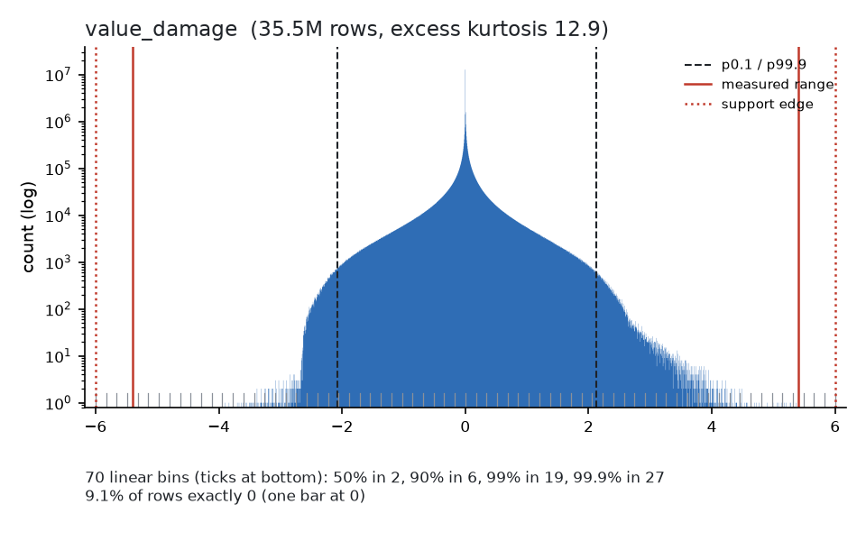
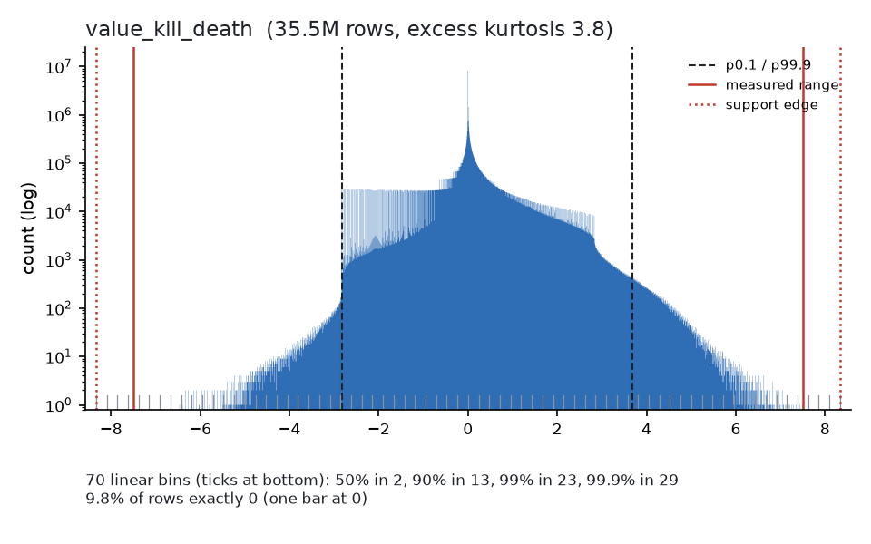
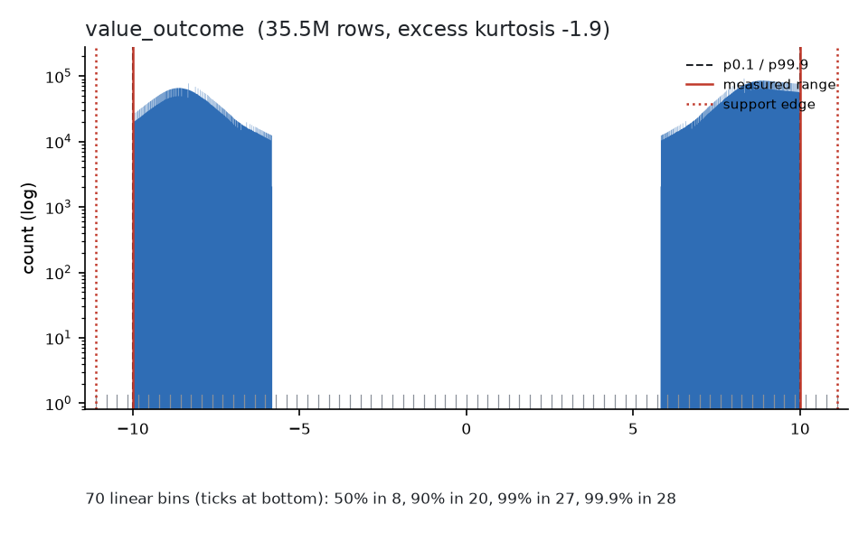
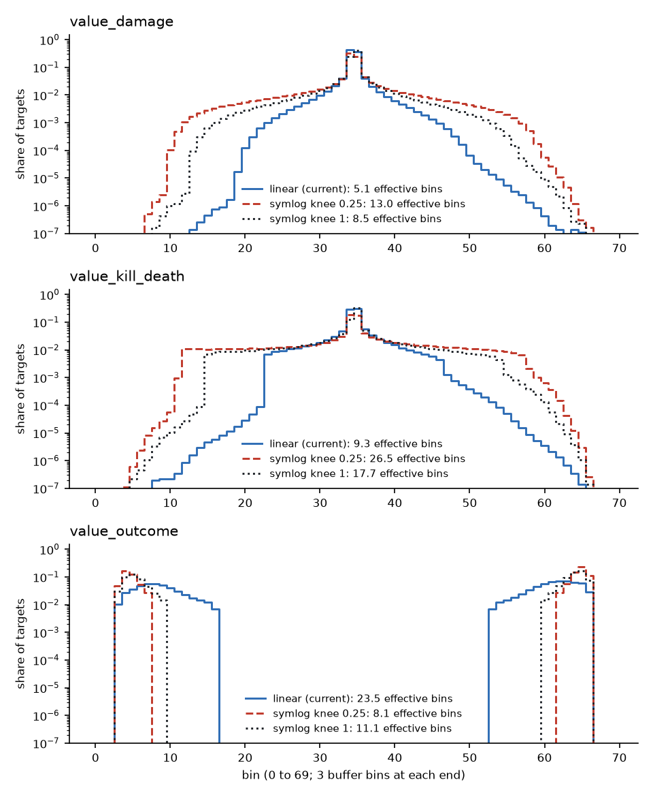
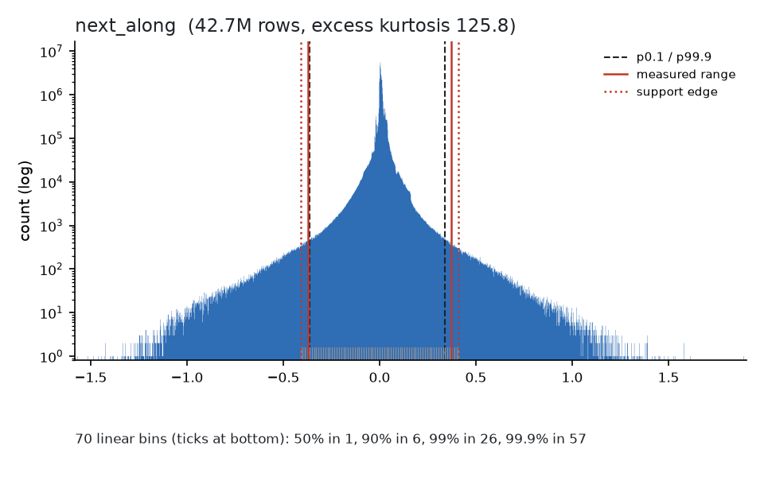
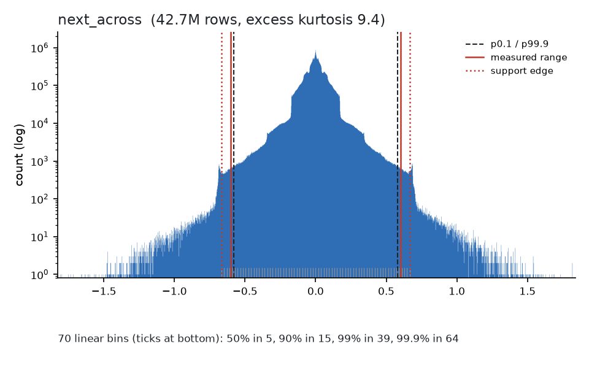
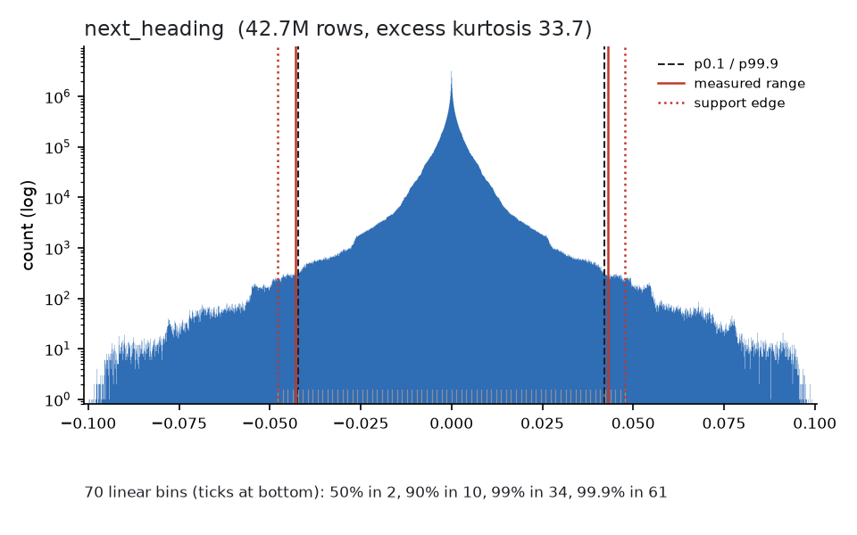
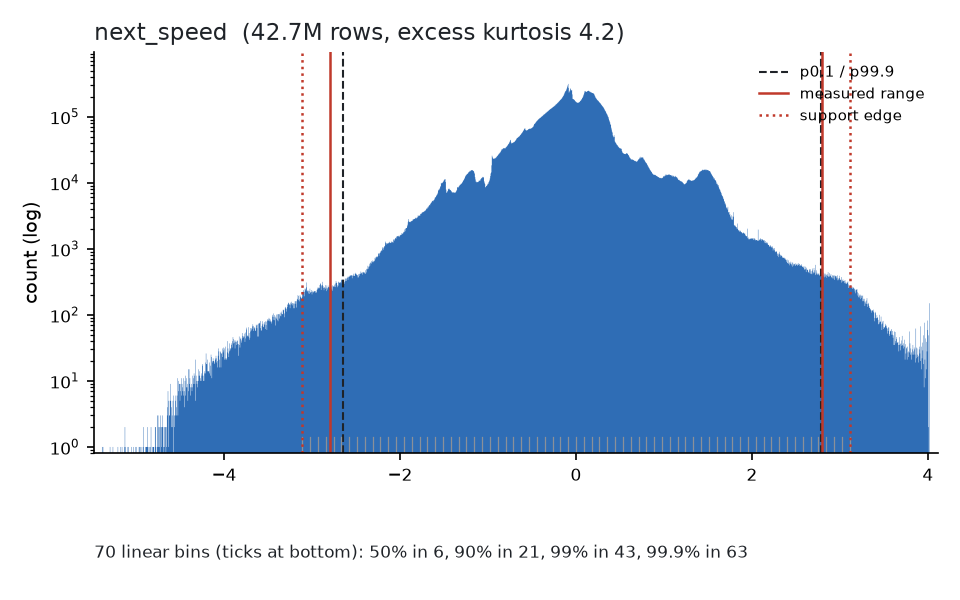
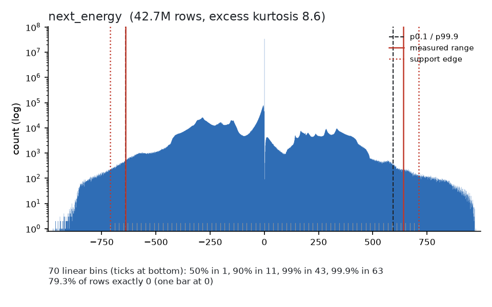
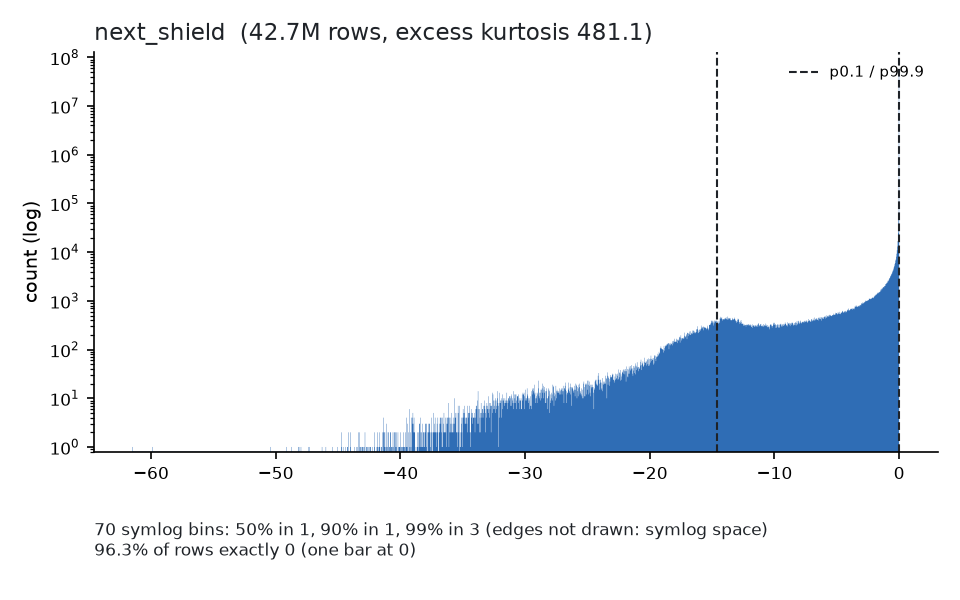
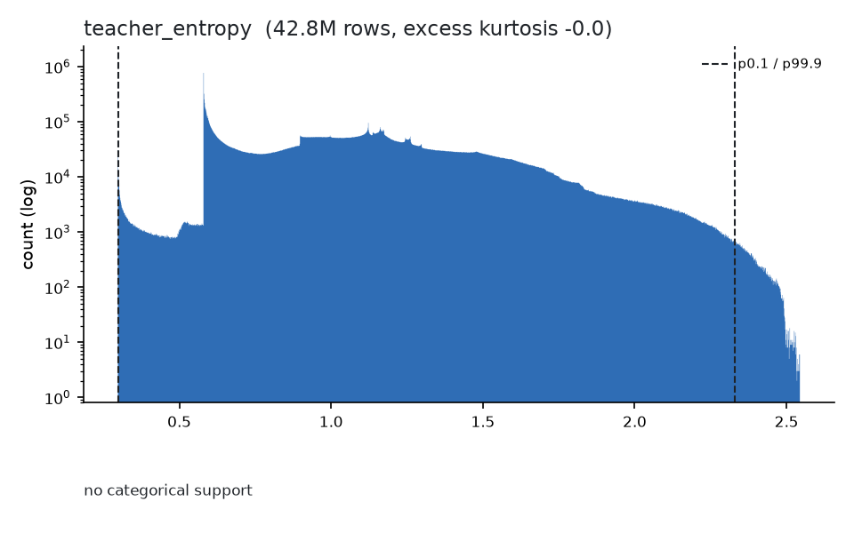

## Notes

- Outcome's mean is +1.37 while it is symmetric by construction per episode: a living ship's
  ticks are counted, and ships on the winning side live longer.
- Along is not centred: median +0.0056 m a tick (about 0.17 m/s against dead reckoning).
- Energy is unchanged on 79% of ticks and the shield on 96%; one bin holds that mass in each.
  The shield's measured range is -90 to 0, but its p0.1 is -14.6 and 99% of its rows fall in 3
  bins.
- The value rows are Monte Carlo returns, not the learner's lambda-returns on a critic; a
  trained critic's lambda-return averages over the same futures, so its spread should be
  no wider, but that is not measured here.
- Not measured: symlog spacings for the next-state columns (only the critic was asked for),
  the PPO advantages, the objective levels.

## The shape (2026-11-25, from the saved fine histograms)

Damage and kill_death: a spike at 0 with density close to 1/|x| from about 0.01 to 0.25
(log-log slope -0.9 to -1.0 for damage, R^2 0.99; -0.6 to -0.8 for kill_death, noisier
because kills are discrete), then a faster fall (damage about e^(-2.6|x|)) and a hard edge
(the most damage a ship can take or deal within the discount's reach). Mechanism: a row's
return is mostly R x discount^k, where k is the ticks to the next burst of reward and R its
size. With k spread fairly evenly over the gaps between fights (much longer than the
horizons: 55 ticks for damage at 0.982, 100 for kill_death at 0.990), log|x| is spread
evenly, which is density 1/|x|: a log-uniform core. The tail is the size distribution of
the bursts. Symlog bins are uniform in log|x| above the knee, so each bin there holds
about the same share and corresponds to a fixed number of ticks to the next event.

A knee from that reading: one event's size times e^(-3), i.e. the value of an event three
horizons ahead; below it the critic stops resolving when the event comes. One hit is
21 points = 0.575 damage-level units (weight 2.74 per 100 points), giving about 0.03;
one kill is 2.83, giving about 0.14. Both sit in the even-occupancy region measured below
(damage knee 0.03: 19 effective bins; kill_death 0.03-0.1: 30-36).

Next-state along and heading: the same 1/|x| core near 0 (manoeuvre intensity varies over
orders of magnitude between rows: straight flight is almost perfectly dead-reckoned) with a
power-law tail of slope about -3 to -3.5 (Student-t-like, about 2 degrees of freedom).

Outcome: a win or loss is +-10 at the game's end and a draw 0 (both teams wiped on the same
tick, or equal ships and equal shield at the clock; none in 6,592 games). Discounted at
0.9997 over at most 1,800 ticks a return keeps |x| >= 10 x 0.9997^1800 = 5.8, so the middle
is empty for Monte Carlo returns. The learner's lambda-returns (0.97) bootstrap from the
critic's mean, which lies between the modes, so the middle bins will be used in training.
