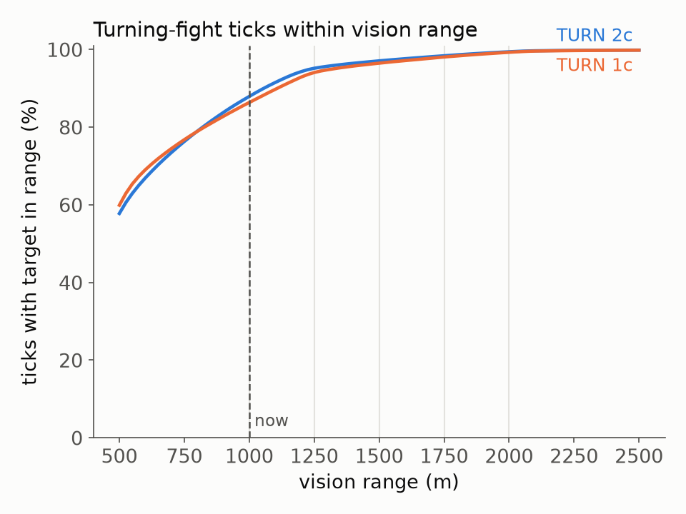
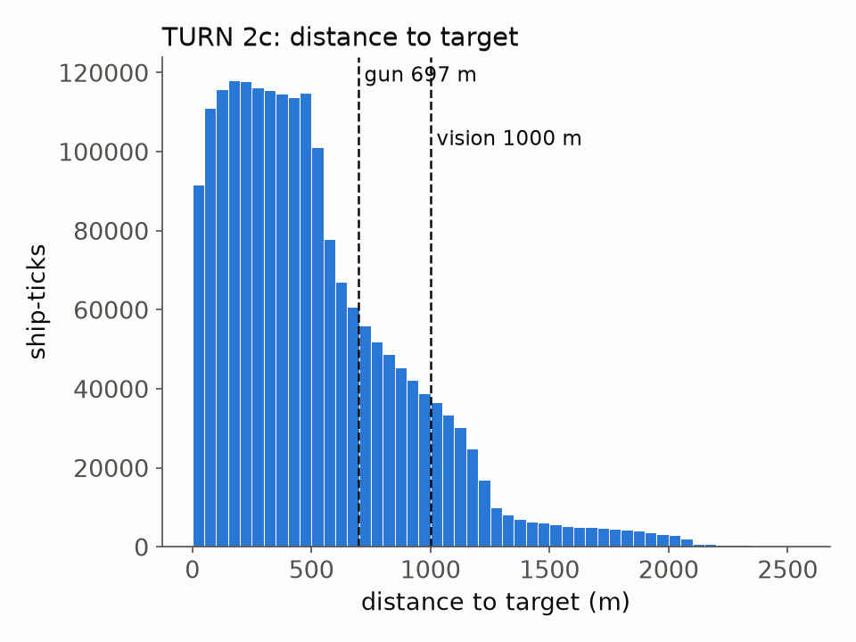

# Vision range in scripted 4v4 turning fights

Measured 2026-11-25 with `vision_measure.py` (beside this page). Nothing in the game or the
agent was changed. Raw chunks, `results.md` and logs: `data/vision-2026-11-25/`.

**Setup.** Training game (`GameConfig(training_spawn=True)`: fields, fog, ghost bullets,
1,800-tick clock, arena radius 4,200 m), 4v4, default scripted agent (yardstick, no persona
spread) on both teams. 1,024 environments x 3,600 ticks on the GPU (RTX 4070 laptop, power
profile `performance`), finished games re-dealt: 3,394 games ended, 11,920 ship-minutes.
Card: the 686 m gun card (12 bullet slots; the game's readout gun range is 697 m), vision
1,000 m. Tactic labels as in `replay/replay.py`. "Seen" is the fog as the agent reads it: the
enemy team saw the ship this tick (own sight, a team-mate's sight, or revealed by firing or
being hit). Distances are true positions.

## Per tactic

| tactic | ship-min | target p50 | p90 | p95 | p99 | target > 1,000 m | target seen | losses / min | lasting > 1 s / min | regained | regain p50 |
|---|---|---|---|---|---|---|---|---|---|---|---|
| SEEK | 3,588 | 2,812 | 4,640 | 5,164 | 5,972 | 90.0% | 45.0% | 10.3 | 3.5 | 99% | 0.2 s |
| MERGE | 3,586 | 586 | 1,489 | 1,744 | 2,013 | 24.1% | 90.0% | 12.1 | 1.1 | 100% | 0.1 s |
| OFF | 2,280 | 938 | 1,774 | 1,946 | 2,192 | 46.1% | 71.0% | 10.9 | 3.4 | 98% | 0.3 s |
| TURN 1c | 516 | 422 | 1,108 | 1,322 | 1,935 | 13.7% | 84.0% | 7.9 | 5.4 | 94% | 1.8 s |
| TURN 2c | 1,087 | 434 | 1,056 | 1,238 | 1,886 | 12.1% | 84.5% | 7.9 | 5.6 | 93% | 2.0 s |
| BREAK | 863 | 592 | 1,312 | 1,582 | 1,965 | 20.6% | 87.2% | 27.4 | 2.6 | 99% | 0.1 s |
| TURN (both) | 1,603 | 430 | 1,072 | 1,264 | 1,902 | 12.6% | 84.3% | 7.9 | 5.5 | 94% | 1.9 s |

A loss is the target going from seen to not seen while the ship keeps the same target, both
alive. Rates are per ship-minute in that tactic. "Regained": the lost enemy is seen again by the
team before the game ends or either ship dies (losses cut off by the end of the run excluded).
Most losses outside turning fights are one-tick flickers (a shot's reveal); in turning fights
most last over a second.

In turning fights the target is within 1,000 m on 87.4% of ticks but seen on 84.3%: field
cores hide it on 7.9% of ticks although it is in range, and shared sight or a shot shows it on
4.8% although it is out of range. Only 41% of the turning-fight losses happen with the target
beyond 1,000 m; the rest are fields (or a team-mate's sight ending). A longer vision range does
nothing for those.

## Candidate vision ranges (offline)

From the recorded distances only (no fields, no shared sight), the agents' behaviour held fixed.
With more vision the agents would fight differently; these numbers ignore that.

| vision | turning ticks in range | range losses / fight-min | lasting > 1 s | TURN 2c in range | TURN 1c in range |
|---|---|---|---|---|---|
| 1,000 m | 87.4% | 5.24 | 4.51 | 87.9% | 86.3% |
| 1,250 m | 94.8% | 1.59 | 1.25 | 95.2% | 94.1% |
| 1,500 m | 96.9% | 0.83 | 0.73 | 97.1% | 96.5% |
| 1,750 m | 98.3% | 0.73 | 0.64 | 98.4% | 98.1% |
| 2,000 m | 99.4% | 0.57 | 0.51 | 99.4% | 99.3% |

## Geometry

Card readouts (`tuning.performance`, game units): best sustained turn 0.697 rad/s at 168 m/s,
radius 241 m; corner 256 m/s at 1.173 rad/s, radius 218 m. A two-circle fight's largest
separation is about two diameters plus the merge offset (4R + offset). The merge offset is
small: the closest approach of MERGE stretches that turn into TURN 2c has p50 8 m (p90 17 m).
So 4R + offset is 971 m at the best sustained turn and 880 m at corner: inside 1,000 m, but
only just. The ships do not fly those circles: in turning fights their speed is 167/205/240
m/s (p10/50/90) and the flown radius (speed / heading rate) 173/313/630 m. At the flown median
radius 4R + offset is 1,261 m, which matches the measured TURN 2c p95 of 1,238 m.

## Seekers

SEEK is 30% of living ship-ticks; the nearest enemy is 2,124 m away at the median (p90 3,362
m), beyond 1,500 m on 77% of SEEK ticks, and on 53% the team sees no enemy at all. In the last
20 s of the clock (game tick >= 1,200; 9.7% of living ship-ticks there are SEEK) the nearest
enemy is at 2,582 m median (p90 4,276 m), beyond 1,500 m on 92%, and 67% see no enemy. A
seeker never has a seen enemy within 1,000 m (by the engage gate, below).

## Caveats

- The labels are gated by distance: `engage_range` is 3 gun ranges (2,091 m), beyond which a
  ship is SEEK by definition. Turning fights that open past it are counted as SEEK, so the
  TURN p99 (about 1.9 km) is bounded by the gate. The TURN 2c histogram also has an
  unexplained shoulder at about 1,250 m.
- The yardstick only; training uses a persona spread.
- The candidate table ignores fields and shared sight and holds behaviour fixed.
