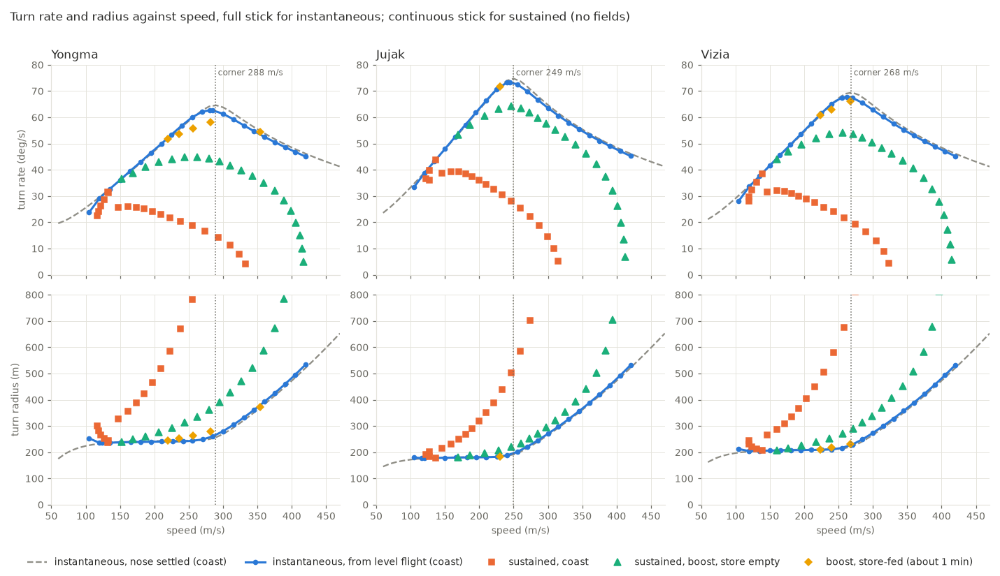

# Turn performance: minimum radius, maximum rate, sustained rate

Measured 2026-11-22 on the CPU (one thread) with `lean/game/core.py` `flight_tick` (equal to v2's
flight to float32 rounding), game version 20 real-scale card, no fields. Rough numbers.

Question: is the speed of minimum turn radius the same as the speed of maximum turn rate?
If so, there is no real choice between a one-circle (radius) and a two-circle (rate) fight.

## Method

Turn rate is the rate of the velocity direction (heading minus angle of attack) per tick,
radius is speed over that rate. Stick index 5/6 is full, 3/4 sustained, 1/2 fine; power 0
coast, 1 boost, 2 reverse.

- **Instantaneous, from level flight:** 94 start speeds from 5 to 470 m/s, straight and
  level, store at spawn (199 kJ), full stick for 3 s with each power. Every tick is binned by
  its current speed (15 m/s bins); per bin the largest rate and the smallest radius.
- **Instantaneous, nose settled:** the code's own `_setting`, `_lift_coefficient` and
  `_rates` evaluated with the angle of attack already at the full-stick target
  (rate = (C_L(angle) v² + T sin angle) / v), 10 to 470 m/s, spawn store and an empty one.
- **Sustained:** each stick level (fine, sustained, full) and each power, held 600 s from
  145 and 300 m/s, from the spawn store and a full store; settled values are the mean of the
  last 60 s. Speed settles in every case (span < 0.2 m/s over the last minute).
  A second sweep holds a continuous stick magnitude 0.05 to 1.0 (a scratch override of the
  stick table, not repository code) to trace the whole sustained curve.
- **Store-fed boost:** boost from a full store, start 150 and 250 m/s, continuous stick
  magnitude 0.3 to 1.0, averaged from 10 s until the store reaches 5 %.

Scripts (in the session scratchpad, not committed; they import `lean.game.core` only):
`sim.py` (batched driver), `envelope.py`, `static.py`, `sustained.py`, `sweep.py`,
`storefed.py <start speed>`, `chart.py`, each run as
`OMP_NUM_THREADS=1 PYTHONPATH=.:src:<scratch> uv run --no-sync python <scratch>/<script>.py`
from the v2 checkout. Each run takes under 20 s.

## Results

Reference constants: corner speed sqrt(max_acceleration / max_lift_coefficient) and the
lift-limited radius 1 / max_lift_coefficient.

| | Yongma | Jujak | Vizia |
|---|---|---|---|
| corner speed (analytic) | 288 m/s | 249 m/s | 268 m/s |
| 1 / C_L,max | 236 m | 176 m | 204 m |
| **Instantaneous** (full stick, from level flight) | | | |
| max rate, coast | 62.7 deg/s at 281 m/s, R 256 m | 73.4 at 244, R 191 | 67.9 at 263, R 222 |
| max rate, boost | 64.1 at 288, R 258 | 74.9 at 250, R 192 | 69.3 at 267, R 221 |
| min radius, coast | 236 m at 123 m/s (rate 30 deg/s) | 178 at 116 (37) | 205 at 119 (34) |
| speeds within 3 % of min radius | 120 to 242 m/s | 105 to 226 | 119 to 225 |
| radius at max-rate speed over min radius | +9 % | +8 % | +8 % |
| **Sustained, coast** (settled, indefinitely) | | | |
| fine stick | 14.1 deg/s at 294 m/s, R 1196, store rises to full | 20.4 at 281, R 790, rises | 17.0 at 287, R 967, rises |
| sustained stick | 26.1 at 161, R 353, rises | 39.4 at 161, R 234, rises | 32.0 at 160, R 286, rises |
| full stick | 34.0 at 141, R 238, store falls about 1 kJ/s, empty after 4 to 8 min, then 31.7 at 131 | 43.8 at 137, R 179, steady at 360 kJ | 38.6 at 139, R 206, falling 17 to 51 J/s |
| **Sustained, boost** (store empties in 15 to 70 s, then sits in the 2 % band, steady) | | | |
| fine stick | 19.4 at 407, R 1198 | 28.8 at 398, R 792 | 23.8 at 403, R 969 |
| sustained stick | 44.4 at 278, R 359 | 63.2 at 263, R 238 | 53.6 at 271, R 290 |
| full stick | 36.6 at 153, R 239 | 53.4 at 169, R 181 | 44.0 at 160, R 208 |
| best (continuous stick) | 44.8 at 244 to 262 (stick 0.70 to 0.75), R 312 to 335 | 64.3 at 247 (0.80), R 220 | 54.1 at 256 (0.75), R 271 |
| **Sustained, reverse** | | | |
| sustained stick | 18.5 at 110, R 340, store full | 28.8 at 115, R 229, full | 22.9 at 111, R 278, full |
| full stick | 29.8 at 127, R 245, store empties in 2 to 5 min | 43.8 at 137, R 179, falling ~100 J/s | 35.7 at 130, R 209, empties in 4 to 9 min |
| **Boost, store-fed** (full store, lasts 50 to 65 s) | | | |
| full stick | 51.7 at 220, R 244 | 71.8 at 230, R 184 | 60.7 at 224, R 211 |
| best (continuous stick) | 58.0 at 282 (0.85), R 278 | 71.8 at 230 (1.0), R 184 | 66.4 at 268 (0.90), R 232 |

Reverse with fine stick is bistable: it settles near 110 m/s from the spawn store and near
260 m/s from a full store. Lighter store-fed boost turns run away to about 420 m/s
(the g limit) at 46 deg/s.

Speeds compared (best power for each):

| | Yongma | Jujak | Vizia |
|---|---|---|---|
| speed of min radius (A) | 123 m/s | 116 | 119 |
| speed of max instantaneous rate (B) | 288 | 250 | 267 |
| B − A, and A / B | 165 m/s, 0.43 | 134, 0.46 | 148, 0.45 |
| speed of max sustained rate, boost, empty store (C) | ~253 | 247 | 256 |
| C − B, and C / B | −35, 0.88 | −3, 0.99 | −11, 0.96 |
| speed of max store-fed rate (C') | 282 | 230 | 268 |
| speed of max sustained rate, coast | 141 | 137 | 139 |

## Answer

Not literally the same speed, but effectively the same choice. Below the corner speed the
radius is a flat plateau at about 1 / C_L,max: within 3 % of its minimum from about 110 to
about 240 m/s for every type, and only 6 to 9 % larger at the corner. The minimum itself
sits at the slow end (116 to 123 m/s), less than half the speed of the best instantaneous
rate (corner, 250 to 288 m/s), but slowing down to it buys under 9 % of radius for half the
turn rate. The best sustained rate is also at the corner when boosting (247 to 256 m/s, 1 to
12 % below the instantaneous peak, the store at its floor and the engine surplus feeding the
turn), and the store-fed boost turn is at the corner too (230 to 282 m/s). So one speed, the
corner, gives the highest instantaneous rate, the highest sustained rate and nearly the
smallest radius at once; a slow one-circle fight has nothing to trade for. The only slow
regime is the coasting turn (best at about 137 m/s, on the radius plateau), which is simply
worse than a boosted turn at the corner (32 to 44 deg/s against 45 to 64). The energy store
does not limit the coasting turn; it limits the boosted turn only as a reservoir worth 50 to
65 s of extra rate (Yongma 58 instead of 45 deg/s), after which the turn is set by engine
power routed through the store.

## Why, from the code

- **Lift-limited radius is speed-independent.** `_setting` gives a lateral acceleration
  `softmin(stick · C_L,max v², max_acceleration)`, and the nose takes the angle that makes
  `C_L(angle) v²` equal it. Below the corner, lateral = C v², so radius v² / (C v²) = 1 / C at
  every speed and rate C v grows linearly. Above the corner, lateral = max_acceleration, so
  radius v² / A grows and rate A / v falls. Rate therefore peaks exactly at the corner, and
  the radius is flat all the way up to it: the textbook horizontal turn without gravity.
- **Softmin rounding** (exponent 16): full stick gives lateral = 2^(-1/16) ≈ 0.958 of the
  budget at every speed, and at the corner the budget itself is 0.958 · C v². That is the 6 to
  9 % rise of the radius at the corner; it is the only thing that makes the plateau end
  before the corner.
- **Thrust times angle** (`thrust * sin0` in `path_rate`): thrust is
  `softmin(P_full / v, static_thrust)`, so at 120 m/s it adds about 3 m/s² against C v² ≈
  60 m/s² (about 5 % smaller radius), and at the corner under 0.5 %. This tilt is why the
  minimum is at the slow end of the plateau. Taken alone it sends the radius toward zero as
  speed goes to zero (nose-settled curve: 9 to 13 m at 10 m/s), but a ship cannot hold those
  speeds in a hard turn: nose response scales with speed, and the sink below speeds the
  ship up to above 100 m/s within a couple of seconds.
- **Weight is paid by the store, not by the wing.** `held` (the lift spent holding the
  vertical) is `demand · (1 − sink_room)`, which is zero while the store is above 2 % of its
  maximum. The vertical lift is whatever the turn leaves over; any shortfall becomes
  `exchange < 0`: the ship sinks, speed rises and the store falls at v · shortfall. So the
  turn never loses lateral acceleration to weight. In a real aircraft the weight term
  (radius v² / (g sqrt(n² − 1))) is what makes slow turns wide and puts the minimum-radius
  speed well away from the corner; here it is absent while the store lasts. With an empty
  store `held` returns and the low-speed radius grows (Yongma reverse, empty store: 422 m at
  100 m/s against 224 m), which moves the minimum radius up to 200 to 240 m/s, even closer to
  the corner.
- **Sustained turns are power against drag at high lift.** `_rates`: d speed / dt =
  thrust cos(angle) − drag − exchange, and the drag carries a separation term
  `(load / C_L,max²)^4` that roughly doubles the induced drag at full lift. Coasting, the only
  power is `engine_power_full_store` (2.0 to 2.1 kW/kg), so the full-stick turn settles at
  about 137 m/s, on the radius plateau. Boosting with the store below the knee (half full),
  `charge` adds the engine surplus (7.4 to 9.2 kW/kg) to the store and the dive exchange
  moves it into speed: four to five times the power, enough to hold the turn near the corner.
  Store-fed boost adds the stored joules on top for about a minute.

## Not determined

- Speeds below about 100 m/s in a hard turn: not holdable dynamically (see above), so the
  instantaneous curves from level flight start near 105 m/s; the nose-settled curve below
  that is a formula, not a flown state.
- The continuous-stick sweeps use a scratch override of the stick table; the game itself
  has only fine, sustained and full. With the real levels the best boosted sustained turn is
  the sustained stick (table above), at 263 to 278 m/s.
- The store-fed figures depend on the start store and speed (bistable at light stick);
  they are one start each (full store, 150 and 250 m/s).
- No fields, no gun or shield interaction, no opponent: these are envelope numbers only.
